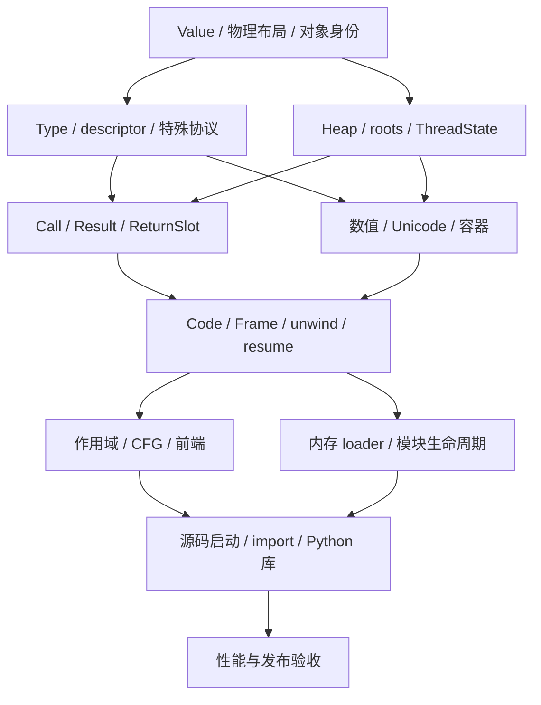

# cxxpython：从对象内核开始重建的架构与实施计划

**文档性质：重新规划的设计方案，替代上一版以现有实现修补为中心的重构顺序。**  
**日期：2026-10-28。交付格式：Markdown。**  
**代码依据：** [dukmu/cxxpython][repo]，`master@885dbf820a008c82f035684b105d1b987442aaa2` 与 `fix-thread-improve@5999962d2a9199c248d4f734c0885bdbe3937f73`。本文的“现有实现”均指这两个固定快照。  
**状态：** 已有源码审查与运行证据；下文新内核是待实施方案，尚未实现或验证。建议以 Python 3.12 为第一条明确的语义基线，本轮差分参考为 CPython 3.12.14。

## 0. 重构结论

**建议建立独立的新内核，先重新定义对象、类型、方法、调用、异常和生命周期，再围绕这些契约实现基础类型、VM、编译器、启动与库。** 旧解释器保留为迁移期间的对照程序；旧问题转为验收用例。新内核使用自己的对象、堆、调用链和执行器，完成一个能力后再接入源码与库，最终替换旧执行路径。

第一项可运行交付应是一个不依赖 Python 语法前端的对象运行时：C++ 测试能创建类型和实例、安装 descriptor、解析方法、完成参数绑定、调用原生函数、转交返回值或异常，并在强制 GC 下保持正确。随后把同一调用协议接到最小 VM，运行 Python 函数。这样，后续语法和库只能依赖已明确的语义接口。

重构边界主要覆盖四部分：

1. **对象与协议内核重建：** Value、Object、Type、native layout、descriptor、特殊方法、统一调用和错误返回。
2. **运行时基础重建：** 堆、精确根、GC、线程状态、阻塞调用、初始化和关闭。
3. **执行与编译核心重建：** Code、Frame、异常展开、暂停恢复、作用域、CFG、字节码验证。
4. **外围按契约迁移：** 可独立验证的算法、语法规则、宿主系统调用、Python 库和测试资产。

当前源码已经有 C3 MRO、开放寻址 dict、对象槽和编译流水线等结构，但协议之间存在可观察的不一致：表达式与容器的 equality 分开，Python descriptor 和 `__new__` 接入不完整，VM fastpath 重写数值规则，GC 根和线程退出缺乏闭合的生命周期。这些证据说明需要调整基础合同。现有测试通过只能说明现有预期被满足；部分测试甚至固定了错误的 equality 行为。详细证据见第 15 节。[S01]、[S02]、[S03]、[S04]

### 本方案采用的主要决策

| 方面 | 新内核第一版的选择 | 接受的代价与后续边界 |
|---|---|---|
| Python 值表示 | 全部 boxed；`Value` 是非拥有的对象指针封装 | 标量仍有分配成本；先优化缓存、分配器与调用，再以数据决定是否引入立即数 |
| 物理布局 | 轻量 header；Python Type 与不可变 LayoutDescriptor 分离 | 需要布局规划器；获得独立的继承、GC 和扩展边界 |
| 方法语义 | 统一属性引擎、descriptor 引擎、特殊协议表和调用协议 | 初版 generic 路径较直接；缓存只能加速同一语义 |
| 生命周期 | 非移动、精确追踪、全堆 mark-sweep；Python 对象不叠加 RC | 需要显式根和暂停预算；及时释放外部资源依靠 `close`/上下文管理 |
| 错误返回 | 显式 `Ok / Raised`，返回载荷写入调用方已注册的根槽 | 接口比裸指针返回严格；消除隐含异常状态与返回失根 |
| 线程模型 | 每解释器一个执行锁，原生阻塞操作可 detach | 首版共享堆的 Python 执行串行；共享堆 CPU 并行另有完整设计门槛 |
| 执行模型 | 栈 VM；稳定 Frame 槽；显式 unwind 与 suspension | 暂不引入 JIT、寄存器 VM 或 CPython 字节码兼容 |
| 库与自举 | 小型原生种子，加实际运行的 Python 层策略与库 | 每个模块要闭合依赖和语义，不能以“可 import”充当支持 |

这些是本次方案的推荐选择。它们不由旧代码的现状决定，也不意味着性能已经达标。

## 1. 先确定兼容合同和架构边界

“兼容 Python 3”需要拆成可验证的承诺。建议第一阶段固定 Python 3.12 的核心语言语义，按能力完成；只有对应矩阵全部通过，才扩大对外承诺。选择 3.12 是为了沿用本轮已经核验的语义和测试基线。

| 维度 | 目标 | 验收方式 |
|---|---|---|
| 语言语义 | 已支持语法的求值顺序、作用域、协议调用、异常和副作用一致 | 与固定 CPython 版本做正例、负例和组合差分 |
| 内建对象 | 数值、Unicode、容器、函数、类、异常的公开行为一致 | 原生合同测试与 Python 协议测试共用样本 |
| 基础库 | 选定模块的公开 API、返回类型、错误和依赖闭合 | 测真实工作流及所选上游测试，记录排除项 |
| 反射 | 已公开的 function/code/frame/signature 信息准确 | 验证 `inspect`、traceback、闭包、源码位置和 flags |
| 性能 | 单核、启动、内存、GC 停顿与并发分别衡量 | 固定工作负载、环境和统计方法，公开原始结果 |
| 原生接口 | cxxpython 自己的嵌入与扩展 API | 句柄、线程、错误、模块状态和卸载合同测试 |

不承诺 CPython ABI，允许采用不同的对象布局、GC、调用 ABI 和私有字节码。Python 源码可见的 `__eq__`、descriptor、类构造、数值精度等仍需遵守选定语义。CPython 扩展二进制、`.pyc`、`marshal` 的内部格式，以及依赖 CPython 私有实现的工具，单独列入兼容矩阵。[P01]、[P02]

功能矩阵统一使用 `Planned / Experimental / Supported / Deliberate difference`。缺失的语法在编译阶段准确诊断；API 的暂缺和实现差异明确记录。对尚未支持的行为，不能悄悄返回近似结果，例如把 signature 返回成字符串、把 dict view 返回成 list。

### 依赖关系

下图表达设计与验证依赖。类型和 GC 的少量自举循环在第 10 节单独闭合。



## 2. 新内核必须共同遵守的不变量

这组不变量应写进架构文档和 debug 断言，并成为新对象、新 opcode、新原生模块的评审依据。

| 编号 | 不变量 |
|---|---|
| I01 | 每个 Python 可见值有合法 Type 和稳定 identity；`None`、未绑定、缺参、结束、错误是不同状态 |
| I02 | Python 继承决定语义；native layout 决定合法内存访问；两者分别验证 |
| I03 | 每个堆分配都对应不可变的 trace/destroy 描述，且描述的存活不依赖 sweep 顺序 |
| I04 | 任意跨可分配、可回调、可收集边界的值，都有可枚举的根或堆边 |
| I05 | 返回值与异常先转交到调用方根槽，callee 才能退栈、解除根 |
| I06 | 属性、方法、运算、容器和 VM 共用协议实现；优化路径遵守同一结果与副作用合同 |
| I07 | 原生回调可以重入 Python；回调前后的容器位置、类型版本和引用有效性需要重新判断 |
| I08 | 运行 Python 或访问 Python 堆必须处于合法的 attached 状态并持有对应执行权限 |
| I09 | 一个对象只归属一个解释器；跨解释器传递通过显式数据复制或序列化 |
| I10 | 控制转移携带明确原因和目标区域；每层 cleanup 保存自己的 continuation |
| I11 | 只有通过验证的 Code 能执行；验证过程本身必须有界 |
| I12 | 运行时存储和扩展代码的销毁，发生在所有可能访问它们的执行活动结束之后 |

## 3. 对象底层：Value、Object 与物理布局

### 3.1 Value 只描述一个值

第一版让所有 Python 可见值都对应堆对象。`Value` 是一字长的指针封装，复制 Value 不改变生命周期。`Handle` 负责根，`GcEdge` 负责堆图，三者不混用。

```cpp
// 接口草案：说明职责与存储合同，具体实现与辅助声明待补齐。
class Value final {
    ObjectHeader* object_;           // 非拥有；合法 Python Value 不为空
};

struct ObjectHeader {
    GcEdge<TypeObject> type;          // Python 语义类型，必须被 trace
};

struct AllocationMeta {
    LayoutId layout;                 // 含复用代号的稳定标识，生命周期独立于 Type
    HeapDomainId owner;
    MarkState mark;
    AllocationFlags flags;
};

struct LayoutDescriptor final {
    NativeLayoutId native_family;
    SizeAndAlignment storage;
    InstanceFieldPlan fields;        // 可选 dict、weakref、__slots__ 等位置
    TraceFn trace_payload;           // 只枚举真实边，不调用 Python
    DestroyFn destroy_payload;       // 清理宿主存储，不执行 Python __del__
};
```

AllocationMeta 可以放在 slab/span 元数据中，不要求每个对象都携带完整副本。对象头不统一塞入 Runtime 指针、instance dict、锁、原子引用计数和 C++ vptr。具体大小由实际 `sizeof`、对齐及每对象总分配开销测量，不能只以 header 的字段数估计内存收益。

非移动 GC 使对象地址在生命周期内稳定；`is` 直接比较身份，`id` 可以编码地址。`None`、`True`、`False`、`NotImplemented`、`Ellipsis` 是解释器内的单例。未绑定 local、未传参数、内部迭代结束等用显式 tag 表达，不能冒用这些单例。[P01]

### 3.2 小整数放在 Int payload 内

第一版的 `IntObject` 使用 `int64 fast payload / BigInt payload` 两种内部表示；二者都具有正常对象身份。exact int 可以缓存一段常用值，缓存范围属于实现选择。int 子类保留自己的 Type、实例字段和身份，不能被折叠成内建 int。

选择全 boxed 的理由是先固定调用、根、继承和身份合同，同时保留与 CPython 类似的基础成本模型。它不会自动达到性能目标，但可避免在第一轮同时承担 Smi materialization、跨边界装箱、`id`、弱引用适用性和类型检查的复杂度。未来若引入立即数，需要单独证明这些行为，并重新衡量容器、Frame、API 和 GC 的表示成本。

### 3.3 Python Type 与 C++ 布局分开

所有基础对象可以用 C++ structs 和普通资源管理实现；Python 继承不映射成一棵 C++ virtual class 继承树。

| 判断 | 用途 | 示例 |
|---|---|---|
| `is_exact_type(v, IntType)` | 可以省略动态覆盖行为的快速路径 | exact int 加法 |
| `is_subtype(type(v), BaseType)` | Python 继承语义 | `isinstance`、构造结果判断 |
| `supports_native_layout(v, IntLayout)` | 安全读取原生 payload | int 子类的数值字段 |
| `is_layout_compatible(a, b)` | 合法的布局切换或继承组合 | 受约束的 `__class__` 赋值 |

普通 Python 类使用通用实例布局；内建类型的 Python 子类使用兼容 native prefix，加经过规划的尾部字段。变长数据优先放在外部缓冲区，实例自身保留固定 prefix，便于子类字段、GC 和分配器统一处理。

`__slots__`、实例 dict、weakref 位置在类创建时由 layout planner 决定。多继承需要同时通过 C3 和 native layout 冲突检查。Python 对某些内建类型子类化、非空 slots 的限制也要单独验证，物理空间足够不能直接推导为语义允许。

LayoutDescriptor 一经发布就不可变。修改 `C.__len__`、`C.__dict__` 或方法缓存，均不能改变 GC 的 trace/destroy。分配元数据持有 layout 的有效引用，直到相应存储释放；同轮收集 Type 与实例时，collector 不能通过已经销毁的 Type 找析构函数。布局注册表只保存宿主描述信息，其内存管理与 Python 对象 GC 分开。

C++ 对象本身的 lifetime、alignment 和 aliasing 也属于布局合同。header、native payload 与尾部字段在各自合法位置构造/销毁；统一的 payload accessor 校验 layout 与 offset，不能凭 Python subtype 就进行任意 `reinterpret_cast`。含 STL 等非平凡成员的 payload 不通过裸 memcpy 搬运。物理分配、Python 语义构造和 C++ 成员构造分别有清楚的入口。

### 3.4 分配与发布是一个受控过程

`allocate(type, layout, caller_root)` 的合同是：检查大小和布局 → 必要时收集 → 分配并初始化 header → 所有可追踪字段置安全空状态 → 注册到 heap → 写入调用方根槽 → 返回。构造过程中可能失败的外部缓冲分配要有回滚。

不完整对象可以被专用 builder 持有，但不能提前进入公开模块、容器或用户回调。GC 必须知道构造中哪些字段已经有效；更简单的第一版是先初始化全部 GC 字段，再允许下一次 safepoint。

## 4. Type、属性、方法与特殊协议

这是新内核的语义中心。VM、builtin、native module 和扩展接口都调用这里的入口。

### 4.1 Type 是 Python 对象，布局是另一份信息

Type 至少保存：名称、qualname、module、bases、C3 MRO、类型字典、实例 layout plan、类型 flags、解析后的协议缓存。metaclass 来自 Type 对象自身 header 的 `type` 边，避免再保存一份可漂移的独立权威状态。

内建类型由 `NativeTypeSpec` 描述其原生实现、公开方法和布局能力；Python 类通过同一 TypeReady 流程完成 MRO、布局及协议解析。TypeReady 成功之前，类型不能供普通调用使用。

类型字典是方法与属性定义的权威来源；协议表是对其语义的解析结果。native method 对外暴露 wrapper descriptor，wrapper 和内部槽调用同一实现。不能形成“属性里一套方法、槽里另一套行为”。

### 4.2 把属性查找、descriptor 绑定和调用分成三个步骤

```text
attribute lookup → descriptor binding → callable invocation
```

默认实例查找依次处理 data descriptor、实例字段、non-data descriptor 或普通类属性；适用的 `__getattribute__` 可以接管普通属性访问，`AttributeError` 才触发 `__getattr__` 后备。Type 对象的查找还要考虑 metaclass 与 class MRO。descriptor 的能力由 descriptor 自身的 Type 判断。[P03]

这意味着 `obj.f` 的结果可以是任意对象。只有进一步执行 `(...)` 时，才检查该结果是否可调用。不能在属性引擎里看到一个名字就直接调某个 C++ 函数。

| 运行时对象 | 绑定行为 | 必须持有的 GC 边 |
|---|---|---|
| PythonFunction | 实例访问产生绑定方法，类访问保留函数 | Code、globals、defaults、closure 等 |
| BoundMethod | 调用时提供 receiver 与原 callable | `__func__`、`__self__` |
| NativeMethodDescriptor | 校验 receiver 约束，接统一 native call 入口 | 所属类型、默认值或上下文等 |
| staticmethod | 返回被包装的 callable | wrapped callable |
| classmethod | 绑定访问所依据的 owner Type | wrapped callable、绑定 owner |
| property / 用户 descriptor | 调用通用 get/set/delete 协议 | 自身实现定义的受管字段 |

`obj.f()` 后续可优化为 `CallTarget{callable, receiver}`，省去短命 BoundMethod；前提是已经证明它等价于普通函数 descriptor 的绑定，且无实例遮蔽、特殊属性 hook 或任意用户 descriptor 改变结果。普通 `obj.f` 取值仍返回正常对象。

### 4.3 特殊方法有独立的隐式查找入口

`getattr(obj, "__len__")` 与 `len(obj)` 各自遵守规定的查找路径。隐式特殊操作通过 Type 的完整 C3 MRO 解析，不能依赖实例字典中的同名覆盖，也不能简单从第一个 base 复制整张槽表。[P01]

新核心提供集中 ProtocolDefinition，描述 Python 名称、槽签名、结果校验、fallback 和原生 wrapper。解析后的每个操作保留足够信息：

```cpp
enum class SlotState { Missing, Disabled, Native, PythonDescriptor };

struct ResolvedSlot {
    SlotState state;
    GcEdge<TypeObject> owner;
    GcEdge<ObjectHeader> descriptor;
    NativeEntry native_entry;        // 如适用
    TypeEpoch resolved_at;
};
```

保留 descriptor 和 owner 很重要：多个 Python 类可能共用一个 C++ generic thunk，只比较 thunk 地址无法判断反射方法是否被重写。二元运算、原地运算、rich comparison 分别定义分派顺序；不同协议的子类优先、反射和最终失败规则不能混成一个算法。

| 协议族 | 统一入口 | 必须闭合的规则 |
|---|---|---|
| 属性与 descriptor | get/set/del attribute；descr get/set/delete | metaclass、实例遮蔽、data descriptor、错误传播 |
| 调用与构造 | call；new；init | 方法绑定、参数、任意 callable、构造返回值 |
| 数值 | unary；binary；inplace；index | reflected、子类优先、NotImplemented、类型与异常 |
| 比较与 hash | rich_compare；container_equal；hash | 非 bool 比较结果、identity shortcut 的适用范围、数值 hash 一致性 |
| 转换 | truth；length；repr；str | 返回类型、负长度、递归保护、错误传播 |
| 容器与迭代 | get/set/del item；contains；iter；next | 序列 fallback、IndexError 结束、StopIteration 适配 |
| 扩展协议 | buffer；await；async iter/next | 首版定义边界，随对应能力实现，不冒充已经支持 |

`a == b` 必须保留用户比较方法可能返回的任意对象。容器查找使用有明确语义的 `container_equal`：identity shortcut 加 rich comparison，再进行 truth 转换。identity shortcut 不能全局放到表达式比较前面，否则 `NaN` 和自定义非自反 equality 会改变结果。[P02]、[P04]

hash 缺省、显式 `__hash__ = None`、用户自定义 hash 分开表示。类创建时的 `__eq__`/`__hash__` 默认规则由 TypeReady 处理；后续动态改类属性按照该操作自己的规则处理，不能每次修改都重新执行类创建逻辑。

### 4.4 类型变化必须有统一的失效机制

第一版推荐 **解释器级 `type_epoch`**：任何影响类型查找的修改递增 epoch；协议槽和属性缓存使用前校验，失效后重新按 MRO 解析。这样基类改变会使子类结果自然失效，不依赖初期就写对一套复杂的增量传播。

所有 Type 修改经过 TypeMutation；内建类型按其语义冻结，`type.__dict__` 公开只读 mappingproxy。实例 dict 和容器另有自己的版本号。缓存只保存查找位置与原始 descriptor，任意 descriptor 的调用结果不缓存成恒定属性。

缓存中对象引用也必须参加 GC，或使用可清理弱引用。只有 class mutation 或全局失效成为实测热点时，再替换成 per-Type 版本和弱子类依赖传播。

`__bases__` 修改需要事务：预计算所有受影响的 MRO、布局和协议 → 全部验证 → 一次提交 → 失效。`__class__` 赋值只接受合法且布局兼容的组合。在相应里程碑完成之前，将这些动态行为明确标记为未支持。

### 4.5 类创建也拆成不同职责

| 层 | 职责 |
|---|---|
| `build_class` | bases 解析、metaclass 选择、`__prepare__`、执行类体、调用 metaclass |
| `type.__new__` | 产生 Type、C3、布局、类字典、`__classcell__`、`__set_name__`、`__init_subclass__` 等 |
| `type.__call__` | 调用 `__new__`；按返回对象和选定类型关系决定是否调用 `__init__`，校验其返回值 |
| 普通实例分配 | 按已批准 layout 初始化内存并发布根，完全不承担类定义策略 |

metaclass 可以是普通 callable，类语句的结果也可能不是 Type；build_class 不能统一强转成 TypeObject。`__new__` 也可以返回其他对象，VM 不得绕过这些协议直接分配实例。[P01]、[P05]

## 5. 调用、参数和异常的统一 ABI

### 5.1 参数借用稳定槽，返回值落入调用方根

原生函数、Python 函数、绑定方法、可调用实例和类构造使用同一个 call 边界。参数使用 view，避免每次调用无条件构建 vector、tuple 和 dict；调用方负责参数所在存储已被追踪且地址稳定。

```cpp
struct CallArgsView {
    Span<const Value> positional;
    Span<const KeywordArg> keywords; // 保序；展开阶段验证重复、名称等
};

enum class ResultTag { Empty, Ok, Raised };

template<class T>
class ReturnSlot;                   // caller-owned；已注册为稳定 root cell

template<class T>
class ResultView;                   // 只借用 ReturnSlot，不能越过其寿命

ResultView<Value> call(CallContext&, Handle<Value> callable,
                       CallArgsView, ReturnSlot<Value>& out);

ResultView<Value> getattr(CallContext&, Handle<Value> object,
                          Handle<StrObject> name, ReturnSlot<Value>& out);
```

ReturnSlot 的 tag 决定扫描成功值还是异常；标量结果也保留有根的 Raised 分支。callee 在退出自己的 RootScope 之前先写 out。根注册、槽赋值、根转交均为 `NoSafepoint`。调用方若继续分配或回调，out 仍受保护；若要长期保存，则写入自己的根或对象字段。

ReturnSlot 复用还要防止别名与过期视图：每次 reset/write 更新 slot generation，ResultView 绑定相应 generation，覆写后旧 view 不可再读。out 不能与本次 callable/参数所借用的根槽重叠；需要原地操作时先把输入转交到独立根，再清空 out。根池扩容可以分配宿主内存，但不能隐式触发 Python GC；失败路径也不能依赖一个尚未建立的返回根。

VM 调 ObjectOps 时，操作数保留在 frame 槽内，结果先写 ReturnSlot，再提交栈变化。不能先把操作数全部 pop 成裸指针，再进入可分配的函数。

### 5.2 CallBinder 与 callable 实现分离

CallBinder 统一参数位置、positional-only、keyword-only、默认值、`*args`、`**kwargs`、重复关键字和错误生成。Code 与 native function 都持有结构化 SignatureLayout。只有确实需要的 varargs/kwargs 才物化 tuple/dict；固定签名可使用经过相同合同验证的快速 binder。

NativeEntry 使用显式 CallContext，不从全局 active VM 猜解释器。C++ 回调需要捕获 Python 对象时，捕获区必须是可 trace 的受管字段；不能藏在不可见的 `std::function` closure 中。原生函数的代码地址和所属动态库 lease 共同存活。

### 5.3 错误通道只保留一个 Python 传播协议

| 状态 | 含义 | 消费方 |
|---|---|---|
| `Ok(value)` | 正常 Python 结果 | 调用者 |
| `Raised(exception)` | Python 异常传播 | 调用边界、VM unwind |
| `Ok(NotImplemented)` | 协议实现拒绝当前组合 | 指定运算的 fallback；普通函数也可正常返回它 |
| `NextDone` | 内部迭代正常结束 | for/iterator adapter；需要时转换为 StopIteration |
| `VmFault / HostFailure` | 内部不变量或宿主边界故障 | 宿主诊断与受控终止，不伪装成用户 ValueError |

ThreadState 保存“正在处理的异常”上下文，为 `sys.exc_info()`、裸 raise 和 handler 嵌套服务；传播中的异常仍通过 Result/Reason 显式携带。两种状态各有一个权威来源。

Python 异常对象持有 type、args、traceback、cause、context、抑制链标志与相应专用字段。SyntaxError、OSError 等通过结构化字段构造。底层 `bad_alloc` 在受控边界映射为 MemoryError，并准备最小的低内存错误路径；系统调用错误保存 errno 后映射。扩展边界截住 C++ 异常，不能让它越过 C ABI。

## 6. 生命周期：Heap、根、GC、终结和资源

### 6.1 选择一个 Python 对象生命周期权威

推荐第一版采用 **非移动、精确、全堆 tracing mark-sweep**。选择依据是：当前不承诺 CPython ABI；对象图、循环、closure、frame、traceback 和 generator 可以使用同一可达性规则；根与 native 边界能集中审核；不需要每次 Value 复制都维护计数。

成本同样明确：标量垃圾也要进入收集调度，全堆扫描有暂停，原生临时值必须显式 root。CPython 的引用计数时机不属于 Python 语言必须采用的内存模型；外部资源仍应有主动关闭路径。[P01]

Python 对象不再同时维护一套缺少零计数释放合同的 RC。宿主独占缓冲、布局元数据或动态库 lease 可以使用正常 C++ RAII，这与 Python 对象寿命是不同层次。

### 6.2 根和边的具体形式

| 持有位置 | 表达方式 | 约束 |
|---|---|---|
| 原生临时变量 | RootScope 中的稳定 RootCell / Handle | 释放不移动其他活跃槽，带所属解释器与槽复用代号 |
| 调用返回 | caller-owned ReturnSlot | 成功值和异常都可 trace |
| Python 对象字段 | `GcEdge<T>` 或受控的 traced array | 写入经过统一 store，不能绕开布局定义 |
| 活跃执行 | ThreadState 持有 Frame，Frame 扫描有效槽 | pop/return 后正确清除不再活跃的引用 |
| 暂停执行 | generator/coroutine 持有 Frame | yield 以后仍有完整的栈、异常和 cleanup 状态 |
| 长期宿主引用 | 显式 PersistentHandle | 需在 attach 合同下创建/释放，不允许裸指针长期保存 |
| 缓存与 intern | 有界强引用，或可清理弱引用 | 动态名称、类型与 code 缓存不能无限保活历史对象 |

RootArena 使用不移动的块和可复用槽，handle 使用稳定 slot identity；释放 A 不改变 B 的定位。集合扫描不能压缩仍被 handle 索引的活跃槽。

所有对象 trace 至少包含 Type 边，再按 allocation layout 扫 payload。exact 标量可以没有 payload GC 边；带实例字段的标量子类仍要扫描这些字段。trace 不分配、不阻塞、不运行 Python。内部 C++ 容器如果保存 Value，必须由其 owner 的 trace 枚举。

`GcEdge::store` 初版做合法性检查和写入，预留 write barrier 的单一入口。以后采用分代或增量收集时扩展该入口；仅有这个包装并不能自动使对象读写支持 free-threading。

### 6.3 第一版收集器先把全堆政策闭合

收集过程：获取执行权限 → 固定根快照 → 标记可达图 → 处理 weakref/finalization → 重验证可达性 → 回收不可达存储。堆索引和空槽可复用，扫描规模与当前堆容量相关，不能永久随历史分配次数增长。

分配压力统计覆盖 header、payload 和外部分配的实际字节，包括 int、str、bytes、BigInt limbs、容器缓冲。叶对象“无子引用”只影响扫描成本，不影响是否需要调度回收。收集后记录 live bytes、reclaimed bytes、pause time，再决定下一次预算；初期预算策略保持简单且可观测。

自动 GC 开关只控制自动触发。显式 collect、线程调度、关闭和信号请求使用独立 eval-breaker 状态。无分配循环也要检查。分代、并发 marking、移动 GC 在有稳定基准后单独设计；新增分代必须同时具备 write barrier、remembered set、晋升规则和自动 full 周期。

### 6.4 `__del__` 与 C++ destroy 分离

Python finalizer 是可运行用户代码的协议；物理 destroy 只是释放已不可达存储。推荐按照可复活对象图设计明确阶段：[P06]

1. 从真实强根识别不可达候选图，冻结本轮候选集合与分配 epoch。weakref 按规定清理与排队；相关对象存储保持完整。
2. 将需要终结的对象及其所需图暂时保活，设置 finalization 状态，执行 callback 和 `__del__`。不持 heap/容器内部锁执行用户代码。
3. 去除临时保活对“是否复活”判断的影响，重新从真实根追踪。已复活对象继续存活；weakref 已清理的状态按既定语义保留。
4. 只对本轮候选中仍可回收的存储执行无 Python 回调的 destroy，并释放分配块。

每个对象的 finalizer 至多按本合同执行一次；终结期间嵌套 collect 请求延后处理，防止重复进入同一收集阶段。finalizer 异常进入 unraisable 处理，并恢复调用前的异常上下文。weakref callback 自身也是受管 callable，不能在目标存储已经释放后再寻找它。

callback 期间新分配的对象和新产生的待终结项进入后续轮次。本轮把新分配集合及其可达闭包作为临时保留集合，防止新对象指向的旧候选提前释放。临时保活根与程序真实根分别标识；复活判定重新枚举全部线程和解释器真实根，不把收集器自身的保护误判为用户复活。由内部保留集合延迟的对象，下一轮再判定可达性。

文件、socket、锁、缓冲区导出等使用独立资源状态机。`close()` 幂等，`with` 主动释放；finalizer 提供补充清理。需要等待的原生资源清理放入受控资源队列，不把不可控等待塞进 heap sweep。

### 6.5 GC 模块反映实际收集器

先实现真实的 enable/disable/collect/isenabled 等选定接口与内部统计。`gc.collect(generation)` 如接受目标版本的 0–2 参数，必须记录这些请求在全堆收集器中的映射；不伪造不存在的三代计数或阈值。尚未支持的调参 API 明确列出，cxxpython 专用诊断字段与 Python 兼容接口分开。[P07]

## 7. 线程和解释器生命周期从第一阶段设计

### 7.1 推荐首版：每解释器执行锁

每个 Interpreter 拥有自己的 heap、roots、builtins、modules、type caches 和执行锁。ThreadState 明确关联 Interpreter；TLS 只定位当前 attachment，不作为一个可跨 Runtime 混用的全局 active VM。

首版支持 OS 线程、正确的 `threading` 行为、阻塞 I/O 并发、原生计算 detach，以及相互隔离的解释器并行。**同一解释器的 Python 堆操作串行执行。** 这一限制是本方案显式接受的范围，避免把“有线程 API”误写成“共享堆 Python CPU 并行”。

只有 attached 且持执行锁的线程能读写 Python 堆。执行锁不能解决用户代码重入：dict hash/eq、descriptor、`__repr__`、callback 都可能反过来修改当前对象或类型，因此版本与根合同仍然必要。

### 7.2 ThreadState 的状态与阻塞边界

| 状态 | 可做的事 | GC 与恢复要求 |
|---|---|---|
| Unattached | 普通宿主工作 | 不能访问 Python 堆 |
| Attached | 持执行权限，运行对象协议和 VM | 根随操作维护，可到达 safepoint |
| Parked | 等执行锁或调度 | 根快照稳定；恢复需取得执行权限 |
| NativeWait | 使用已准备好的宿主资源，进行阻塞或原生工作 | 不修改 Python 根和堆；完成后重新 attach |
| Exiting | 清理线程记录并通知等待者 | 退出前释放线程拥有的根；不能留下活跃 frame |

进入 NativeWait 前，把需要的数据复制到宿主存储，或取得受控 BufferLease/ResourceLease；发布根与状态，再释放执行锁。返回时先取得执行锁、确认解释器仍允许进入，最后构造 Python 结果。只切换一个状态枚举不构成完整恢复协议。

sleep、文件与 socket I/O、锁等待、condition、join、子进程等待、模块初始化等待都复用同一 detach/attach guard。长时间运行的原生计算也要有明确的可中断或分块策略。持执行锁的无限小循环依靠 opcode 预算检查释放执行权，无需依赖发生分配。

原生回调必须重新 attach；跨线程交付 Python 引用需要显式根转交，不能把裸指针塞进任务队列。detach 期间只允许 BufferLease 合同明确允许的稳定宿主缓冲访问。

默认 detach 使用数据副本或不可变 bytes。owner root 与导出计数只保证存活和地址稳定，无法阻止另一线程写 bytearray；只读 memoryview 也不意味着底层不可变。借用 mutable buffer 必须另有独占或同步访问合同，并阻止冲突的 Python 访问；缺少该能力时保持 attached 或复制数据。

### 7.3 停止、终结与销毁

Runtime 拥有线程记录和生命周期 lease，线程入口不捕获一个可提前析构的 Runtime 裸引用。`start` 失败回滚注册与根；线程异常通过统一 Python 异常出口处理；`current_thread`、ident、daemon、join 等读取同一权威状态。[P08]

正常关闭依次进行：

1. 进入 Closing，拒绝新线程与新外部请求的 admission；允许已有 lease 的执行活动恢复并完成调用和清理。
2. 等待非 daemon 线程结束，等待期间释放执行锁；完成相应退出回调与资源终结。
3. 处理 daemon 和原生阻塞活动，确认哪些活动已经静止、哪些仍持 lease。
4. 在所有可能访问对象或扩展代码的活动结束后，销毁堆、布局与根，再卸载扩展。

NativeWait/Parked 期间的根始终可枚举。Closing 不能把已有线程的重新 attach 一概拒绝，否则等待它们完成的 shutdown 会死锁；只有 lease 和可访问活动归零后才能进入 Closed。

daemon 是 CLI 与嵌入场景的重要差别：仍有 daemon lease 时，CLI 完成必要 flush 后使用明确的立即进程终止路径（如 `std::_Exit` 或平台等价机制），不返回 main 触发共享运行环境的自动/静态析构。嵌入 API 无法安全强杀任意 C++ 线程，`shutdown(deadline)` 应在尚未静止时返回 Busy 并保留必要存储，交由宿主选择取消、继续等待或延后销毁。不能用 reverse-delete 或 detach 后直接 free 代替这个合同。

### 7.4 共享堆 CPU 并行的决策门槛

若项目把同一解释器内的多核 Python 执行列为首版必要目标，应在 M0 就选定 free-threaded 路线，并将下列工作前移；本文的默认主线采用执行锁基线。

| 需要重新验证的合同 | free-threaded 版本必须增加的内容 |
|---|---|
| 对象读写与发布 | 容器与类型的同步、不可变对象发布、版本与可见性、C++ 数据竞争证明 |
| 引用读取 | 从容器读取到建立根之间的安全性；不能先读裸指针再补根 |
| GC 停顿 | request epoch、每线程 ack、native wait、resume barrier、注册/退出竞争 |
| 用户回调 | 临界区释放、候选对象保活、回调后重验证、锁顺序与重入策略 |
| API 与性能 | 扩展线程合同、TSan 压力测试、单线程损耗和多线程扩展性 |

PEP 703 可以提供问题清单和工程参考，但 cxxpython 不必照搬 CPython 的 RC 机制。仅增加原子计数、对象 mutex 或去掉全局锁，都不足以完成上述合同。[P09]

## 8. 基础类型从共同协议推导

### 8.1 数值：表示、运算和协议分派分别实现

NumericKernel 负责受控的数值算法，ObjectOps 负责 Python 动态分派，VM 负责取操作数和提交结果。三层共享一个语义实现，不各自重写整数除法、比较和异常规则。

| 类型或操作 | 实现决定 | 必须验证的边界 |
|---|---|---|
| int | 对象内 small payload 加 BigInt；推荐先封装 Boost.Multiprecision `cpp_int` 作为后端 | 溢出提升、负数、进制转换、位运算、内存失败 |
| bool | 独立 Type、True/False 单例，遵守 int 子类型语义 | 不可子类化、算术结果、hash 与比较 |
| float | binary64；采用可往返的转换与格式化 | signed zero、NaN、Inf、极端指数、负数取模 |
| complex | 实部与虚部，接同一数值协议 | 混合运算、幂、相等与 hash，拒绝无意义的排序 |
| int/float 比较 | 按精确数值关系判断，必要时分解浮点指数与尾数 | `2**53` 附近、大整数、无穷、NaN |
| numeric hash | 各数值类型使用一致的等值映射 | 相等且可 hash 的数值具有相同 hash |

Boost 后端仅提供大整数运算能力，其异常、舍入、除法和表示不能直接当成 Python 规则。封装层负责 Python floor division/modulo、指数与移位范围、转换错误；所有机器整数运算使用 checked helper，尤其提前处理 `INT64_MIN / -1` 和超宽移位。[P02]、[P10]

先建立 exact builtin 的通用算法与混合类型结果矩阵，随后 VM 可在 exact-type guard 成立时直达同一 helper。int 子类、反射运算、用户重载和 NotImplemented 均回到协议引擎。

### 8.2 Unicode：码点、编码与字节分别定义

推荐 `UnicodeObject{length, kind, buffer, cached_hash}`，kind 表示每个码点使用 1/2/4 字节的内部定宽存储；它与 UTF-8/UTF-16 编码格式分开。索引、切片、迭代、排序和长度使用逻辑码点；bytes 使用 0–255 的字节序列。

Python str 需要表达包括孤立 surrogate 在内的码点。codec 决定这些内容如何编码、拒绝或按指定 error handler 处理；不能在普通 str 构造时一概要求“有效 UTF-8”。源文件解码、文本 I/O、正则与普通字节处理分别使用明确的边界。[P02]、[P11]

第一版至少闭合 UTF-8、ASCII、严格错误和基础 error handler；其他 codec 按模块能力扩展。名称与属性使用受控的 Unicode key，常用协议名称可预 intern；动态字符串或动态类名不能全部永久驻留。repr 的转义、实际文本输出和 encode 是不同操作。

### 8.3 容器：数据结构与用户回调一起设计

| 类型 | 存储与接口 | 语义和复杂度约束 |
|---|---|---|
| list | 连续的 traced Value 缓冲，显式 size/capacity | 摊销 append；index/切片走统一 index 协议；迭代遵守 list 的修改行为 |
| tuple | 固定长度 traced 槽，构造后冻结 | 缓存 hash 需正确处理失败；不可变只约束其引用集合 |
| dict | hash 索引加插入顺序条目；删除标记与摊销压缩 | 平均查找/更新 O(1)，整体遍历 O(n)，不逐元素复制整表 |
| set/frozenset | 共用 hash/equality 核心，分别管理可变性 | 自定义 hash/eq、数值等值、迭代修改、frozenset hash |
| range/slice | 精确边界表示，惰性元素产生 | 大整数参数、负步长、索引和长度的溢出/范围合同 |

dict 的 keys/items/values 是动态 view，持有 owner 并在访问时观察相应内容。迭代器有自己的 cursor 和结构版本；值替换与键集合变化分开计数，不能所有写操作都一概导致迭代失败。list 迭代也不能套用 dict 的 fail-fast 规则。[P02]

hash 和 equality 都可能调用 Python。dict 查找先保活 key/候选对象，调用用户方法后检查结构变化，再重新定位；不能在回调前保留一个可能失效的 `vector` 元素地址。第一版持执行锁仍要处理这种重入。容器快照只用于明确要求快照的 API，不承担普通迭代或 GC traversal。

repr 使用 per-thread、按容器身份管理的递归 guard；循环 list/dict 给出正确的递归表示。比较另有递归深度与错误规则，不能把 repr 的“已访问就省略”策略用于 equality。

### 8.4 迭代、buffer 和资源视图

`iter` 优先使用迭代协议，在允许 fallback 时通过整数下标和 IndexError 实现序列迭代，不要求存在 `__len__`。显式禁用某个协议与缺少协议是不同状态。[P01]

内部 next 结果区分 Item、Done、Raised。Done 必须能保存终止值或原有终止异常的必要信息，供 `next()`、generator delegation 等边界恢复；for 循环可以直接消费 Done。`yield from` 需要委托的返回值、send、throw 和 close，不能只实现为一个 for 循环。[P12]

bytes、bytearray、memoryview 共用明确的 BufferLease：owner root、数据范围、只读性、格式、维度、步长、导出计数和 release。持有导出时，改变底层地址的 resize 按协议拒绝。这个合同同时服务 I/O 和原生扩展，避免后续再把裸 `char*` 长期借给外部。

## 9. 在对象内核之上重建 VM 与前端

### 9.1 Code、Function、Frame 各自只有一个职责

| 对象 | 保存内容 | 生命周期 |
|---|---|---|
| Code | 已验证指令、常量、名称、签名布局、locals/cells、区域与源码位置 | 发布后执行结构不可变，缓存另有受控侧表 |
| Function | Code、globals、defaults、kwdefaults、annotations、closure、qualname | 普通 GC 对象，参与 descriptor 绑定 |
| Frame | 本次执行的 locals、cells、operand 槽、pc、区域、异常与 continuation | 活跃时被线程根持有，暂停时被 generator/coroutine 持有 |

第一版可直接采用 GC 管理的 Frame 对象。operand 区按验证得到的 max_stack 预分配，执行中只移动 sp；native call 借用的参数区间在重入期间保持地址稳定。traceback 观察到的 Frame 也有真实存活路径。

Frame 按 ScopeInfo 选择名称存储：优化函数的普通 local 使用 fast slots，cell/free variable 使用 Cell；module、class body 与需要 mapping 语义的 exec 使用 NamespaceMapping。class 的 mapping 可来自自定义 `__prepare__`，不能先复制成 dict 再执行。`locals()`/`f_locals` 的观察与同步按目标版本实现，各类变量只有一个执行权威。

公开 `co_flags` 从内部 flags 显式映射；私有指令编码不能直接冒充 CPython 的 `co_code` 合同。`dis`、CodeType 构造与缓存格式的差异单独记录。

普通 Python→Python 调用由执行循环调度 Frame 和调用 continuation，避免每层 Python 递归都递归调用 C++ execute。原生→Python 的重入允许建立嵌套执行边界，但必须经过统一 RecursionGuard，兼顾 Python 递归限制与宿主栈预算；超限走受控错误，不能依赖 C++ 栈先溢出。

### 9.2 调用结果、控制原因与暂停分别建模

```text
ExecOutcome = Return(Value) | Yield(Value, SuspensionInfo) | Raise(Exception)
ResumeInput = Start | Send(Value) | Throw(Exception) | Close

Reason = Normal(destination) | Return(value) | Raise(exception)
       | Break(loop_id) | Continue(loop_id)
```

ExecOutcome 用于函数或恢复边界。普通 call 使用 `ReturnSlot<Value>`；execute/resume 使用 `ReturnSlot<ExecPayload>`，其成功载荷为 `Returned(Value) | Yielded(Value, SuspensionInfo)`，执行错误仍使用同一槽的 Raised 分支。ExecOutcome 只是 rooted ResultView 的观察形式，不另存一份裸值或异常；ReturnSlot 按成功载荷类型精确扫描全部 Value。

PythonFunction 适配器在 NoSafepoint 区间把 Returned 转交到普通 call 的 Ok 槽，然后才解除 callee 根。调用 generator 函数先产生 generator 对象；resume 才执行 Frame 并可能 Yield。send/next/close 在各自协议边界转换结果、Done/StopIteration 和异常。

Frame 具有 Created/Running/Suspended/Completed 状态，Running 状态的 generator 禁止重入。暂停时把自身 handled-exception 上下文保存到 Frame，并恢复调用者上下文；恢复时反向交换。continuation、异常和所有待恢复输入都由稳定根或 Frame 字段持有，不能依赖一次 resume 调用的 C++ 局部变量。

Reason 表示某次离开词法区域的控制转移。Break/Continue 带明确 LoopId，不能扫描所有活跃 finally 后无条件执行。普通区域内的分支保持简单跳转；跨 cleanup 区域的跳转进入统一 unwind。

### 9.3 unwind 采用区域与 continuation 栈

每个受保护区域具有 RegionId、parent、目标 handler/cleanup，以及运行时进入时的 stack_base、异常上下文边界。UnwindCursor 逐层退出；遇到 finally 或 with，就保存一份独立记录：

```cpp
struct CleanupContinuation {
    RegionId region;
    TracedReason saved_reason;       // 对象载荷由 Frame 拥有并 trace
    UnwindCursor next;
    Pc resume_pc;
    ExceptionContext saved_exception_context; // 同样使用受追踪字段
    StackIndex stack_base;
};
```

| cleanup 中发生的事 | 处理 |
|---|---|
| 正常结束 | 恢复本层 saved_reason，继续原展开 |
| 新的 return/raise/break/continue | 用新 Reason 替换本层保存原因，按新目标继续展开 |
| 内部异常被内部 handler 捕获 | 保留本层 saved_reason，继续 cleanup body |
| 合法的 yield | 保存 Frame 与整个 continuation 栈，恢复后继续 |

每退出一层只恢复到该层 stack_base，外层 for 迭代器等仍保留。except handler 的进入与离开显式保存/恢复 handled exception；`except ... as name` 的清理由专门 cleanup 表达。不能根据栈顶当前是什么 block 猜是否要恢复异常。[P05]

TracedReason 和异常上下文里的对象使用 Frame 拥有的 GcEdge/受追踪字段；不保存临时 RootScope 的 Handle。Frame 挂起、恢复或被 traceback 长期持有时，这些字段仍适用同一 trace 描述。

with 通过特殊方法协议获取 enter/exit，enter 成功后注册 cleanup，随后执行 as 目标绑定；绑定失败也进入清理。异常退出时 exit 可以抑制 Raise；return/break/continue 仍按原控制转移完成。exit 自己抛错则产生新 Raise。查找、调用和副作用顺序都进入差分测试。[P05]

generator 的 send/throw/close 复用同一控制模型。close 向挂起点注入 GeneratorExit，关闭中再次 yield 转为相应错误；意外逃出的 StopIteration 适用目标版本规则。async/await 复用可暂停 Frame，事件循环和调度策略放在 Python 层。[P04]、[P13]

### 9.4 字节码是经过验证的执行计划

第一版保留易检查的内存指令表示与 switch 参考执行器。每个 opcode 只有一份元数据：最少输入数、输出数、操作数域、正常与异常后继、区域效果、resume 约束和可到达 safepoint 的性质。由它生成名称、dis 与验证信息。

CodeBuilder 负责符号标签和结构化区域，验证后冻结为 Code。验证状态包括栈高度/槽种类、区域路径、handler 与 cleanup 边界、恢复入口；合流要求兼容。不能不断枚举任意新栈深度，让正增长回边使验证器永久运行。

验收覆盖空指令、未知 opcode、操作数/常量/名称越界、跳转越界、输入不足、不一致合流、非法区域跳入、坏 handler、坏 resume 和增长回边。合法的零增长无限循环可以通过验证；验证器有界并不等于证明 Python 程序终止。

私有持久化格式另设版本：magic、格式版本、目标特性、字节序、源码/选项标识及完整性检查。内部字节码和外部 `.pyc` 兼容分开规划。新架构阶段先不让持久化格式限制尚未验证的控制模型。

### 9.5 编译器先建立 ScopeInfo 和结构化 CFG

```text
SourceBuffer + Span
  → Token / AST
  → Scope tree / frozen ScopeInfo
  → structured CFG
  → CodeBuilder / verification
  → Code
```

Scope pass 按源码顺序收集绑定、引用和 global/nonlocal 声明，再决议 local/global/free/cell。函数闭包、class namespace、`__class__` cell、名称改写及 3.12 annotation scopes 分别建模；不能在发出 opcode 的过程中临时猜一个名称属于哪里。[P14]

Target 建成 Name/Attribute/Subscript/Tuple/List/Starred 的语法族，按 assignment、augassign、for、with、del 检查。普通赋值先 RHS，再按规定处理目标；增强赋值单独定义读写次序。literal 转换共用 Numeric/Unicode 的正确边界。语法错误贯穿 filename、start/end position、源文本等结构信息。[P15]

前端可继续采用合适的递归下降/Pratt 表达式处理，不以换 parser 技术作为目标。优先保证完整消费 token、保留词、缩进、语句分隔、合法目标与错误阶段。新语法只能降到同一 ScopeInfo/CFG/对象协议，不能在 parser 或 VM 中添加旁路实现。

## 10. 自举、导入和 Python 层底座

### 10.1 内核自举从对象阶段就存在

| 阶段 | 建立内容 | 约束 |
|---|---|---|
| B0 Host | InitConfig、平台能力、错误出口、分配器配置 | 此时尚无 Python 异常，可返回 BootstrapError |
| B1 Runtime | Interpreter、ThreadState、执行锁、RootArena、Heap | 所属关系确定，不运行用户代码 |
| B2 Object seeds | object/type 壳、互指、基础 MRO、native layout 描述 | 有界的 bootstrap allocation 阶段，不在半初始化图上运行普通 GC |
| B3 Core types | 基础值、str/tuple/dict、callable/descriptor、异常，完成 TypeReady | 临时 seed 元数据转成正常对象与根；完成后启用正常 GC |
| B4 Language state | builtins、sys、modules、stdio、最小 loader 与执行入口 | 执行 Python 所需的单一权威状态已建立 |
| B5 Python boot | 执行版本固定的 bootstrap source/code，安装 import 与库层策略 | 使用与普通模块相同的对象和调用协议 |

object/type 的循环由显式 seed 构造解决，后续不能长期保留“自举对象专用属性规则”。早期 namespace 可用受限的宿主 seed 表暂存，B3 完成后转换到真实 Type dict，移除双份权威状态。所有阶段都有失败回滚和可重复初始化测试。

M1 可以用合成 layout 和受控测试节点独立验证 Heap/RootArena，不对外暴露未就绪的 Python 对象。M2 完成最小 B3 种子和 TypeReady 后，即启用正常 GC 验证方法调用；M3 扩充这些类型的完整能力，绝不把收集器启用拖到所有内建类型完成之后。VM/前端成熟后接 B4–B5。

### 10.2 导入状态与 loader 分开

Loader 返回 native initializer 或经过验证的 Code。先用 in-memory loader 测模块生命周期，再增加 SourceLoader、文件系统和 package policy；import 核心不直接依赖 parser。

ModuleRecord 至少有 `Absent / Initializing(owner) / Ready / Failed` 状态，以及规范名称、origin、loader 和 package search locations。`sys.modules`、`sys.path` 是实际运行时状态；内部不另藏一份与 Python 修改脱节的路径快照。

导入时先登记模块，再执行模块体；失败只撤销本次加载仍拥有的记录。package、相对导入、循环导入和 parent attribute 的行为按统一规则处理；`-m pkg` 先正常初始化包，再进入目标的 `__main__` 执行环境。[P16]

模块初始化采用按模块协调的状态，不在执行任意模块体期间长期持有一个全局 import mutex。等待其他线程初始化时释放执行锁；同线程循环导入可看到部分初始化模块；跨线程循环依赖有明确检测与处理。相关规则先在内存 loader 中测清楚。

### 10.3 script、`-c`、`-m`、REPL 与 embedding 共用 RunRequest

RunRequest 统一 code/source、执行模式、globals、locals、builtins、模块身份与诊断信息。不同入口只负责准备环境，调用同一个执行服务。

RuntimeConfig 明确可执行文件位置、安装前缀、stdlib 路径、环境变量处理、argv 和 isolated 配置。CLI 的 `--version`/`--help` 可以在完整运行时初始化之前结束。stdio、`print`、`input`、`open` 通过真实 Python 可见流对象工作，`sys.stdout` 替换能够生效。

bootstrap code 的冻结在私有格式稳定后进行。初期可嵌入版本固定的 Python source，由自己的编译器处理；后续构建工具复用同一编译器生成 frozen code，记录版本与来源。交叉编译区分 host 工具与 target 运行时。

## 11. 基础库与核心库按依赖闭合

库分为“必须原生提供的能力”和“由 Python 实现的公开策略”。原生层处理运行时状态、真实系统调用、I/O、同步、编码或性能必要内核；Python 层承担组合逻辑、默认行为、适配和公开接口。

| 库能力组 | 前置底座 | 推荐推进方式 |
|---|---|---|
| builtins / sys / 基础异常 | 对象协议、调用、Frame/Code、模块状态 | 先验证动态调用和公开对象类型 |
| io / os / 路径与进程 | buffer、codec、资源状态、平台适配、detach | 同时覆盖文本/二进制、错误与关闭，避免假 open 接口 |
| types / abc / operator / functools / collections | 类、descriptor、closure、hash、weakref、iterator | 按模块实际依赖逐个闭合，运行真实 API 测试 |
| contextlib / traceback / inspect | generator、with、异常链、源码位置、signature/frame | 返回真实对象，测试重入、异常与资源释放 |
| re / json / pickle 等 | Unicode、协议完整性、必要的专用内核 | 独立兼容项目；regex 方言和序列化协议明确选版本 |
| threading / queue / concurrent / asyncio | 线程记录、同步、timeouts、可暂停 Frame、I/O readiness | 先同步与生命周期，再线程组合和事件循环 |

这是一份依赖方向表，不宣称每行模块都能同时实现。每个目标模块生成自己的依赖清单：需要的语法、builtins、原生入口、其他模块、测试与已知差异。进入 Supported 需要整个依赖闭包可用。

纯 Python 标准库可以从固定上游版本选择、适配，并保留来源和许可信息；其 C 扩展依赖需要本项目提供相应能力。源码可导入不等于 API 兼容，更不代表 NumPy 等 CPython 二进制扩展可以直接加载。

`re` 应选定 Python 兼容实现路线，不能把 ECMAScript `std::regex` 换个参数名就对外承诺 Python re。`inspect.signature` 依赖结构化 Signature/Parameter、默认值和绑定规则；`__text_signature__` 是辅助文本，不能替代其结果对象。[P17]、[P18]

## 12. 性能与工程化随架构落地

### 12.1 从第一阶段测成本，在合同稳定后优化

M1 开始记录对象总分配大小、root 注册、分配/回收、调用与 descriptor dispatch 成本；M3 加内建对象基准；M4 加 VM；M5 才有完整源码基准。这样能尽早发现基础选择的成本，又不需要在旧 fastpath 上继续堆优化。

优先优化已经确定的高频开销：

1. 减少不必要的参数、BoundMethod、临时 dict 和整个容器副本，保证算法复杂度。
2. 小对象 slab、准确的内存压力预算、稳定 root arena 与 Frame 槽，减少分配与根维护开销。
3. 受 type/dict 版本保护的属性、global、方法与 exact-type 数值缓存；miss 回到相同 ObjectOps。
4. 在统一语义上比较指令融合、specialization、dispatch 组织，再评估立即数、JIT 或其他执行架构。

所有 fastpath 必须有明确 guard、相同异常与溢出规则、可回退路径，并与 generic 路径运行同一测试集。引用数量、GC 停顿与缓存保活也计入收益判断，不能只比较一个算术循环的 elapsed time。

### 12.2 性能目标需要预先声明工作负载

建议 M0 固定 workload manifest，包含短脚本启动、算术、函数/方法调用、属性与 descriptor、Unicode、容器、异常、导入、真实库任务和 I/O 并发。集合在优化之前确定，发现慢项不能静默删除。

正式测量固定 Python/编译器/构建选项、机器、CPU 策略与输入；区分 cold start、warm steady state、进程外壁钟与脚本内部计时。使用足够的独立运行、统计离散度，保存正确性校验和原始样本。单线程和并行指标单独报告。

**建议产品目标：** 已承诺核心工作负载的 `T_cxxpython / T_CPython` 几何均值最终达到不高于 1.0；明显慢项单独列出并解释。此值是建议目标，不是当前结果或进度承诺。目标未达到时，发布状态与“性能兼容”的对外表述应一致。

内存还要验证固定 live set 下的稳态 RSS、heap metadata、缓存和长跑增长，记录峰值与 GC P95/P99 停顿。全 boxed/tracing 是否继续合适，由这些数据判断。

### 12.3 新工程边界

保留用户已经熟悉的 `Include/Objects/Python/Parser/Modules/Lib/Programs/Tests/Tools/doc` 顶层习惯，新核心内部按合同组织。下面是建议的最终模块划分，不是本次已创建的代码：

| 模块 | 负责内容 |
|---|---|
| `Include/cxxpython/core/` | Value、Handle、ReturnSlot、Type/布局、ObjectOps、Context 的窄接口 |
| `Objects/` | layout、Type、descriptor、callable、协议与内建对象 |
| `Python/runtime/` | Heap、roots、GC、ThreadState、启动与关闭 |
| `Python/execution/` | Code、Frame、binder、VM、unwind、resume |
| `Python/compiler/` 与 `Parser/` | Source/AST、ScopeInfo、CFG、CodeBuilder、验证 |
| `Python/import/` | module record、loader 合同与执行服务 |
| `Modules/` 与 `Lib/` | 原生能力与 Python 库实现 |
| `Tests/` 与 `Tools/` | 合同、差分、集成、诊断、基准和构建工具 |

每个模块声明可依赖的层。对象协议通过注册的 CallExecutor 接入 Python 函数执行，避免 Objects 直接包含整个 VM；初期 native callable 就能测试该协议，后期 Python callable 使用同一入口。

构建拆分核心库、CLI、嵌入示例和测试。测试依赖不应成为普通消费者的强制网络下载；依赖版本固定并提供可复现的构建方式。平台调用通过 HostPlatform 抽象，依次验证 Linux、Windows、macOS，公开支持矩阵，不把 POSIX 路径直接当成全平台实现。

CMake install、可搬移 stdlib 布局、发布包、版本、许可与第三方清单、命令行错误码和嵌入示例都是发布门槛。设计文档与兼容矩阵从实际测试结果更新，不能继续把计划当成已实现能力。

### 12.4 原生扩展 API 的冻结时机

在 M1–M4 内部协议稳定前，原生接口标为 internal/unstable。公开 C API 使用不透明的 Interpreter/Thread/Handle、root scope、类型定义、调用与错误返回；C++ RAII 只是其封装，STL、模板和对象布局不跨公开 ABI。

模块状态归属 Interpreter。扩展初始化、反初始化、callback、BufferLease、线程 attach 和代码卸载都有合同。动态库只有在其对象、函数入口和后台活动均不可达后才卸载。是否长期稳定本项目自己的 ABI，在嵌入使用场景和布局验证后决定。

## 13. 从底层开始的实施里程碑

### 13.1 工作分解以新合同为单位

| 阶段 | 主要交付 | 必须通过的门槛 |
|---|---|---|
| **M0：冻结设计** | 兼容矩阵；Value/Layout、根/结果、Type/方法、GC/线程、执行模型 ADR；基准 manifest | 所有不变量和接口能解释对象创建、方法调用、异常、GC、重入与退出，没有双重权威状态 |
| **M1：对象存储与运行环境** | 独立新核心 target；Context、Heap、Layout、Value、RootArena、ReturnSlot、基本 GC、执行锁；B0–B2 | 无源码分配/回收、非 LIFO 根释放、失败回滚、多 Interpreter 隔离、线程 attach 生命周期正确 |
| **M2：类型、方法与调用** | 最小 B3 种子就绪并启用正常 GC；TypeReady、MRO、descriptor、CallBinder、native callable、协议分派、类型失效 | 完成“实例→查找→绑定→调用→结果/异常→GC”闭环；C++ 测试可构造用户类型验证覆盖与重入 |
| **M3：基础对象完整化** | 扩充数值、Unicode/codec、容器、iterator、buffer、weakref/finalization | equality/hash、任意精度、Unicode、动态 view、递归对象、资源与回收组合通过 |
| **M4：执行内核** | CodeBuilder/验证器、Code/Function/Frame、switch VM、unwind、resume | 无源码 Code 测调用、嵌套 finally/with、handler、yield/send/throw/close；强制 GC 全通过 |
| **M5：前端与源码闭环** | Source/Span、AST、ScopeInfo、CFG；核心语法与错误诊断 | 最小源码切片与 CPython 一致；编译器生成的所有 Code 均验证通过 |
| **M6：启动、导入与宿主能力** | B4–B5、RunRequest、CLI/embedding、loader/import、I/O、线程 API 与正常关闭 | script/`-c`/`-m`/REPL、包初始化、路径修改、并发导入等待、流替换与退出都闭合 |
| **M7：真实 Python 库** | 按依赖组迁移库；生成可追踪的支持矩阵 | 模块的实际 API 与工作流通过，不仅能 import；必要语言缺口回到前端正式补齐 |
| **M8：语言扩展与优化** | 扩展语法、更多库、specialization、分配器和缓存优化 | 每项有新合同、差分和性能证据；不得降低已有语义门槛 |
| **M9：替换与发布** | 新 CLI/嵌入接口接管、移除旧路径、可安装产物与公开文档 | 兼容、生命周期、平台和声明的性能目标全部有可复现证据 |

M0–M2 是这次重规划的起点。M3 的大量类型工作和 M4 的执行工作可在最小内建集合成立后并行；in-memory loader 可早于完整前端验证；M6 的线程 API 建立在 M1 已经固定的 ThreadState 合同之上。

finalization 的无源码验收也按层推进：M1 的合成布局只验证可达性与物理销毁；M2 在真实 TypeReady 类型上安装 NativeFunction callback，走生产 ObjectOps/GC 验证回调与复活；M3 完整化 weakref/finalizer 矩阵；M4 用 CodeBuilder 创建 PythonFunction finalizer 验证 VM 重入。测试夹具只组合生产初始化步骤，不另建测试专用分派或回收路径。

不必等全部基础库完成才运行第一段源码，也不必为赶源码演示绕过底层。M5 从小切片开始，之后每个新能力都纵向贯穿协议、编译、执行和测试。

### 13.2 核心语法的能力顺序

| 批次 | 语法与语言能力 | 前置 |
|---|---|---|
| L0 最小闭环 | literals、名字、赋值、表达式、分支/循环、函数调用与返回 | M2/M3 与最小 M4 |
| L1 类与异常闭环 | 完整参数、closure/nonlocal、class/descriptor、try/except/finally、with、raise/chaining、解包、assert | ScopeInfo、Type、完整 unwind |
| L2 库常用能力 | comprehensions、generator、yield from、decorator、f-string、完整 import；相应字面量和目标规则 | resume、Unicode、模块系统 |
| L3 扩展兼容 | async/await、async for/with、match、exception groups/except*、3.12 type 参数与 annotation scopes 等 | 对应协议与独立语义合同 |

L0–L2 也需要负例与组合规则，不能每个关键词只通过一个示例就宣布支持。完成 L2 可以定义一个明确的“核心 Python 子集”；声明完整 3.12 语言兼容前，还要完成 L3 和其他矩阵项。

### 13.3 首批任务应落在哪里

| 顺序 | 可独立评审的任务包 | 输出 |
|---|---|---|
| 01 | 写 Value/Layout/Handle/ReturnSlot/Context 合同，选定执行锁与 tracing | 头文件草案、ADR、不变量清单、测试场景 |
| 02 | 建独立 core target 和可回收的 Heap/RootArena | 无 parser、无 VM 的 allocation/root tests |
| 03 | 完成 object/type seed、layout planner 与 TypeReady | 类型自举、继承布局、失败清理测试 |
| 04 | 实现 AttributeEngine、descriptor、NativeFunction、BoundMethod、CallBinder | 第一条完整方法调用闭环，覆盖返回与异常根转交 |
| 05 | 完成特殊协议解析、版本失效和最小数值/字符串/容器集合 | 重载、容器比较、类型修改、强制 GC 组合测试 |
| 06 | 实现 CodeBuilder、Frame 和小型参考 VM | 同一协议调用 PythonFunction；开始 unwind/resume 矩阵 |

这组任务完成前，新增标准库函数、旧 VM 快路径调参和功能数量扩张不进入新主线的关键路径。

### 13.4 并行与工期管理

可并行的分工是“对象/方法”“Heap/线程/资源”“执行/编译”“库与平台”，前提是 M0 的接口由共同评审冻结。M1–M2 的接口变更必须同时审 root、调用和对象布局，避免不同分工各自创造结果或错误协议。

按能力门槛推进比按固定周数更可靠。建议先用两个短迭代完成 M0–M2 的最小闭环，再依据实际实现速度、回归规模和人员投入估算后续。当前缺少维护人力和投入时间，给整个 Python 运行时一个精确完工日期没有依据；一次性宣称短期完成全部标准库、性能和共享堆并行也不可信。

## 14. 迁移、测试与停止旧路径的条件

### 14.1 独立核心如何并存

建立隔离的新核心目录/命名空间和构建 target，或使用独立工作分支；旧 CLI 只用于对照。new-core 不链接旧 Runtime/Object/VM 来补能力，不在两个堆之间传 Object 指针。迁移以“完整满足新合同的一项能力”为单位。

| 旧资产 | 处理建议 | 允许迁移的条件 |
|---|---|---|
| Object/Type、roots、Runtime 生命周期 | 按新合同重建 | 只迁移独立算法或测试，不搬旧所有权假设 |
| C3、hash 表等算法 | 评估后移植 | 与 Type/layout、重入与复杂度合同一致 |
| 旧 VM、pending control、scope collector、Code 验证 | 重新实现核心 | 新 Frame/region/ScopeInfo 决定行为 |
| parser 的语法规则和 AST 家族 | 按语法族迁移 | 正负例、完整 token 消费、位置与求值顺序通过 |
| native syscall 代码 | 保留纯宿主部分，重写胶水 | 错误映射、资源、root、detach 与关闭合同通过 |
| Lib 和脚本示例 | 逐模块迁移 | 对 CPython 重新验证 expected，依赖闭合 |
| ObjectSpan、typed names、dispatch 等优化思路 | generic 路径稳定后评估 | A/B 有收益且不改变协议或根规则 |

旧测试是一份重要资产，expected 需要重新核对。保持错误预期绿色没有迁移价值。旧流程在新核心达到对应语言、库、生命周期与安装门槛后整体退役，避免长期同时维护两套 ObjectOps、异常或 import 状态。

### 14.2 测试按合同组合

| 测试层 | 主要内容 |
|---|---|
| 原生合同 | 布局、root、返回、descriptor、Type mutation、分配失败、重入 |
| 差分语义 | 结果、类型、异常类别/阶段、状态改变和副作用顺序 |
| 执行组合 | for/while 与 try/except/finally/with 的内外嵌套，叠加 return/raise/break/continue/yield |
| 生命周期 | 每个允许 safepoint 处强制 GC，弱引用/复活、挂起 Frame、thread start/exit、shutdown |
| 系统集成 | CLI、包导入、编码与 I/O、多个 Interpreter、扩展、安装位置 |
| 性能 | 正确性校验、复杂度、分配量、稳态内存、延迟和并发进展 |

差分对照不比较地址型 repr、随机 hash 值、精确 GC 时机等实现细节；也不能把异常类型或关键副作用全部归一化掉。对旧实现的反例作为 seed，再加入生成的协议组合与性质测试。

测试 harness 每个 case 独立记录、设置超时、区分 stdout/stderr/退出码、隔离临时目录，保存环境元数据。ASan/UBSan 覆盖新核心，TSan 用于线程状态和同步测试；parser 与 bytecode verifier 做结构化 fuzz。发生超时、内部错误或进程崩溃单独标记，不等价于一个普通断言失败。

### 14.3 从旧问题导出的首批验收样本

```python
# 数值与相等/hash：同时检验运算、容器、跨类型语义
assert 9223372036854775807 + 1 == 9223372036854775808
assert (-9223372036854775807 - 1) // -1 == 9223372036854775808
assert 3 ** 35 == 50031545098999707
assert 2 ** -1 == 0.5
assert not (9007199254740993 == 9007199254740992.0)
assert [1] == [1.0]
assert len({1: 'a', 1.0: 'b', True: 'c'}) == 1

# Unicode 与递归表示
assert len('中文😀') == 3
a = []
a.append(a)
assert repr(a) == '[[...]]'

# Python descriptor、继承与运行期类型变化
class D:
    def __get__(self, obj, owner):
        return 42

class A:
    x = D()

class B(A):
    pass

assert B().x == 42
A.__len__ = lambda self: 3
assert len(B()) == 3

# 外层迭代器不能被内部异常清掉
seen = []
for i in range(2):
    try:
        raise ValueError('x')
    except ValueError:
        seen.append(i)
assert seen == [0, 1]

# 每层 finally 都需要自己的 continuation
events = []
def f():
    try:
        try:
            return 7
        finally:
            events.append('inner')
    finally:
        events.append('outer')

assert f() == 7
assert events == ['inner', 'outer']
```

这些只是可阅读的种子。根转交、GC 期间返回异常、布局销毁顺序、NativeWait 恢复、daemon/嵌入关闭等必须用更底层的合同测试覆盖，不能仅靠上述 Python 脚本证明安全。

## 15. 审查证据摘要：用于说明重建理由

以下沿用本轮已有源码审查和实验记录。这里未重新声称执行完整 CPython 测试集，也未把定向失败比例当作总体兼容率。

### 15.1 构建与测试口径

| 项目 | 结果 |
|---|---|
| master Release | 223/223 现有 CTest 项通过，其中一个测试项覆盖 91 个 golden 脚本 |
| fix-thread-improve Release | 246/246 现有 CTest 项通过，其中一个测试项覆盖 94 个 golden 脚本 |
| 参考环境 | Linux x86-64、GCC 13.3、CPython 3.12.14 |
| 范围 | 静态源码审查、定向差分、内部 C++ 探针与小规模性能测试 |
| 限制 | 未运行完整 CPython suite；未完成全面 TSan 或应用级长期性能认证 |

### 15.2 问题与应改变的底层合同

| 证据 | 现象与适用范围 | 新设计对应 |
|---|---|---|
| 数值固定宽度及重复 fastpath | 两分支的超大整数回绕，极小负数除以 -1 触发 SIGFPE；大数/float 比较失真 | Value/Int 表示、统一 NumericKernel、checked 运算。[S01]、[S05] |
| equality 与 hash 分裂 | `[1] == [1.0]` 为 False，反向为 True；`1` 与 `1.0` 成为不同 dict key；现有单测固定两套 equality 的差异 | Type/协议与 container_equal 统一。[S02]、[S03]、[S04] |
| 字符串按字节处理 | `len('中文😀')` 得到 10；非法 UTF-8 decode 被接受 | Unicode/bytes/codec 边界。[S01] |
| Python 方法未完整进入槽 | 自定义 descriptor 不执行；`__new__` 返回值被忽略；第二基类的 `__len__` 对 len 不生效 | descriptor、TypeReady、完整 MRO 与构造调用链。[S02] |
| 容器递归与复杂度 | 自引用 list repr 在本轮两分支运行中 SIGSEGV；dict next 每次复制整表，整体迭代 O(n²) | repr guard、受控迭代与直接数据访问合同。[S06]、[S07]、[S08] |
| 异常与 finally | try/except 清空外层 for 的栈；嵌套 finally return 跳过外层清理 | Region、stack_base、CleanupContinuation。[S09]、[S10] |
| 字节码构造缺少完整验证 | 内部 C++ API 的空 Code 崩溃；正栈增长回边验证超时；越界跳转被接受 | 有界 verifier、CodeBuilder 与冻结门禁。[S11] |
| GC/退出不闭合 | 禁自动 GC 后显式 collect 的线程样本超时；普通 Thread 尚运行时退出在本轮两分支触发崩溃 | ThreadState、执行权限、NativeWait 与 shutdown lease。[S12]、[S13]、[S14] |
| 分支 root 与寿命回归 | handle 索引被压缩后失效；分支逆序销毁容器触发 ASan 报告的 heap-use-after-free | 稳定 RootCell、tracing 权威、物理 destroy 与对象图分开。[S15]、[S16] |
| 自动回收政策缺口 | 分支有叶对象压力改进，但老代仅显式 full 回收；heap 槽长期 append | 所有字节记账、完整自动政策、可复用 heap 元数据。[S17] |
| boot/import/公开库失真 | 路径修改未同步、`-m` 跳过包初始化、导入锁等待死锁、print 忽略 stdout 替换 | 单一模块/路径状态、RunRequest、import 生命周期与真实 I/O。[S18]、[S19]、[S20] |

补充边界：空 Python 源文件会生成返回指令，不等于上表内部 API 的空 Code；dict 本身已经采用开放寻址，问题在迭代/删除接口；普通 list 迭代不应被概括为 O(n²)。分支已有参数 span、typed names、部分 dispatch 和叶对象压力改进，迁移时按新合同评估，不抹去这些已有工作。

### 15.3 现有性能样本

下表是同机 Release、5 次独立进程的脚本内部计时中位数，结果校验一致；未做核心绑定、预热与严格噪声隔离，只用于定位方向，不能作为正式性能承诺。

| 工作负载 | CPython 3.12.14 | master | fix-thread-improve |
|---|---:|---:|---:|
| 100000 次算术循环 | 0.002905 s | 0.026979 s | 0.020133 s |
| 20000 次函数调用 | 0.000950 s | 0.031775 s | 0.015853 s |
| 遍历 1000 项 dict | 0.000060 s | 0.001385 s | 0.001603 s |
| 遍历 4000 项 dict | 0.000281 s | 0.018754 s | 0.017790 s |

这组结果支持优先检查分配、调用/根维护和容器复杂度。它不能单独证明必须采用 tagged Value、RC、JIT 或某种 dispatch。新核心应通过分层基准逐项验证成本来源。

## 16. 架构决策记录与完成标准

M0 至少形成以下 ADR，后续实现偏离时显式修订，避免又出现多套隐含合同。

| ADR | 决策 |
|---|---|
| ADR-001 | Python 版本、能力边界、公开反射与实现差异 |
| ADR-002 | Value/Object、身份、Type 与 native layout |
| ADR-003 | RootCell/Handle/GcEdge/ReturnSlot、分配与 safepoint |
| ADR-004 | 属性、descriptor、特殊协议、TypeReady 与失效 |
| ADR-005 | CallBinder、native/Python 调用、Result 与异常上下文 |
| ADR-006 | Heap/GC、weakref/finalization、资源关闭 |
| ADR-007 | Interpreter/ThreadState、执行锁、detach、shutdown、并行目标 |
| ADR-008 | Code/Frame、region/unwind、resume、验证器 |
| ADR-009 | boot、RunRequest、loader/import、stdlib 来源与依赖 |
| ADR-010 | 测试与性能口径、原生 API 冻结、发布条件 |

**新底座成立的标志：** 任意受支持对象，不论来自 builtin、Python 类还是扩展，都能沿同一类型、方法和调用协议运行；值与异常能跨分配、回调、暂停和线程边界保持正确存活；执行器能按相同规则处理正常返回与所有清理路径；库通过真实 Python 能力组合工作。完成这些之后，再扩大语法、库与性能承诺。

---

## 参考资料与源码定位

以下 Python 文档约束公开语义；GC、布局、返回槽、线程和 VM 的具体实现选择属于本方案设计。源码链接固定 commit，不随分支移动。实验数据来自上述快照的本轮审查，未据此推算整体兼容率。

### 官方资料

- **P01**：[Python 3.12 数据模型]、[P01]。
- **P02**：[Python 3.12 内建类型]、[P02]。
- **P03**：[Descriptor Guide]、[P03]。
- **P04**：[Python 3.12 表达式与生成器]、[P04]。
- **P05**：[Python 3.12 复合语句]、[P05]。
- **P06**：[PEP 442：安全对象终结]、[P06]。
- **P07**：[Python 3.12 gc 模块]、[P07]。
- **P08**：[Python 3.12 threading 模块]、[P08]。
- **P09**：[PEP 703：可选 GIL 的系统性变化]、[P09]。
- **P10**：[Boost.Multiprecision cpp_int]、[P10]。
- **P11**：[PEP 393：字符串表示设计参考]、[P11]。
- **P12**：[PEP 380：yield from 委托]、[P12]。
- **P13**：[PEP 479：生成器中的 StopIteration]、[P13]。
- **P14**：[Python 3.12 执行模型]、[P14]。
- **P15**：[Python 3.12 简单语句]、[P15]。
- **P16**：[Python 3.12 import system]、[P16]。
- **P17**：[Python 3.12 re]、[P17]。
- **P18**：[Python 3.12 inspect]、[P18]。

### 主要源码

- **S01**：[基础数值、字符串与 codec]、[S01]。
- **S02**：[对象核心、Type、协议与属性]、[S02]。
- **S03**：[容器 key/equality 路径]、[S03]。
- **S04**：[heap type 单测中的 equality 分歧]、[S04]。
- **S05**：[VM 数值 fastpath]、[S05]。
- **S06**：[序列对象与 repr]、[S06]。
- **S07**：[dict 存储、遍历访问与删除]、[S07]。
- **S08**：[迭代器实现]、[S08]。
- **S09**：[VM 异常、控制与清理]、[S09]。
- **S10**：[Frame/block 定义]、[S10]。
- **S11**：[Code 构造与字节码验证]、[S11]。
- **S12**：[master GC]、[S12]。
- **S13**：[原生线程入口]、[S13]。
- **S14**：[master 启动与析构]、[S14]。
- **S15**：[分支临时根索引]、[S15]。
- **S16**：[分支启动与析构]、[S16]。
- **S17**：[分支 GC 政策]、[S17]。
- **S18**：[import 协调]、[S18]。
- **S19**：[搜索路径读取]、[S19]。
- **S20**：[print 等 builtin]、[S20]。

[repo]: https://github.com/dukmu/cxxpython
[P01]: https://docs.python.org/3.12/reference/datamodel.html
[P02]: https://docs.python.org/3.12/library/stdtypes.html
[P03]: https://docs.python.org/3.12/howto/descriptor.html
[P04]: https://docs.python.org/3.12/reference/expressions.html
[P05]: https://docs.python.org/3.12/reference/compound_stmts.html
[P06]: https://peps.python.org/pep-0442/
[P07]: https://docs.python.org/3.12/library/gc.html
[P08]: https://docs.python.org/3.12/library/threading.html
[P09]: https://peps.python.org/pep-0703/
[P10]: https://www.boost.org/doc/libs/latest/libs/multiprecision/doc/html/boost_multiprecision/tut/ints/cpp_int.html
[P11]: https://peps.python.org/pep-0393/
[P12]: https://peps.python.org/pep-0380/
[P13]: https://peps.python.org/pep-0479/
[P14]: https://docs.python.org/3.12/reference/executionmodel.html
[P15]: https://docs.python.org/3.12/reference/simple_stmts.html
[P16]: https://docs.python.org/3.12/reference/import.html
[P17]: https://docs.python.org/3.12/library/re.html
[P18]: https://docs.python.org/3.12/library/inspect.html
[S01]: https://github.com/dukmu/cxxpython/blob/885dbf820a008c82f035684b105d1b987442aaa2/Objects/object_primitives.cpp
[S02]: https://github.com/dukmu/cxxpython/blob/885dbf820a008c82f035684b105d1b987442aaa2/Objects/object_core.cpp
[S03]: https://github.com/dukmu/cxxpython/blob/885dbf820a008c82f035684b105d1b987442aaa2/Objects/object_mapping.cpp#L278-L291
[S04]: https://github.com/dukmu/cxxpython/blob/885dbf820a008c82f035684b105d1b987442aaa2/Tests/cpp/test_heap_types.cpp#L87-L94
[S05]: https://github.com/dukmu/cxxpython/blob/885dbf820a008c82f035684b105d1b987442aaa2/Python/vm_fastpaths.cpp
[S06]: https://github.com/dukmu/cxxpython/blob/885dbf820a008c82f035684b105d1b987442aaa2/Objects/object_sequences.cpp
[S07]: https://github.com/dukmu/cxxpython/blob/885dbf820a008c82f035684b105d1b987442aaa2/Objects/object_mapping.cpp
[S08]: https://github.com/dukmu/cxxpython/blob/885dbf820a008c82f035684b105d1b987442aaa2/Objects/object_iterator.cpp
[S09]: https://github.com/dukmu/cxxpython/blob/885dbf820a008c82f035684b105d1b987442aaa2/Python/vm.cpp
[S10]: https://github.com/dukmu/cxxpython/blob/885dbf820a008c82f035684b105d1b987442aaa2/Include/cxxpython/vm.hpp
[S11]: https://github.com/dukmu/cxxpython/blob/885dbf820a008c82f035684b105d1b987442aaa2/Python/bytecode.cpp
[S12]: https://github.com/dukmu/cxxpython/blob/885dbf820a008c82f035684b105d1b987442aaa2/Python/gc.cpp
[S13]: https://github.com/dukmu/cxxpython/blob/885dbf820a008c82f035684b105d1b987442aaa2/Modules/_thread.cpp
[S14]: https://github.com/dukmu/cxxpython/blob/885dbf820a008c82f035684b105d1b987442aaa2/Python/runtime_bootstrap.cpp
[S15]: https://github.com/dukmu/cxxpython/blob/5999962d2a9199c248d4f734c0885bdbe3937f73/Python/runtime_roots.cpp
[S16]: https://github.com/dukmu/cxxpython/blob/5999962d2a9199c248d4f734c0885bdbe3937f73/Python/runtime_bootstrap.cpp
[S17]: https://github.com/dukmu/cxxpython/blob/5999962d2a9199c248d4f734c0885bdbe3937f73/Python/gc.cpp
[S18]: https://github.com/dukmu/cxxpython/blob/885dbf820a008c82f035684b105d1b987442aaa2/Python/import.cpp
[S19]: https://github.com/dukmu/cxxpython/blob/885dbf820a008c82f035684b105d1b987442aaa2/Python/import_find.cpp
[S20]: https://github.com/dukmu/cxxpython/blob/885dbf820a008c82f035684b105d1b987442aaa2/Modules/builtins/core.cpp

