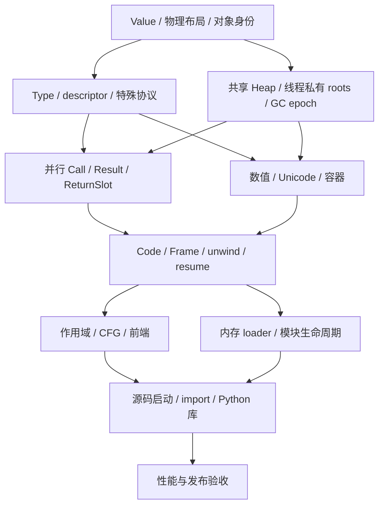

# cxxpython：基于当前新内核的无 GIL 重构计划

**版本：第二版，2026-10-29。交付格式：Markdown。**  
**审查仓库：[dukmu/cxxpython][repo]，主要基线：`fix-thread-improve@b23f367c98ee3290c893871c7104a49e9a834ff5`。**  
**硬要求：同一进程、同一 Interpreter、同一对象堆中的多个 OS 线程，同时执行 Python 字节码与对象协议。** Python 源码兼容仍以 3.12 核心能力矩阵为起点，不承诺 CPython ABI。

阅读定位：§0 为最新仓库与路线变化；§3–7 为对象、方法、内存与线程合同；§9 为现有 VM 的改造；§13 为下一批任务；§14–15 为验收与本轮证据。

## 0. 本轮结论、最新进度与路线变更

**保留已经落地的新对象与执行内核，把并发合同改为多 mutator 共享堆。撤销上一版“首版每解释器执行锁、共享堆并行以后再做”的决定。** 下一步先改对象访问、根、堆元数据和 GC 协调，再继续补语法与库。多核能力从下一阶段开始验证，不能等到产品发布前补加。

### 0.1 已重新查看正在改动的仓库

本轮开始时远端仍是 `5999962`；再次查询捕获到 `b23f367`，随后重新 fetch，并在独立工作树审查新提交。以下判断以新提交为准：

| 项目 | 本轮确认 |
|---|---|
| 最新审查分支 | `fix-thread-improve@b23f367c98ee3290c893871c7104a49e9a834ff5` |
| 提交主题 | `Schedule with cleanup through ordinary calls and record route review` |
| 提交时间 | 2026-10-29 13:45:09 +08:00 |
| 与上轮线程分支 `5999962` 的差异 | 86 个文件，增加 16,891 行，删除 104 行；包含新 foundation、测试、文档和 legacy 修补 |
| 当前替代核心 | `cxxpython::core`；独立 `cxxpython_foundation` target，不依赖 legacy Runtime/Object/VM |
| 文档当前状态 | 明确记录并发路线审查暂停，承认 `State::execution` 尚未满足共享堆 CPU 并行 |
| 本轮操作范围 | 只读审查、独立构建验证、更新本计划；未修改或提交仓库源码 |

架构与进度证据见 [R01]、[R02]、[R03]、[R04]。分支继续变化时应重新审查增量，本文的源码结论不会自动延伸到后续提交。

### 0.2 已有成果和这次需要改的部分

| 层 | `b23f367` 已有成果 | 无 GIL 修订 |
|---|---|---|
| Value / layout | boxed Value；Python Type 与不可变 allocation layout 分离；精确 trace/native destroy | 保留；补共享字段分类、安全发布和不依赖全局堆表锁的 layout 查询 |
| 根与返回 | 稳定 RootCell、generation/revision、RootScope、caller-owned ReturnSlot | 保留槽稳定和返回交付协议；根 arena 改为线程私有，Handle 增加所属 arena/线程身份 |
| GC | 无 Python 对象 RC 的非移动精确 tracing | 保留生命周期权威；增加多 mutator 停止确认、根发布、登记/恢复握手 |
| 类型与方法 | C3、布局检查、descriptor、类构造、binder、统一特殊协议 | 保留语义实现；类型元数据改为不可变快照，重做发布与缓存失效协议 |
| 基础类型 | int64/BigInt、码点字符串、数值协议、表示与递归保护等切片 | 保留已实现算法；审计实例尾槽、字典、Cell、缓存和其他共享可变字段 |
| 执行 | immutable VerifiedCode、固定 Frame 槽、非递归 CALL、traceback、结构化 unwind、同步 with | 保留；补显式 safepoint、共享 Function/Cell/异常同步、线程私有执行缓存 |
| 生命周期 | State lease、close 拒绝新 attach、NativeWait RAII | 延续；NativeWait 改为冻结根与 epoch 恢复，增加完整 registry/shutdown 协议 |

上述内容分别可在 [R05]–[R24] 复核。它们是已落地的切片，不能据此宣布完整 M2、M3 或 M4 已完成。新前端、源码差分、完整语法和库仍需后续门槛。[R03]

当前互斥的根源非常具体：`State::execution` 位于 `Python/runtime/foundation.cpp:161`；`Attachment` 在构造时加锁，`require_attached()` 以持有该锁为堆访问权限；`NativeWait` 暂时释放后再取得它。[R06] 这保证了现有串行实现的许多访问安全，也意味着当前多线程不能同时执行普通 Python 工作。不能只删除这把锁：全局 `heap/roots/free_root`、计账、类型 epoch 及裸 payload 访问都依赖它。

### 0.3 本版选定的实现主线

| 方面 | 选择 | 约束 |
|---|---|---|
| 正常执行 | 一个 Interpreter 内多个 Active mutator | 不设包围 opcode、普通调用或整段 attachment 的全局互斥 |
| 对象寿命 | 延续非移动、精确 STW tracing | Python 对象实际释放只在已确认停止的回收阶段；Value 复制不加 RC |
| 共享对象 | 不可变数据安全发布；可变数据短临界区或专用原子字段 | 回调、分配、阻塞前退出内部临界区 |
| 元数据 | TypeSnapshot / FunctionCallState 不可变发布 | 读到快照后先保活；缓存不指向无保护的 mutable 存储 |
| 根与分配 | ThreadRecord 自有 roots、Frame、本地分配缓存和计账 | 热路径不经全局 roots/heap mutex 或逐对象全局写计数器 |
| GC 协调 | request/ack/completed epoch；登记、退出、恢复共用 gate | 有界 STW 可保留；普通执行期间多线程并行 |
| 终结与原生资源 | GC 发现候选，恢复线程后运行 Python callback | 终结、I/O、join 和扩展调用不占住整个解释器 |

**无 GIL 不要求没有锁，也不要求第一版并发 GC。** 本版采用局部同步和短暂 STW，先把生命周期与并行访问证明闭合；对象锁竞争、暂停和分配成本进入明确的性能门槛。当前 tracing 方案已经在新 core 中实施，本次不再引入 RC/cycle 的第二套寿命权威。[R01]、[R06]

### 0.4 下一条必须运行的闭环

先由两个 OS 线程共享一个 Interpreter，以生产核心接口执行：

**已登记线程 → 创建与发布对象 → 同时查找/绑定/调用 → 结果进入各自根槽 → 同时请求 GC → 全体确认停止 → 回收 → 恢复并行 → 线程退出。**

随后复用现有 CodeBuilder 与 Frame 调度器，让两个线程调用**同一个 PythonFunction 和同一份 Code**，跑 CPU 密集循环、异常和 with/finally。单独解释器、多进程、I/O 释放锁或原生函数中的并行，均不能代替这项验收。

### 0.5 文档改动必须先统一

把本版并发合同纳入仓库权威计划；修改 `AGENTS.md` 的 execution-lock 条目和 `doc/foundation_contracts.md` 中相应前提，在 `doc/development_status.md` 顶部追加新路线与实际验收状态。保留开发历史。旧 `doc/nogil_gc_threading_design.md` 的 RC 路线继续标为 legacy，不再参与新 core 的所有权决定。用户最新的共享堆并行要求取代旧计划的串行选择，无需再次把该选择作为待确认事项。[R01]、[R03]、[R04]、[R36]

### 0.6 2026-10-29：按用户要求整合仓库与代码格式

用户最新要求删除旧实现及其测试，只保留当前项目，并按 CPython 的职责重新组织代码、启用 clang-format。该要求取代此前“保留 legacy CLI 作为迁移对照”的仓库保留策略，不取代本计划的语言、库、无 GIL、性能和发布验收目标。

当前实现统一为 `cxxpython_core` 库和唯一的 `cxxpython` 程序；使用 `Include/cxxpython/`、`Include/internal/`、`Objects/`、`Parser/`、`Python/`、`Programs/`，原生测试位于 `Tests/cpp/`，Python 测试驱动位于 `Lib/test/`，测量工具位于 `Tools/benchmarks/`。旧 Runtime/Object/VM、标准库、扩展 API 和专属测试已移除，不保留构建开关或兼容入口。现有 namespace 和生命周期/同步合同不变，不借目录整理引入另一套运行时。

`.clang-format` 与 `format`、`format-check` 构建目标统一项目 C++ 格式，CTest 同时检查。旧设计及原迁移合同移入 `doc/archive/`；当前架构、开发指南和运行时合同在 `doc/`，`doc/development_status.md` 继续只追加或前插，原始性能证据保留。删除 legacy 不表示 N6/M9、完整 Python 能力或 CPython 性能门槛已经通过。

### 0.7 2026-10-30：标准库与宿主测试分离

按用户要求，`Lib/` 只用于解释器标准库。宿主 Python 差分驱动、测量报告测试统一迁到 `Tests/python/`，与 `Tests/cpp/` 并列；CMake、开发规则和当前文档同步采用此路径。前一节及历史开发记录中的 `Lib/test/` 是整理时的旧位置，不再作为当前目录约定。

### 0.8 2026-10-30：从 Base 到 Full 的持续范围与阶段 Goal

用户再次明确：模块、namespace、loader、import、大量语法以及标准库和产品解释器都是必须继续完成的目标，不因 N0-N3 或数值切片通过而缩减。允许直接参考、复制固定 CPython 源码并改造，不要求把纯 Python 标准库全部重写为 C++；原生 C/C++ 能力与 Python 策略层按实际依赖划分，详细推进顺序见 §11.2。

当前服务 goal 已由用户替换为模块与统一导入基础阶段：Module/namespace、唯一模块表、GC 安全的并发初始化与失败回滚，内存/文件源码与 C/C++ 原生模块，动态扩展 ABI 边界，import/from/包以及 sys/builtins/__main__ 的基础闭环。该阶段验收、提交和推送后才标完成，再创建下一依赖阶段 goal。被替换的完整 N0-N6/M0-M9 目标没有被宣布完成；完整范围继续由本计划约束，阶段 goal 不是对它的删减。

后续不得遗忘的用户指定范围为：sys、os、posix、encodings、ctypes、curses、importlib、logging、re、test、threading、weakref、abc、ast、code、dataclasses、dis、enum、opcode、pdb、pickle、socket、tokenizer、trace、types、uuid，以及 runpy、产品解释器和 N4 之后的完整目标。tokenizer 能力对照固定基线的 tokenize/token 等实际接口，不伪造兼容模块名称。依赖模块也属于闭包，不能只让这些顶层名字可导入。

用户接受语义/架构推进中的有限性能回退，但不接受极大幅度或指数级退化；不能据此把目前数量级的 CPython 差距标为达标。沿用原始记录与自动生成报告，按输入规模检查复杂度，性能要求见 §12.2。

### 0.9 2026-10-30：普通 Namespace 的非分配删除

模块初始化失败后必须在 OOM 下撤销自己的 sys.modules entry，又不能丢失并发成功导入的其他模块。原普通名字字典的整份 COW 删除需要再次分配，不适合这个回滚合同。因此普通 namespace 改为每对象短临界区内的保序存储：插入节点在锁外准备，替换和条件删除不分配受管对象，等待通过 NativeWait，锁内不执行 Python/GC/扩容。读取视图复制并显式保活键值；TypeView 生成的临时存储由其自身根槽保活。

这不是改为全局字典锁或执行 GIL。Type 的公开元数据和类 namespace 继续使用 TypeSnapshot 的不可变存储与 epoch 发布；其原结构化字典在首次发布后释放本地存储，保留字典身份而不保留第二份字段真相。后续实现已将普通 namespace 与通用 Python dict 的有序条目、哈希/相等协议、映射代理及迭代共用，具体已支持切片与剩余容器矩阵见 doc/foundation_contracts.md；不能继续用“B3 名字字典”注释代替实际迁移。模块阶段 goal 继续要求完整的后续 loader/import/ABI 验收。

### 0.10 2026-10-30：完整文法改为独立自动生成前端

用户要求停止扩写手工递归下降语法，采用可独立构建的自动生成解析器，覆盖固定 Python 3.12 的完整文法，再继续本计划后续 N 阶段。当前服务 goal 已替换并恢复为这一前端阶段及后续未完成路线；此前模块阶段没有被虚标完成。

选用固定 CPython 3.12.14 的 `Grammar/python.gram`、`Grammar/Tokens` 和 pegen 文法读取/左递归分析。项目的 C++ 输出后端生成独立 PEG parser，替换 CPython 专属 AST 动作，构造不含受管引用的原生 CST。普通构建使用入库生成文件，不运行 Python、不链接 CPython 或外部解析运行库；再生成和一致性检查使用宿主 Python。保留上游许可、来源、文法摘要和可复现生成命令。

词法、生成式文法识别、CST 到 AST 的语义适配、作用域/编译和 VM 执行分别验收。词法包括缩进、Unicode、字面量和 PEP 701 f-string；文法识别包括 async/await、yield、模式匹配、类型参数等完整规则，不能将未完成执行的语法从文法中删除。原手写 parser 不保留为回退路径。缺失的编译/执行能力在适配层明确诊断，不得把“能识别”宣称为“能执行”。`invalid_*` 的第二遍专门错误文案不是语言接受条件；缺少精确文案须注明。

阶段验收包括独立标准库依赖构建、生成一致性、固定 CPython 文法正负例、上游源码语料、原有可执行语义回归以及并行解析/共享堆执行的各自测试。完成后继续 ModuleSpec/loader/Python 自举、标准库 Base 到 Full、N4 执行与运行时补全（完整基础类型、弱引用/终结、暂停恢复及线程资源）、N5 源码与实际库/产品入口闭环、N6 优化与替换发布，以及 M0-M9 未完成门槛。现有 N0-N3 证据不因换前端失效，也不得借路线变更引入 GIL。性能沿用已有基线，仅针对解析器新工作负载和具体回退采样。

### 0.11 2026-10-30：CPython 复用与基础兼容优先

用户要求能够复用固定 CPython 实现时直接复制，后续尽可能保持其接口、行为和异常语义一致。Lib 中为当前依赖缺口进行的适配不是最终分叉路线；逐项记录来源、必要差异、缺失依赖和撤销条件，见 doc/cpython_compatibility.md。优先补真实底层能力并恢复上游代码，不删除失败路径或提供空壳模块来使导入通过。GC、同堆 CPU 真并行和本项目扩展 ABI 的必要适配不变，也不得引入 CPython 的 GIL/RC 假设。

builtins 的唯一字典、名称解析和自举就绪不代表完整内建能力已经完成。现代 finder/loader 统一事务形成稳定节点后，主线优先补 Base builtins、基础类型/bytes/buffer、I/O 和编码等实际依赖；warning/metadata/resource 等导入边缘能力随各自依赖闭合，不以反复加固小节点替代基础推进。完整 N4-N6/M0-M9 和指定标准库范围不缩减，仍按真实验收证据完成阶段。

### 0.12 2026-10-31：REPL 依赖与 Python 脚本夹具

用户补充要求：在现有标准库与产品路线中完善 readline、curses、dis 和 gc，以支撑完整 REPL，而不止简单逐行启动器。readline 包括编辑、历史与补全，curses 包括真实终端能力及异常/退出后的状态恢复；dis 必须反映本项目实际指令、栈效果和位置元数据，不能伪造 CPython 字节码；gc 的控制、检查、统计及回调须符合共享堆 tracing GC 合同。底层 C/C++ 能力与 Python 层仍按 CPython 职责划分；非交互、重定向输入及终端不可用时的行为必须分别验收。此项增加后续交付范围，不宣告这些模块已经完成，也不取代 N4-N6/M0-M9。

脚本测试文件统一命名为 Tests/cases/<name>/test.py，stdin.bin 只保存可选进程输入，stdout.bin/stderr.bin/exitcode.txt 分别记录输出和退出状态。测试驱动直接调用产品执行 .py 文件，复用固定参考解释器核对；不得继续把源码存成 stdin.bin，或用原生测试包装本可直接运行的 Python 程序。

### 0.13 2026-10-31：网络稳定点后暂停功能扩张

用户要求完成当前网络库稳定点后，暂停原有完整兼容服务 goal，转入性能优化、代码清理和去冗余。此为工作优先级调整，不将未完成的完整前端、导入、标准库、产品及 N4-N6/M0-M9 验收标为完成，也不删除其后续范围。

下一工作线首先改善 Python 可见异常诊断（例如 AttributeError 必须给出实际模块/类型和属性名，而不是笼统的 module attribute not found），整理 Modules 中重复的参数转换/错误构造/安装逻辑和不直观的头文件边界，再基于实测处理 cache locality、分配和存储复用。共享堆 CPU 真并行、精确根和 GC epoch 合同不变，不引入 GIL、对象 RC 或针对性能样本的特判。

根目录 matrix.py 为用户提供的本地性能参考，不提交。结合保留的历史原始记录，仅测量当前工作负载与实际改动涉及的热点、规模和线程数，不为每个整理提交反复运行全部基线。测量表继续由 Tools/benchmarks/record.py 生成，不手补。完成稳定节点后及时提交推送，开发记录仍在 doc/development_status.md 前插或追加。

2026-10-31 后续要求：将零散的 foundation/lexing/regex 等性能驱动整理为统一、可重复的工程化 Python 基准，参考 CPython 社区的 pyperformance/pyperf 方法。按实际用途保留工作负载，删除无必要的旧驱动及 doc/benchmarks 生成报告；原始运行证据默认保留在忽略的 .cache/benchmarks，不再把每轮测量作为源码文档提交。必须包含单/多线程固定总工作量、计算与资源 I/O、分配/GC 压力；分开报告内核计时与启动成本，保留 warmup、独立进程、多值、参考解释器、版本/环境及校验结果。不得将每线程重复全部工作伪称固定工作量加速，也不得靠 GIL 换单线程成绩。

GC、分配、缓存及线程协调都可作为后续优化对象，不限定为继续修改调用层。先区分分配成本、epoch rendezvous、STW 工作及锁竞争的实际影响，再决定是否借鉴 JVM 等实现；不凭类比直接加入并发标记、写屏障或新收集器框架。共享堆真并行及既有精确根/epoch 安全合同继续作为验收约束。

## 1. 先确定兼容合同和架构边界

“兼容 Python 3”需要拆成可验证的承诺。建议第一阶段固定 Python 3.12 的核心语言语义，按能力完成；只有对应矩阵全部通过，才扩大对外承诺。选择 3.12 是为了沿用本轮已经核验的语义和测试基线。

| 维度 | 目标 | 验收方式 |
|---|---|---|
| 语言语义 | 已支持语法的求值顺序、作用域、协议调用、异常和副作用一致 | 与固定 CPython 版本做正例、负例和组合差分 |
| 内建对象 | 数值、Unicode、容器、函数、类、异常的公开行为一致 | 原生合同测试与 Python 协议测试共用样本 |
| 基础库 | 选定模块的公开 API、返回类型、错误和依赖闭合 | 测真实工作流及所选上游测试，记录排除项 |
| 反射 | 已公开的 function/code/frame/signature 信息准确 | 验证 `inspect`、traceback、闭包、源码位置和 flags |
| 并发语义 | 同 Interpreter、共享堆、多线程 CPU 并行；共享操作具备明确同步与原子性边界 | 并行进展、共享引用、回调、GC 与关闭的组合验证 |
| 性能 | 单核、启动、内存、GC 停顿与多核伸缩性分别衡量 | 固定工作负载、线程数、环境和统计方法，公开原始结果 |
| 原生接口 | cxxpython 自己的嵌入与扩展 API | 句柄、线程、错误、模块状态和卸载合同测试 |

不承诺 CPython ABI，允许采用不同的对象布局、GC、调用 ABI 和私有字节码。Python 源码可见的 `__eq__`、descriptor、类构造、数值精度等仍需遵守选定语义。CPython 扩展二进制、`.pyc`、`marshal` 的内部格式，以及依赖 CPython 私有实现的工具，单独列入兼容矩阵。[P01]、[P02]

功能矩阵统一使用 `Planned / Experimental / Supported / Deliberate difference`。缺失的语法在编译阶段准确诊断；API 的暂缺和实现差异明确记录。对尚未支持的行为，不能悄悄返回近似结果，例如把 signature 返回成字符串、把 dict view 返回成 list。

### 依赖关系

下图表达设计与验证依赖。类型和 GC 的少量自举循环在第 10 节单独闭合。



## 2. 新内核必须共同遵守的不变量

这组不变量应写进架构文档和 debug 断言，并成为新对象、新 opcode、新原生模块的评审依据。

| 编号 | 不变量 |
|---|---|
| I01 | 每个 Python 可见值有合法 Type 和稳定 identity；`None`、未绑定、缺参、结束、错误是不同状态 |
| I02 | Python 继承决定语义；native layout 决定合法内存访问；两者分别验证 |
| I03 | 每个堆分配都对应不可变的 trace/destroy 描述，且描述的存活不依赖 sweep 顺序 |
| I04 | 任意跨可分配、可回调、可收集边界的值，都有可枚举的根或堆边 |
| I05 | 返回值与异常先转交到调用方根槽，callee 才能退栈、解除根 |
| I06 | 属性、方法、运算、容器和 VM 共用协议实现；优化路径遵守同一结果与副作用合同 |
| I07 | 原生回调可以重入 Python；回调前后的容器位置、类型版本和引用有效性需要重新判断 |
| I08 | 多个 Active 线程可同时访问堆；每个共享字段遵守其锁、原子或不可变发布合同 |
| I09 | 一个对象只归属一个解释器；跨解释器传递通过显式数据复制或序列化 |
| I10 | 控制转移携带明确原因和目标区域；每层 cleanup 保存自己的 continuation |
| I11 | 只有通过验证的 Code 能执行；验证过程本身必须有界 |
| I12 | 运行时存储和扩展代码的销毁，发生在所有可能访问它们的执行活动结束之后 |
| I13 | collector 只扫描已确认静止的线程；恢复、登记与新 stop request 由同一 epoch gate 排序 |
| I14 | 内部对象临界区不执行 Python、不进入 GC、不做可能阻塞或扩容的分配；不阻塞等待其他锁 |
| I15 | 普通调用、opcode、root push/pop 和常见标量分配的快路不以全局互斥作为默认路径 |
| I16 | 不可变数据完成构造后安全发布；版本重验证不能补救对普通可变内存的数据竞争 |

## 3. 对象底层：Value、Object 与物理布局

### 3.1 Value 只描述一个值

第一版让所有 Python 可见值都对应堆对象。`Value` 是一字长的指针封装，复制 Value 不改变生命周期。`Handle` 负责根，`GcEdge` 负责堆图，三者不混用。

```cpp
// 接口草案：说明职责与存储合同，具体实现与辅助声明待补齐。
class Value final {
    ObjectHeader* object_;           // 非拥有；合法 Python Value 不为空
};

struct ObjectHeader {
    AtomicGcEdge<TypeObject> type;    // 合法 __class__ 更新可发布新类型；读取需保活
};

struct AllocationMeta {
    LayoutId layout;                 // 含复用代号的稳定标识，生命周期独立于 Type
    HeapDomainId owner;
    MarkState mark;
    AllocationFlags flags;
};

struct LayoutDescriptor final {
    NativeLayoutId native_family;
    SizeAndAlignment storage;
    InstanceFieldPlan fields;        // 可选 dict、weakref、__slots__ 等位置
    TraceFn trace_payload;           // 只枚举真实边，不调用 Python
    DestroyFn destroy_payload;       // 清理宿主存储，不执行 Python __del__
};
```

AllocationMeta 可以放在 slab/span 元数据中，不要求每个对象都携带完整副本。对象头不统一塞入 Runtime 指针、instance dict、锁、原子引用计数和 C++ vptr。具体大小由实际 `sizeof`、对齐及每对象总分配开销测量，不能只以 header 的字段数估计内存收益。

非移动 GC 使对象地址在生命周期内稳定；`is` 直接比较身份，`id` 可以编码地址。`None`、`True`、`False`、`NotImplemented`、`Ellipsis` 是解释器内的单例。未绑定 local、未传参数、内部迭代结束等用显式 tag 表达，不能冒用这些单例。[P01]

### 3.2 小整数放在 Int payload 内

第一版的 `IntObject` 使用 `int64 fast payload / BigInt payload` 两种内部表示；二者都具有正常对象身份。exact int 可以缓存一段常用值，缓存范围属于实现选择。int 子类保留自己的 Type、实例字段和身份，不能被折叠成内建 int。

选择全 boxed 的理由是先固定调用、根、继承和身份合同，同时保留与 CPython 类似的基础成本模型。它不会自动达到性能目标，但可避免在第一轮同时承担 Smi materialization、跨边界装箱、`id`、弱引用适用性和类型检查的复杂度。未来若引入立即数，需要单独证明这些行为，并重新衡量容器、Frame、API 和 GC 的表示成本。

### 3.3 Python Type 与 C++ 布局分开

所有基础对象可以用 C++ structs 和普通资源管理实现；Python 继承不映射成一棵 C++ virtual class 继承树。

| 判断 | 用途 | 示例 |
|---|---|---|
| `is_exact_type(v, IntType)` | 可以省略动态覆盖行为的快速路径 | exact int 加法 |
| `is_subtype(type(v), BaseType)` | Python 继承语义 | `isinstance`、构造结果判断 |
| `supports_native_layout(v, IntLayout)` | 安全读取原生 payload | int 子类的数值字段 |
| `is_layout_compatible(a, b)` | 合法的布局切换或继承组合 | 受约束的 `__class__` 赋值 |

普通 Python 类使用通用实例布局；内建类型的 Python 子类使用兼容 native prefix，加经过规划的尾部字段。变长数据优先放在外部缓冲区，实例自身保留固定 prefix，便于子类字段、GC 和分配器统一处理。

`__slots__`、实例 dict、weakref 位置在类创建时由 layout planner 决定。多继承需要同时通过 C3 和 native layout 冲突检查。Python 对某些内建类型子类化、非空 slots 的限制也要单独验证，物理空间足够不能直接推导为语义允许。

LayoutDescriptor 一经发布就不可变。修改 `C.__len__`、`C.__dict__` 或方法缓存，均不能改变 GC 的 trace/destroy。分配元数据持有 layout 的有效引用，直到相应存储释放；发布后的布局字段保持不可变，同轮收集 Type 与实例时，collector 不能通过已经销毁的 Type 找析构函数。布局注册表只保存宿主描述信息，其内存管理与 Python 对象 GC 分开。

C++ 对象本身的 lifetime、alignment 和 aliasing 也属于布局合同。header、native payload 与尾部字段在各自合法位置构造/销毁；统一的 payload accessor 校验 layout 与 offset，不能凭 Python subtype 就进行任意 `reinterpret_cast`。含 STL 等非平凡成员的 payload 不通过裸 memcpy 搬运。物理分配、Python 语义构造和 C++ 成员构造分别有清楚的入口。

### 3.4 分配、构造与发布分开约束

`allocate(type, layout, caller_root)` 分为准备和有限提交：先验证并 root 类型/布局输入，在合法安全点处理压力、领取存储并准备可能扩容的宿主缓冲；随后在 NoSafepoint 内初始化 header 和所有 GC 字段，完成本线程分配记录，写入调用方已有根槽。完成后才允许下一次 safepoint。

常见小对象来自线程本地 span；慢路批量领取空间和登记页。长时间的宿主资源/缓冲准备不能混入有限提交区，可通过已冻结根的 NativeWait 准备独立存储，恢复 Active 后再组装。

构造中的对象只属于当前 builder，不能提前进入共享容器、模块或用户 hook。首次共享通过对象锁 release 或 atomic release 发布，对应读取 acquire；接口验证类型状态与布局已就绪。失败时回滚尚未发布的私有存储与外部资源，这种构造失败清理与已发布对象的 STW 回收分开。

不完整对象若需要跨安全点存在，必须有可追踪 builder/staging，明确每个阶段的有效字段；首版优先避免这种状态，先初始化全部 GC 字段再进入可暂停代码。不能让 collector 猜测某个 C++ 成员是否已经构造。

### 3.5 每类字段的访问合同必须在头文件中可见

当前 `payload<T>() -> T&`、`instance_slot` 和 `instance_dictionary` 将共享可变存储直接交给调用者；这种接口依赖执行锁，需要从访问边界改造。[R05]、[R06]

| 字段类别 | 典型对象 | 运行时访问接口 |
|---|---|---|
| 构造后不可变 | int/float/str/bytes payload、tuple 槽集合、VerifiedCode、native layout | 构造完成后安全发布；提供 const view。tuple 内的元素对象仍可能可变 |
| 单个可变引用 | Cell.contents、适合单边更新的 slot、header.type | AtomicGcEdge 的 rooted load/store，或所属对象短锁 |
| 多字段不变量 | list size/storage、dict index/entries/version、资源状态 | scoped mutable guard 与受控 ObjectOps，不返回逃逸的 T& |
| 版本化元数据 | Type namespace/name/flags、未来 Function 元数据 setters | 不可变 snapshot，原子 current，旧版本由 GC 保活 |
| 执行者私有 | 当前 Frame、RootArena、repr guard、IC | owner-only；GC 确认停止后扫描；外部观察通过快照 |
| 延迟缓存 | str hash/UTF-8 缓存、数值或类型缓存 | 原子标量或不可变缓存对象发布；不能以 const API 掩盖普通字段写入 |

每个共享字段在代码评审中必须指出唯一保护规则。GC 遍历入口可以在 STW 下直接读字段，普通 mutator 入口不能借用 collector 的特权。debug 模式检查 attachment、owner、临界区和访问模式。

**具体 C++ 迁移点：** 当前各 payload 构造函数按值接收并复制 ObjectHeader。[R09] header.type 变为 atomic 后，改用 InitialType/UnpublishedHeader 构造 token，在最终位置原位初始化；删除已发布 header 的 copy/move。不要为保持旧构造签名而允许复制并发中的 atomic header。继续检查 standard-layout、alignment、尾部字段构造和 destroy 的对应关系。

类构造过程中也可能经共享 `__classcell__` 或 `__set_name__ / __init_subclass__` 把新 Type 交给另一个线程。首次发布前 Type 必须结构完整、可追踪且达到调用所需的 Ready；这不表示类创建 hook 已完成。后续变更走正式发布协议；hook 失败也不能撤销或销毁已逃逸的 Ready 类型。不能用“还没返回 type.__new__”推断对象仍私有。[R08]、[R13]

## 4. Type、属性、方法与特殊协议

这是新内核的语义中心。VM、builtin、native module 和扩展接口都调用这里的入口。

### 4.1 Type 是 Python 对象，布局是另一份信息

Type 具有稳定身份，逻辑状态包括名称、qualname、module、bases/C3 MRO、namespace、实例 layout plan 与类型 flags；并发表示采用 §4.4 的 TypeSnapshot，协议缓存是派生数据。metaclass 来自 Type 对象自身 header 的 `type` 边，避免再保存一份可漂移的独立权威状态。

内建类型由 `NativeTypeSpec` 描述其原生实现、公开方法和布局能力；Python 类通过同一 TypeReady 流程完成 MRO、布局及协议解析。Ready 表示结构、命名空间和已支持协议可以安全调用，必须在首次对其他代码/线程发布前建立；它不表示类创建 hook 已完成，`__set_name__/__init_subclass__` 期间允许 owner()/cls() 等正常调用。Building/Structural 仅供受控构建，后续修改使用正式 TypeMutation 发布。[R08]、[R13]

类型字典是方法与属性定义的权威来源；协议表是对其语义的解析结果。native method 对外暴露 wrapper descriptor，wrapper 和内部槽调用同一实现。不能形成“属性里一套方法、槽里另一套行为”。

### 4.2 把属性查找、descriptor 绑定和调用分成三个步骤

```text
attribute lookup → descriptor binding → callable invocation
```

默认实例查找依次处理 data descriptor、实例字段、non-data descriptor 或普通类属性；适用的 `__getattribute__` 可以接管普通属性访问，`AttributeError` 才触发 `__getattr__` 后备。Type 对象的查找还要考虑 metaclass 与 class MRO。descriptor 的能力由 descriptor 自身的 Type 判断。[P03]

这意味着 `obj.f` 的结果可以是任意对象。只有进一步执行 `(...)` 时，才检查该结果是否可调用。不能在属性引擎里看到一个名字就直接调某个 C++ 函数。

| 运行时对象 | 绑定行为 | 必须持有的 GC 边 |
|---|---|---|
| PythonFunction | 实例访问产生绑定方法，类访问保留函数 | Code、globals、defaults、closure 等 |
| BoundMethod | 调用时提供 receiver 与原 callable | `__func__`、`__self__` |
| NativeMethodDescriptor | 校验 receiver 约束，接统一 native call 入口 | 所属类型、默认值或上下文等 |
| staticmethod | 返回被包装的 callable | wrapped callable |
| classmethod | 绑定访问所依据的 owner Type | wrapped callable、绑定 owner |
| property / 用户 descriptor | 调用通用 get/set/delete 协议 | 自身实现定义的受管字段 |

`obj.f()` 后续可优化为 `CallTarget{callable, receiver}`，省去短命 BoundMethod；前提是已经证明它等价于普通函数 descriptor 的绑定，且无实例遮蔽、特殊属性 hook 或任意用户 descriptor 改变结果。普通 `obj.f` 取值仍返回正常对象。

### 4.3 特殊方法有独立的隐式查找入口

`getattr(obj, "__len__")` 与 `len(obj)` 各自遵守规定的查找路径。隐式特殊操作通过 Type 的完整 C3 MRO 解析，不能依赖实例字典中的同名覆盖，也不能简单从第一个 base 复制整张槽表。[P01]

新核心提供集中 ProtocolDefinition，描述 Python 名称、槽签名、结果校验、fallback 和原生 wrapper。解析后的每个操作保留足够信息：

```cpp
enum class SlotState { Missing, Disabled, Native, PythonDescriptor };

struct ResolvedSlot {
    SlotState state;
    GcEdge<TypeObject> owner;
    GcEdge<ObjectHeader> descriptor;
    NativeEntry native_entry;        // 如适用
    TypeEpoch resolved_at;
};
```

保留 descriptor 和 owner 很重要：多个 Python 类可能共用一个 C++ generic thunk，只比较 thunk 地址无法判断反射方法是否被重写。二元运算、原地运算、rich comparison 分别定义分派顺序；不同协议的子类优先、反射和最终失败规则不能混成一个算法。

| 协议族 | 统一入口 | 必须闭合的规则 |
|---|---|---|
| 属性与 descriptor | get/set/del attribute；descr get/set/delete | metaclass、实例遮蔽、data descriptor、错误传播 |
| 调用与构造 | call；new；init | 方法绑定、参数、任意 callable、构造返回值 |
| 数值 | unary；binary；inplace；index | reflected、子类优先、NotImplemented、类型与异常 |
| 比较与 hash | rich_compare；container_equal；hash | 非 bool 比较结果、identity shortcut 的适用范围、数值 hash 一致性 |
| 转换 | truth；length；repr；str | 返回类型、负长度、递归保护、错误传播 |
| 容器与迭代 | get/set/del item；contains；iter；next | 序列 fallback、IndexError 结束、StopIteration 适配 |
| 扩展协议 | buffer；await；async iter/next | 首版定义边界，随对应能力实现，不冒充已经支持 |

`a == b` 必须保留用户比较方法可能返回的任意对象。容器查找使用有明确语义的 `container_equal`：identity shortcut 加 rich comparison，再进行 truth 转换。identity shortcut 不能全局放到表达式比较前面，否则 `NaN` 和自定义非自反 equality 会改变结果。[P02]、[P04]

hash 缺省、显式 `__hash__ = None`、用户自定义 hash 分开表示。类创建时的 `__eq__`/`__hash__` 默认规则由 TypeReady 处理；后续动态改类属性按照该操作自己的规则处理，不能每次修改都重新执行类创建逻辑。

### 4.4 Type 快照、方法选择与并发失效

当前 `TypeState` 已用于 Building/Structural/Ready 生命周期枚举，因此新增的并发数据结构命名为 **TypeSnapshot**，避免把两个概念合并。[R07] 每个 Type 保留稳定身份及原子 `current_snapshot`；快照持有 namespace、名称、flags 和查找所需的元数据。第一阶段冻结发布后的 bases/MRO 拓扑，继续复用当前 C3 与布局检查。动态 `__bases__` 更新另设完整事务门槛。

TypeSnapshot 是由同一 GC 跟踪的内部对象，拥有明确 trace/layout；Type 与读者根分别保活当前和正在使用的旧快照。writer 交换指针后不能立即 delete 旧快照。`mappingproxy` 关联 Type/namespace 的稳定身份，每次访问取得 current snapshot；不能固定住创建代理时的旧字典。当前代理与普通可变 Dict 的连接需要据此改造。[R09]、[R12]

**发布协议：**

1. writer 在锁外准备新快照，完成分配、名字处理和可重复的纯计算；用户 hook 按规范顺序在锁外执行。
2. 通过 GC-aware 等待取得 `TypeMutationGate`，验证准备时的版本。锁内只做有界提交，不调用 Python、不分配、不进入 safepoint。
3. 首版用明确的 `seq_cst` 原子序列：全局发布序号变奇数 → 发布新的 snapshot 指针 → 序号变为下一个偶数。该序号同时使继承查找缓存失效。
4. reader 读取偶数 `e0`，逐个取得并 root 所需不可变快照，完成纯查找，再读取 `e1`。只有 `e0 == e1` 且为偶数，才把结果标记为该版本。变化时仅重试尚未产生用户副作用的解析。

首版选强内存序，随后有 C++ 内存模型证明与针对性压力测试才放宽。不能仅把现有 `type_epoch` 换成 atomic：当前“查找 → root → 读取 epoch”和“写 dict → invalidate”的顺序，可能把旧目标标成新版本。[R06]、[R11]、[R14] **版本计数不保护正在被另一线程修改的普通 vector/map。** reader 只读已经发布且不再修改的快照。[P21]

每次 snapshot load→root 是短 NoSafepoint；大 MRO 遍历可以在临时引用全部保活后 poll。遇到奇数序号时应退出临界区、poll/backoff，不能在 NoSafepoint 内无限自旋等待 writer。

IC 首版放在线程私有、容量受限的 sidecar。缓存保存 owner、descriptor、必要快照及版本，均有 GC 边；过期项在本线程清理，类型修改不去并发写其他线程的缓存。全局 type epoch 可以先做粗粒度失效，避免过早引入 subclass 传播图的并发维护。通常调用同一个函数或方法不会竞争同一个 cache mutex。

**方法选择只冻结到当前规范规定的选择点。** 选中 callable/receiver 后先 root，再调用；方法运行期间不持类型锁。已选择的方法可以完成，后续 fallback 重新解析。例如 `__add__` 改写另一个类的 `__radd__` 后返回 NotImplemented，随后应按协议看到这次修改。不能一次缓存整个运算的全部未来候选，也不能在冲突后重放已经运行的 Python callback。当前核心已有反射 fallback 重解析回归，应保留。[R14]、[R23]

对一般 Python descriptor，绑定事件还必须读取 descriptor 当前 Type 的协议；只有经过证明的 exact、不可变 native descriptor 才能缓存绑定分类并直接走短路。不能让旧的 DescriptorKind 跳过运行期新增的 `__get__ / __set__`。

`__class__` 赋值验证 native layout、尾部字段和类型约束后，原子发布 header 的类型边。`__bases__` 后续若开放，须预计算并一次提交所有受影响类型的一致 MRO/布局视图。未达到门槛的变更明确标为未支持，不能发布部分更新。

### 4.5 类创建也拆成不同职责

| 层 | 职责 |
|---|---|
| `build_class` | bases 解析、metaclass 选择、`__prepare__`、执行类体、调用 metaclass |
| `type.__new__` | 产生 Type、C3、布局、类字典、`__classcell__`、`__set_name__`、`__init_subclass__` 等 |
| `type.__call__` | 调用 `__new__`；按返回对象和选定类型关系决定是否调用 `__init__`，校验其返回值 |
| 普通实例分配 | 按已批准 layout 初始化内存并发布根，完全不承担类定义策略 |

metaclass 可以是普通 callable，类语句的结果也可能不是 Type；build_class 不能统一强转成 TypeObject。`__new__` 也可以返回其他对象，VM 不得绕过这些协议直接分配实例。[P01]、[P05]

## 5. 调用、参数和异常的统一 ABI

### 5.1 参数借用稳定槽，返回值落入调用方根

原生函数、Python 函数、绑定方法、可调用实例和类构造使用同一个 call 边界。参数使用 view，避免每次调用无条件构建 vector、tuple 和 dict；调用方负责参数所在存储已被追踪且地址稳定。

```cpp
struct CallArgsView {
    Span<const Value> positional;
    Span<const KeywordArg> keywords; // 保序；展开阶段验证重复、名称等
};

enum class ResultTag { Empty, Ok, Raised };

template<class T>
class ReturnSlot;                   // caller-owned；已注册为稳定 root cell

template<class T>
class ResultView;                   // 只借用 ReturnSlot，不能越过其寿命

ResultView<Value> call(CallContext&, Handle<Value> callable,
                       CallArgsView, ReturnSlot<Value>& out);

ResultView<Value> getattr(CallContext&, Handle<Value> object,
                          Handle<StrObject> name, ReturnSlot<Value>& out);
```

ReturnSlot 的 tag 决定扫描成功值还是异常；标量结果也保留有根的 Raised 分支。callee 在退出自己的 RootScope 之前先写 out。有限的根槽发布、槽赋值和根转交处于 `NoSafepoint`；可能扩容的准备在安全阶段提前完成。调用方若继续分配或回调，out 仍受保护；若要长期保存，则写入自己的根或对象字段。ReturnSlot/ResultView 只属于当前调用线程，跨线程使用 §6.2 的 TransferRecord。

ReturnSlot 复用还要防止别名与过期视图：root cell 复用代号 generation 与内容 revision 分开；每次 reset/write 更新 revision，ResultView 绑定该版本，覆写后旧 view 不可再读。out 不能与本次 callable/参数所借用的根槽重叠；需要原地操作时先把输入转交到独立根，再清空 out。根容量扩展在可停顿的准备阶段完成，内部临界区只写已有槽；失败路径也不能依赖一个尚未建立的返回根。

VM 调 ObjectOps 时，操作数保留在 frame 槽内，结果先写 ReturnSlot，再提交栈变化。不能先把操作数全部 pop 成裸指针，再进入可分配的函数。

### 5.2 CallBinder 与 callable 实现分离

CallBinder 统一参数位置、positional-only、keyword-only、默认值、`*args`、`**kwargs`、重复关键字和错误生成。Code 与 native function 都持有结构化 SignatureLayout。只有确实需要的 varargs/kwargs 才物化 tuple/dict；固定签名可使用经过相同合同验证的快速 binder。

NativeEntry 使用显式 CallContext 和当前线程的 attachment，不从跨 Runtime 共用的 active VM 猜解释器。C++ 回调需要捕获 Python 对象时，捕获区必须是可 trace 的受管字段；不能藏在不可见的 `std::function` closure 中。原生函数的代码地址和所属动态库 lease 共同存活。

### 5.3 Python 错误通道保持统一

| 状态 | 含义 | 消费方 |
|---|---|---|
| `Ok(value)` | 正常 Python 结果 | 调用者 |
| `Raised(exception)` | Python 异常传播；对象及控制状态已被根/Frame 保活 | 调用边界、VM unwind |
| `Ok(NotImplemented)` | 协议实现拒绝当前组合 | 指定运算的 fallback；普通函数也可正常返回它 |
| `NextDone` | 内部迭代正常结束，保留必要终止载荷 | for/iterator adapter；需要时转换为 StopIteration |
| `VmFault / HostFailure` | 内部不变量或宿主边界故障 | 宿主诊断与受控退出，不伪装成普通用户 ValueError |

ThreadState 的 handled exception 为 `sys.exc_info()`、裸 raise 和 handler 嵌套服务；传播中的控制原因仍经 Result/TracedReason 显式交付。两者职责分离，引用都进入根或 Frame trace。

异常实例包含 type、args、traceback、cause/context 及专用字段，可能被多个线程共享。ExceptionOps 同步其读写并保留实例 identity；传播记录保存保活与控制信息，不维护忽略用户修改的第二份 traceback 权威。在裸 raise、sys.exc_info 和 with 退出参数的规范观察点，读取同步且已 root 的当前异常状态。详见 §9.8。[P15]、[P22]

SyntaxError/OSError 等保持结构化字段；系统调用失败先保存 errno，再经正常错误入口转换。`bad_alloc` 在受控边界映射 MemoryError，预留最小错误转交资源，不能为报告分配失败再次无界分配。C ABI 边界截住 C++ 异常。错误回调、unraisable hook 和日志输出可能重入或阻塞，同样遵守 attachment/NativeWait 合同。

## 6. 生命周期：并行 mutator 下的 Heap、根和 GC

### 6.1 延续现有 tracing 生命周期

新 core 已经由 tracing 决定 Python 对象寿命，布局中保存物理 trace/destroy，Value 本身不做引用计数；这些选择继续成立。[R05]、[R06] 首版仍用非移动精确 mark-sweep。collector 的扫描和物理释放先在 STW 内完成，不同时引入分代、移动、并发标记和立即析构。

不需要在每次 Value 复制上添加 atomic RC，前提是以下四点全部成立：

1. 所有 Python 对象真正释放都由 STW collector 进行，没有“最后一个引用离开就释放”的旁路。
2. 每个能访问堆的线程在 safepoint、Parked、NativeWait 或退出前，发布完整根和构造/分配状态。
3. 从共享字段取指针到写入本线程既有根槽之间，不允许 safepoint；字段读取本身仍遵守其锁或原子协议。
4. 外部数组、哈希表、旧快照和扩展代码有独立的存活规则；保活 Python owner 并不自动保证它以前的缓冲区仍有效。

tracing 解决对象是否仍存活；对象同步解决字段是否能安全读写。两者必须同时满足。

### 6.2 根、堆边和跨线程交付

| 形式 | 所有者与写入规则 | collector 看到的内容 |
|---|---|---|
| ThreadRecord / RootArena | 一个 mutator 私有；保留稳定 cell、非 LIFO 释放、generation/revision | 确认停止后扫描已发布的有效槽和 arena extent |
| Frame 槽与控制原因 | 正在执行该 Frame 的线程拥有写权限 | locals、operand stack、reason、continuation、handled exception、closure 等真实边 |
| ReturnSlot | 调用方提前分配；callee 在自身根释放前写入 | Ok 或 Raised 的受管对象；保持现有 stale-view/alias 检查 |
| 普通 GcEdge | 构造期私有，或由所属对象锁保护 | STW 期间直接枚举有效边 |
| AtomicGcEdge | 单一可变引用；release 发布、acquire 读取并 root | STW 中读取已停止状态；初始化/删除也遵守同一协议 |
| TransferRecord | 共享队列/线程登记中的受管记录 | 跨线程任务、参数和结果；记录移交前后连续可达 |
| Interpreter roots | 已发布 builtins、modules、类型与运行期服务 | 通过初始化发布合同和各自对象同步维护 |

当前 RootCell 设计可保留，但 `State::roots/free_root/root_count` 必须迁到 ThreadRecord。[R06] Handle 同时包含解释器与 arena 身份、槽地址及代号；仅有 State owner 无法阻止线程 B 读写线程 A 的根。普通 Handle/ReturnSlot/ResultView 不跨线程借用。

跨线程提交采用明确的所有权交付：发送方保活输入 → 在队列锁外分配并 root 受管 TransferRecord，准备所需容量 → 短锁内只做有限的链接/发布提交 → 接收方在 NoSafepoint 内复制到自己的既有根 → 才解除队列记录中的强边。线程启动、join 结果、异步 callback 均复用这一协议。

RootArena 的 cell、分配 extent、free-list 与计数都必须在停止确认前成为一致状态；collector 持有 ThreadRecord lease，直到整轮 GC 完成且不再使用其根或分配元数据。不能仅发布一个 root 指针却继续扩容/释放它的 arena。ThreadState 自有的 repr stack、handled exception 和其他 C++ 字段也要明确如何被扫描。

### 6.3 共享引用的 load→root 协议

以 list 元素读取为例，规范顺序如下：

1. 在进入临界区之前准备好输出根、临时根和必要的错误输出槽。
2. Active 线程进入短 NoSafepoint，尝试取得 list 内部锁。
3. 成功后，在锁内检查下标，读取元素，并通过已校验的 `store_root_noexcept` 写入本线程输出根。
4. 解锁，退出 NoSafepoint；此后允许 poll、分配、调用或构造 IndexError。
5. 若锁未取得，释放已持有的所有内部锁，退出 NoSafepoint，发布根并 GC-aware 等待，再以 Active 状态重试。

原子 Cell/Type 边省去容器锁，但 load→root 仍不可被 safepoint 分开。因为所有物理回收均等待该线程确认停止，所以该短区间内的未 root 指针不会被 GC 回收。

**既有 API 需要改实现。** 当前 `ReturnSlot::ok` 调用 `require_owns`，后者查询共享 `unordered_map heap`；不能直接宣称这是临界区内可无等待、无异常执行的操作。[R06] 入口先验证 Handle/归属与输出槽，内部 store 只更新当前线程已有 cell。也不能读完元素后再调用可能扩容或失败的 RootScope::root。

对象数组元素地址、字典 entry 指针和 `span<Value>` 不能随锁释放而逃逸。root 住的是 Python 对象，容器 resize 仍可能使旧 slot 地址失效。需要跨回调保存时，只保存已 root 的值和之后重新验证的逻辑标识。

### 6.4 并行分配与堆元数据

当前所有分配记录、ownership/layout 校验和外部 buffer 计账集中在一个 `unordered_map`；将它整体加 mutex 会把大部分 boxed 数值和 payload 访问重新汇聚到一个热点。[R06] 需要同时改存储和访问接口：

- 小对象从线程本地、按 size class 划分的 span/slab 获取；慢路批量领取页，较大对象走独立受控路径。
- 每个分配的 owner/layout 保持稳定，可由对象邻接元数据或稳定页索引定位。正常 payload 校验不再查一个正被其他线程修改的全局 hash map。
- 页池、页索引与大对象登记可使用短协调锁/分片；其发布与退休遵守 GC epoch。已有根中的合法 Value 不需要每次访问都走全局登记查询。
- 每线程记录分配字节和外部缓冲变化，按批量预算检查压力；避免每个 int 分配都写同一个全局 cache line。GC 请求标志的只读检查可以保留。
- STW 前发布线程的已完成 allocation extent；collector 在一致的页/大对象集合上扫描和 sweep。空页归还、线程退出缓存和失败分配计账都需要测试。
- 大缓冲的准备可在安全点或 NativeWait 宿主阶段完成；有限的初始化、登记和写 root 才放入 NoSafepoint。不能把未知时长的 native 构造或系统分配藏在禁停顿区。

所有对象都计入压力，包括 int、str 等叶对象及容器外部存储。删除大量临时叶对象后，即使没有环，也必须能触发回收。分配失败先释放未发布的宿主资源；已有根和堆记录保持一致，MemoryError 路径不能依赖再次分配大块存储。

第一条两线程 GC 原型可暂用短锁中央登记来验证协议，但它是明确的过渡实现；分片元数据与本地分配是无 GIL 性能验收的前置，不放到发布后。

### 6.5 GC 阶段与暂停边界

`Attachment::collect()` 改为 coordinator 请求，不能直接调用扫描 heap 的裸函数。第 7 节定义停止握手；所有参与者确认后，才复用现有 mark/sweep 核心。

首版的停顿内工作为：固定根集合 → 标记强可达图 → 判定 weak/finalizer 候选 → 扫除可直接释放的对象 → 汇总账目 → 发布完成。trace/destroy 只读已经停止的对象，不获取对象锁、不运行 Python、不等待用户线程。布局生命周期不依赖被扫描 Type 的生存顺序。

大堆暂停是本路线的明确成本。记录请求到最后确认的 rendezvous 时间、mark、weak/finalizer 登记、sweep 各段，以及总暂停 P50/P95/P99/最大值。超时应诊断阻塞的 ThreadRecord 和最后安全点；不得把未响应线程排除后继续回收。

先保证全堆收集正确，再依据暂停与吞吐数据单独决定分代/增量/并发方案。`GcEdge::store` 是后续 write barrier 的统一入口，但预留入口不等于已经实现 remembered set 或并发屏障。

### 6.6 weakref、finalizer 与复活

`__del__`、weakref callback 和 C++ physical destroy 是三个不同阶段。GC 停顿内不能执行用户 callback。终结 API 的公开行为依据 Python 数据模型与 PEP 442 逐项验证，以下是本项目的执行设计。[P01]、[P06]

1. STW 标记后，在物理回收和恢复 mutator 之前，清除应失效的 weak target 并发布 dead 状态；记录终结候选及回调顺序。回调所需对象、候选及其完整强引用可达图由受管 quarantine/batch roots 保活。
2. 恢复 mutator。领取该批任务的已登记线程，按正常 ObjectOps 执行回调；执行期间允许其他线程工作和后续 GC。
3. 为每个候选维护未排队/已排队/终结中/已终结状态，保证 finalizer 不被两个线程执行两次；dispatch 不能递归重复领取同一批。
4. callback 完成后，在后续 STW 从真实程序根重新判定复活。完成的内部保留根不算程序复活；仍在运行的批次继续受保护。
5. 只有不可达且满足终结状态的存储才物理释放。C++ destroy 不调用 Python、不解引用其他可能已销毁的 Python 对象。

回调中嵌套 `gc.collect()` 可以收集其他垃圾，不能等待当前正在执行自己的 finalizer batch。并发 collect 合并停止请求；某次 collect 可等待并完成自己领取的有限批次，但不能要求所有未来新 finalizer 都排空。阻塞的 finalizer 可能阻塞其调用线程，不能持有整个 interpreter 的 GC/执行权限。

weakref 读取也通过同步的 load→root，不能返回可能随下一次安全点消失的裸引用。复活、回调删除 weakref、并发清除、终结期间再触发 GC 都是必测组合。

### 6.7 GC API 与资源释放

`gc.disable()` 仅控制自动触发；显式收集、已有停止请求的响应和 shutdown 协调仍然有效。`gc.collect()` 的计数、嵌套调用和并发调用结果要形成项目合同，不能直接伪装 CPython 分代统计。`get_objects`、callbacks 等支持范围从真实 collector 导出。[P07]

文件、socket、mutex、线程和动态库通过明确的 close/with/lease 管理。GC 可以发现遗漏清理，但不可把阻塞的 close/join 放入 STW physical destructor。原生资源最后一次释放若可能阻塞，应交给已登记的清理活动或宿主 deferred disposer；解释器和扩展代码 lease 覆盖整个活动。

## 7. 真正多线程：状态机、内存顺序和关闭

### 7.1 多个线程同时拥有执行资格

Interpreter 拥有共享 heap、core image、模块系统和 GcCoordinator。ThreadRecord 拥有 roots、Frame 链、异常上下文、本地分配缓存和私有 IC。TLS 仅定位当前 attachment；所有 API 仍能核验所属解释器和线程，不使用跨 Runtime 混用的 active VM。

正常调用只要求线程已登记并处于 Active。**多个 Active 可以同时存在。** coordinator mutex 仅保护低频登记、状态转换与 GC 请求；它不得包围 opcode、对象协议、函数体或 callback。

| 状态 | 堆访问资格 | GC 处理 |
|---|---|---|
| PendingAttach | 尚未取得访问资格；参数仍由创建者/TransferRecord 保活 | 当前轮完成后才能转 Active |
| Active | 按每个对象/字段合同访问堆；可修改自己的 roots/Frame | 必须到达安全点并发布停止确认 |
| Parked(epoch) | 不访问堆；根和分配记录冻结 | 可扫描；恢复必须经过 epoch gate |
| NativeWait | 只访问许可的宿主资源或受保护字节缓冲 | 冻结根可跨多轮 GC 扫描；返回/回调先通过 gate |
| Collector | 已发布自己的根，执行停顿内 GC | 所有参与者安全后才扫描与回收 |
| Exiting | 已完成退出交付、冻结根并发布最终状态，不再访问堆 | ThreadRecord 在本轮 pin 解除前不能销毁 |

TLS 清理、结果交付和可能执行 Python 的退出工作仍处于 Active，不能提前把它们标成安全的 Exiting。完成清理并发布最终静止状态后才能进入 Exiting/注销。

frame_depth 为零不表示线程安全：native 函数、嵌入调用和对象构造都可能尚在访问堆。历史分支按“别的线程有 Frame 就跳过 GC”的规避方式不作为新方案。[R26]

### 7.2 request/ack/completed epoch 的完整握手

GcCoordinator 包含 `phase`、`request_epoch`、`completed_epoch`、线程登记表与等待通知。状态原子操作和锁的内存顺序必须写成实际 happens-before 图与测试，不能只声明“使用 atomic”。

1. **请求。** 发起者先离开所有对象临界区，保活临时值；在 coordinator 下合并已有请求或创建新 epoch。若已有 collector，新的请求者必须发布根并 Parked，再等待完成，不能以 Active 身份等待 collector。
2. **固定参与集合。** 本轮 pin 现有 ThreadRecord；新 attachment 保持 PendingAttach。已在 NativeWait/Parked 的线程由其冻结根与关闭的恢复 gate 证明安全，不必等阻塞 I/O 返回。
3. **停止确认。** Active 线程在 poll 观察 request；整理 Frame、arena 和 allocation extent，释放所有内部对象锁，再 release 发布本轮 ack/静止状态。collector acquire 观察确认后才可读其普通 roots。
4. **等待与回收。** 等待其他线程时不持有它们需要的对象、分配或 parking 锁；全部安全后运行第 6 节 GC。collector 也不得在 trace/destroy 重新获取对象锁。
5. **完成。** 发布 completed epoch 并唤醒；恢复方通过同一 gate 检查当前 phase，并以 acquire 获得回收后的状态。检查与转 Active 对新一轮 stop request 必须有同一排序点。
6. **退出。** 清理或交付结果后，在 gate 下退出登记；尚被 collector pin 的记录由 lease 留存。不能先 free arena 再注销，也不能在本轮快照外悄悄进入运行。

因此“看到没有请求后直接 Running”和“把状态枚举改回原值”都不是恢复协议。普通 NativeWait 返回、模块等待返回、对象锁等待、join、原生 callback 重入全部使用相同入口。

### 7.3 safepoint 必须覆盖不分配的代码

VM 在有界 opcode 预算、回边/函数调度边界和受控原生 API 边界 poll；它不能只依赖对象分配触发。当前 `eval.cpp` 的取指循环尚无完整显式 poll，合法的无分配回边可以一直不响应停止，需要前移修订。[R19]

长时间数值、Unicode、rehash、编译与 I/O 准备工作应分块或转入有明确资源边界的 NativeWait；每段之间所有 Python 引用都进入根。快路 poll 只读请求标志，不能每条指令都写全局状态计数器。长禁停顿区要有 debug 检测、统计和诊断。

### 7.4 对象内部锁如何与 GC 共存

内部 critical section 采用“短尝试、失败后发布根等待”：

- 在 Active 状态进入 NoSafepoint，只做 `try_lock`；成功后的字段操作有界、无 Python callback、无 GC，不执行可能阻塞或扩容的分配，包括任意宿主分配；只使用事先准备的有界存储。
- 失败时释放已取得的所有内部锁，退出 NoSafepoint，注册等待谓词/通知序号，再成为 Parked。等待记录用 native lease 固定，Parked 不读普通 Python payload。
- Parked 仅等待通知；唤醒先通过 GC 恢复 gate，变为 Active 后重新 try_lock。**不能先在 Parked 状态拿到对象 mutex，再持该 mutex 等 GC 恢复。**
- 多对象操作使用稳定 LockId 顺序尝试；部分失败必须全部释放。实现可以进一步优化，但禁止持 A 阻塞等 B 的无界链。
- 等待注册和 unlock 通知使用可验证的谓词/序号，覆盖“检查失败到真正等待”的窗口，避免丢通知。处理虚假唤醒与取消。

resize/rehash 的 O(n) 搬运不能直接塞进任意长度的 NoSafepoint。可用独立、可停顿的 container maintenance token 阻止所有影响源存储的写入，再按稳定、被保活的视图分块准备；短锁只提交新存储。仅禁止 resize、size/capacity 或键集合变化不够，元素替换仍会与普通数组复制竞争。其他可选实现是读取真正不可变/COW 存储，或在短锁内分块取值并 root、验证相应值/结构版本。

maintenance token 是 collector 不依赖的逻辑维护权，区别于对象 mutex：所有相关 writer 必须遵守；等待者 GC-aware Parked；collector 不获取或等待 token。持有者在每个 poll 点让旧对象与新 staging 都完整可扫描且被保活。持 token 不调用 Python、不阻塞取得第二个 token；多 token 用稳定顺序 try-all，失败释放重试。需要用户 hash/equality 等 callback 时先结束维护状态，再回到版本重验证流程。

用户可见的 `threading.Lock/RLock` 与内部对象锁不同：Python 代码可以在用户锁内分配和进入 GC。collector 不获取用户锁；runtime 的 Lock.acquire 在等待时冻结根并 NativeWait/Parked。不要用“内部临界区禁止 safepoint”的规则禁止用户在 with lock 中执行普通 Python。

### 7.5 对用户公开的并发语义

语言层有逻辑竞争，运行时也必须保持 C++ 内存安全。未加用户锁的竞态不能导致 use-after-free、撕裂指针或破坏容器内部结构。

| 操作 | 本项目首版要承诺的边界 |
|---|---|
| 已发布不可变对象读取 | 数据保持一致；缓存也遵守原子/不可变发布规则 |
| 单个 Cell/slot 引用读取或替换 | 单个边的原子 load/store；返回值先保活 |
| exact list append/pop、内建可哈希 key 的单次 dict 更新等 | 为支持的操作明确线性化点，保持容器结构一致 |
| 需要 `__hash__/__eq__/descriptor` 等用户回调的复合协议 | 短锁之间可交错，按回调语义重验证；不能笼统宣称整项原子 |
| `counter += 1`、`d[k] += 1`、check-then-act | 多步逻辑；需要用户 Lock/原子 API/Queue 协调 |
| Lock、Event、Condition、Queue、线程完成/join | 公布的同步操作建立相应可见性；文档与测试一致 |
| 并发迭代 | 按每种 iterator 合同检查结构变化；不暗中全量复制，也不承诺整个迭代事务 |

Python 3.12 源码语义基线与多线程原子性合同分别维护。CPython free-threading 文档用于核对工程风险，不意味着它的每个当前实现细节都成为本项目的公开承诺。[P08]、[P19]

### 7.6 NativeWait、扩展与共享 buffer

NativeEntry 收到显式 attachment。进入 NativeWait 前必须结束所有内部对象临界区，发布 roots 和分配状态；此后不能访问任意 Python 对象或 GC 边。返回或回调 Python 前恢复 Active，并重新验证可变状态。保留现有 RAII 入口，替换其当前 unlock/relock 实现。[R05]、[R06]

默认传给宿主的数据是复制后的存储或真正不可变的 bytes。BufferLease 固定 owner、buffer 存活和形状/resize 约束；如果 buffer 可写，还需要独占借用或明确的并发访问协议。`readonly memoryview` 只限制该视图写入，不证明 exporter 没有别的 writer。NativeWait 中获准写入的外部 buffer 不包含 Python 引用边。

扩展模块显式声明并通过 free-threading 合同。无法满足的扩展可以拒绝加载，或在具有明确重入合同的模块/资源边界局部串行；局部 gate 的等待仍要 GC-aware，不能持 gate 执行任意 Python callback 再与其他线程互等。缺少这个合同就拒绝加载，不能随手加模块 mutex 后宣称支持，也不能为了一个扩展静默开启全解释器 GIL。对象直接字段访问、borrowed reference 和 callback 重入全部受本项目 API 约束。[P20]

### 7.7 线程结束与 Interpreter 关闭

已有 State lease 和关闭 admission 的方向正确，应扩展为 Booting → Open → Closing → Quiescing → Closed 生命周期。[R06]

1. Closing 拒绝新顶层任务、新线程和新扩展 admission；已登记活动保留 RuntimeLease。
2. 允许既有 lease 从 NativeWait 恢复、执行属于该调用的 callback 并完成清理，否则关闭方可能永远等不到线程结束。
3. 通知协作退出，等待普通线程和受控活动结束；join 本身使用 GC-aware 等待，不在 STW 或持 coordinator/object 锁时 join。
4. 交付结果、清理 thread-local、finalizer 与模块资源，确认没有能再次进入堆的活动。
5. 才销毁 heap、页池、模块状态和动态库代码，完成 Closed。

不能安全取消的 native 调用是实际边界。嵌入 API 提供 deadline/Busy，保留 lease，不释放仍可被访问的存储。CLI 如需支持存活 daemon 的进程退出，应有独立的最终进程终止路径，不能边 detach 线程边正常析构 Runtime。主解释器信号处理、interrupt 检查和未捕获线程异常也走已登记、可暂停的入口。

### 7.8 “已完成无 GIL”的最小证据

至少同时满足：两个线程在同一解释器执行同一 Function/Code 的 CPU 循环；观测到多个 Active mutator 和 CPU 并行；共享对象与 GC 压测通过；无分配循环能响应停止；注册/退出/NativeWait 恢复无死锁；受测路径 TSan 无报告。并发测试不能只覆盖 I/O、不同解释器或在 native 函数内部并行的工作。

## 8. 基础类型从共同协议推导

当前 core 已实现若干数值、码点字符串和表示协议切片；本节保留完整目标，后续任务按实际矩阵增量完成。[R09]、[R15]、[R16]

### 8.1 数值：表示、运算和协议分派分别实现

NumericKernel 负责受控的数值算法，ObjectOps 负责 Python 动态分派，VM 负责取操作数和提交结果。三层共享一个语义实现，不各自重写整数除法、比较和异常规则。

| 类型或操作 | 实现决定 | 必须验证的边界 |
|---|---|---|
| int | 保留已有对象内 small payload 加 BigInt、封装 Boost.Multiprecision `cpp_int` 的方向 | 继续补齐溢出提升、负数、进制转换、位运算、内存失败矩阵 |
| bool | 独立 Type、True/False 单例，遵守 int 子类型语义 | 不可子类化、算术结果、hash 与比较 |
| float | binary64；采用可往返的转换与格式化 | signed zero、NaN、Inf、极端指数、负数取模 |
| complex | 实部与虚部，接同一数值协议 | 混合运算、幂、相等与 hash，拒绝无意义的排序 |
| int/float 比较 | 按精确数值关系判断，必要时分解浮点指数与尾数 | `2**53` 附近、大整数、无穷、NaN |
| numeric hash | 各数值类型使用一致的等值映射 | 相等且可 hash 的数值具有相同 hash |

Boost 后端仅提供大整数运算能力，其异常、舍入、除法和表示不能直接当成 Python 规则。封装层负责 Python floor division/modulo、指数与移位范围、转换错误；所有机器整数运算使用 checked helper，尤其提前处理 `INT64_MIN / -1` 和超宽移位。[P02]、[P10]

先建立 exact builtin 的通用算法与混合类型结果矩阵，随后 VM 可在 exact-type guard 成立时直达同一 helper。int 子类、反射运算、用户重载和 NotImplemented 均回到协议引擎。

### 8.2 Unicode：码点、编码与字节分别定义

保留已有的码点 Str 基础。后续可评估 `UnicodeObject{length, kind, buffer, cached_hash}` 的 1/2/4 字节紧凑存储，但这属于内存/性能选择，不阻挡 N1–N3。内部码点存储与 UTF-8/UTF-16 编码格式分开；索引、切片、迭代、排序和长度使用逻辑码点，bytes 使用 0–255 字节。[R09]

Python str 需要表达包括孤立 surrogate 在内的码点。codec 决定这些内容如何编码、拒绝或按指定 error handler 处理；不能在普通 str 构造时一概要求“有效 UTF-8”。源文件解码、文本 I/O、正则与普通字节处理分别使用明确的边界。[P02]、[P11]

第一版至少闭合 UTF-8、ASCII、严格错误和基础 error handler；其他 codec 按模块能力扩展。名称与属性使用受控的 Unicode key，常用协议名称可预 intern；动态字符串或动态类名不能全部永久驻留。repr 的转义、实际文本输出和 encode 是不同操作。

### 8.3 容器：把存储、回调和并发提交一起设计

当前新 core 的 Dict 主要服务名称空间，并非完整 Python dict；完整 list/set/iterator/buffer 仍需后续切片。下表是它们从第一版开始遵守的目标合同，不表示这些功能已经全部存在。[R04]、[R09]、[R10]

| 类型 | 存储与接口 | 并发与复杂度约束 |
|---|---|---|
| list | 连续 traced 槽与 size/capacity；独立结构版本 | 单次读取先 root；append 摊销 O(1)；resize 分离准备与短提交 |
| tuple | 构造后冻结的 traced 槽 | 不锁只读 payload；元素不是深度不可变；hash 失败/缓存不得产生竞争 |
| dict | hash 索引与插入顺序条目，删除标记与摊销压缩 | 平均查找/更新 O(1)，遍历 O(n)；不每取一项复制全表 |
| set/frozenset | 共用 hash/equality 核心，分别处理可变性 | 内容发布、比较回调、结构修改与 hash 合同明确 |
| range/slice | 精确边界和惰性元素 | 大整数参数、负步长、长度溢出独立校验 |

dict keys/items/values 是持有 owner 的动态 view。迭代器分开记录游标、键集合结构变化和值替换；不能把所有写都当成同一种版本。list 迭代遵守自己的修改行为，不直接套 dict 的规则。[P02]

**通用 dict 查找/更新的步骤：**

1. 在锁外执行 key 规范化与 hash，保活 key、临时结果和必要 owner。
2. 短锁中读取桶/条目、版本及候选 key/value，把候选交给既有根；不把 entry 指针带出去。
3. 解锁后执行用户 equality/truth。执行完成后保留其副作用，不能因为版本变化就当作从未发生。
4. 再进入短锁，验证候选条目身份、相关版本和本次操作的提交条件；必要时重新定位。类型/容器在回调期间发生变化时，按照操作合同继续或重试未产生副作用的部分。
5. 空间不足时先准备存储，再验证并提交。持续争用有 backoff/响应 GC 的策略，不能无限占着禁停顿区。

有用户回调时，整个操作不必成为一个不可分割事务；必须逐项定义何时可交错、返回哪次观察的值、哪些修改需要重新判断。exact 内建 key 的快路可在短锁内完成纯比较，但需要 exact-type 和无 callback 的可靠证明。

类型 namespace 的不可变快照、module globals 的共享 dict、用户 dict 可以使用不同的数据结构优化，但都经统一的 Python 协议。globals 缓存保存受保护的 binding/版本，添加、删除、rebind 与 builtins fallback 都能失效；不能缓存另一份永不更新的 globals 真相。

repr 使用线程私有、按对象身份管理的递归 guard。每个需要调用 repr 的成员先保活后解锁；并发修改不保证整个表示来自单一瞬间，但不能使用失效 slot 或死锁。比较使用独立的递归/错误规则，不能沿用 repr 的省略策略。

### 8.4 迭代、buffer 与共享资源视图

`iter` 优先使用迭代协议，允许的序列 fallback 依靠整数下标与 IndexError，不要求 `__len__`。内部 next 区分 Item、Done、Raised；Done 保留 generator delegation 需要的返回值或终止异常信息。[P01]、[P12]

同一个内建 iterator 被多个线程调用时，游标推进和元素取得组成受保护的步骤，返回元素必须先保活。运行时维护游标、缓存或暂停状态的内建 iterator 可定义 reservation/in-progress 协议；callback 期间不持对象锁。普通 Python 实现的 `__next__` 仍是普通方法调用，不为整个方法另加隐式互斥或并发拒绝；共享字段走对象同步合同，复合逻辑由用户协调。generator 的单执行者与暂停交付由第 9 节定义，不能靠锁住整个生成器函数体完成。

bytes、bytearray、memoryview 共享明确 BufferLease：owner、数据存活、范围、格式、维度、步长、只读性、导出计数与 release。resize 不能使活跃导出的指针失效；可写共享 buffer 还需读写同步或独占 lease。owner root 与 export count 只保证部分存活/形状条件，不自动消除数据竞争。

BufferLease 与 ResourceLease 在 I/O 和扩展边界统一使用；关闭资源、并发读写、重复 release、异常和 NativeWait 中的 GC 都进入组合测试。

## 9. 在现有执行内核上完成并行 VM 与前端

当前已经有 CodeBuilder/验证器、immutable VerifiedCode、FrameActivation 非递归调度、统一 binder、traceback、区域 unwind 和同步 with；本节延续这些实现，补并发访问及尚未完成的执行能力。[R17]–[R24]、[R28]、[R33]、[R34]

### 9.1 Code、Function、Frame 的职责与并发边界

| 对象 | 内容 | 新合同 |
|---|---|---|
| Code | 已验证指令、常量引用、名称、签名、区域、源码位置 | 发布后不可变，多线程共享；引用的常量对象未必深度不可变 |
| Function | Code、globals、defaults、kwdefaults、closure、公开元数据 | 当前只读字段先冻结；开放 setter 前采用 FunctionCallState 一致快照 |
| Frame | 本次 locals/cells/operand、pc、reason、region/continuation、handled 状态 | 一个执行 owner 写入；GC 停稳后扫描；暂停后可显式移交 |
| 执行 sidecar | 指令计数、IC、quickening 状态、profile 数据 | 每线程拥有；有界缓存，不原地改共享 Code |

保留现有固定 operand 槽、verified max_stack 和区域容量；native call 借用的参数区间在重入期间地址稳定。当前返回值先写调用方根再释放 child 的规则继续成立。PreparedPythonCall 中的本线程 Handle 只能活在该调用边界，不能直接排入其他线程队列或保存为 generator 的长期状态。[R11]、[R19]

**同一个 Function 的多线程调用不能靠持有函数 mutex 执行 binder 或函数体。** FunctionCallState 是由 GC 跟踪的不可变节点，包含 Code、签名关联信息、closure 集合、defaults/kwdefaults 引用及代号；调用 acquire-load 后先 root，使用同一版本完成准备。未来 setter 在锁外准备、短提交，并一次验证 Code/closure/签名兼容性；已运行的 Frame 继续用它取得的 Code。

当前核心 Python 可见 Function 元数据主要是 getter，因此此项包含将来开放写接口的前置设计，不是声称现有 setter 已发生竞态。[R19] 现有 globals/kwdefaults 指向可变字典，已经需要安全读取。defaults 内可变对象保持共享身份，不做深拷贝。

优化函数 local 继续用线程私有 fast slots；闭包内容以 Cell 为唯一权威，使用单步 Bound(Value)/Unbound 原子读取，不能先 is_empty 再取值。module/class/exec 的 NamespaceMapping 可能共享或来自用户 `__prepare__`，经正常对象协议访问；Frame 私有不代表它的 globals 私有。`locals()/f_locals` 行为按所选 Python 版本单独落实。

跨线程 Frame 反射采用 owner 在 safepoint 提供的快照或已冻结的完成态。不得直接读另一个线程正在变动的 pc、operand vector 和 fast locals。trace/profile、调试器和信号观察使用同一机制；快照请求者等待时也要对 GC 安全。

普通 Python→Python 调用保留现有 FrameActivation 调度，不重回 C++ 递归 execute。native→Python 重入仍经过统一 RecursionGuard、attachment 与根协议。公开 co_flags、co_code、dis/CodeType 构造和私有指令格式的差异分别记录。

### 9.2 调用结果、控制原因与暂停分别建模

```text
ExecOutcome = Return(Value) | Yield(Value, SuspensionInfo) | Raise(Exception)
ResumeInput = Start | Send(Value) | Throw(Exception) | Close

Reason = Normal(destination) | Return(value) | Raise(exception)
       | Break(loop_id) | Continue(loop_id)
```

ExecOutcome 用于函数或恢复边界。普通 call 使用 `ReturnSlot<Value>`；execute/resume 使用 `ReturnSlot<ExecPayload>`，其成功载荷为 `Returned(Value) | Yielded(Value, SuspensionInfo)`，执行错误仍使用同一槽的 Raised 分支。ExecOutcome 只是 rooted ResultView 的观察形式，不另存一份裸值或异常；ReturnSlot 按成功载荷类型精确扫描全部 Value。

PythonFunction 适配器在 NoSafepoint 区间把 Returned 转交到普通 call 的 Ok 槽，然后才解除 callee 根。调用 generator 函数先产生 generator 对象；resume 才执行 Frame 并可能 Yield。send/next/close 在各自协议边界转换结果、Done/StopIteration 和异常。

Frame 状态为 Created/Running/Suspended/Completed，Running 状态的 generator 禁止重入；核心已接入显式 generator 暂停与线程交付（§9.7），不代表 async 或自动终结完成。暂停时把自身 handled-exception 上下文保存到 Frame，并恢复调用者上下文；恢复时反向交换。continuation、异常和所有待恢复输入都由稳定根或 Frame 字段持有，不能依赖一次 resume 调用的 C++ 局部变量。

Reason 表示某次离开词法区域的控制转移。Break/Continue 带明确 LoopId，不能扫描所有活跃 finally 后无条件执行。普通区域内的分支保持简单跳转；跨 cleanup 区域的跳转进入统一 unwind。

### 9.3 unwind 采用区域与 continuation 栈

每个受保护区域具有 RegionId、parent、目标 handler/cleanup，以及运行时进入时的 stack_base、异常上下文边界。UnwindCursor 逐层退出；遇到 finally 或 with，就保存一份独立记录：

```cpp
struct CleanupContinuation {
    RegionId region;
    TracedReason saved_reason;       // 对象载荷由 Frame 拥有并 trace
    UnwindCursor next;
    Pc resume_pc;
    ExceptionContext saved_exception_context; // 同样使用受追踪字段
    StackIndex stack_base;
};
```

上面的结构是逻辑职责示意。当前等价的 RegionLayout、active regions 和 continuation 表示继续保留；可由区域元数据推导的信息无需再次存储，也无需为了字段命名重写已通过验证的 unwind。[R17]、[R20]

| cleanup 中发生的事 | 处理 |
|---|---|
| 正常结束 | 恢复本层 saved_reason，继续原展开 |
| 新的 return/raise/break/continue | 用新 Reason 替换本层保存原因，按新目标继续展开 |
| 内部异常被内部 handler 捕获 | 保留本层 saved_reason，继续 cleanup body |
| 合法的 yield | 保存 Frame 与整个 continuation 栈，恢复后继续 |

每退出一层只恢复到该层 stack_base，外层 for 迭代器等仍保留。except handler 的进入与离开显式保存/恢复 handled exception；`except ... as name` 的清理由专门 cleanup 表达。不能根据栈顶当前是什么 block 猜是否要恢复异常。[P05]

TracedReason 和异常上下文里的对象使用 Frame 拥有的 GcEdge/受追踪字段；不保存临时 RootScope 的 Handle。Frame 挂起、恢复或被 traceback 长期持有时，这些字段仍适用同一 trace 描述。

with 通过特殊方法协议获取 enter/exit，enter 成功后注册 cleanup，随后执行 as 目标绑定；绑定失败也进入清理。异常退出时 exit 可以抑制 Raise；return/break/continue 仍按原控制转移完成。exit 自己抛错则产生新 Raise。查找、调用和副作用顺序都进入差分测试。[P05]

generator 的 send/throw/close 复用同一控制模型。close 向挂起点注入 GeneratorExit，关闭中再次 yield 转为相应错误；意外逃出的 StopIteration 适用目标版本规则。async/await 复用可暂停 Frame，事件循环和调度策略放在 Python 层。[P04]、[P13]

### 9.4 字节码是经过验证的执行计划

第一版保留易检查的内存指令表示与 switch 参考执行器。每个 opcode 只有一份元数据：最少输入数、输出数、操作数域、正常与异常后继、区域效果、resume 约束和可到达 safepoint 的性质。由它生成名称、dis 与验证信息。

CodeBuilder 负责符号标签和结构化区域，验证后冻结为 Code。验证状态包括栈高度/槽种类、区域路径、handler 与 cleanup 边界、恢复入口；合流要求兼容。不能不断枚举任意新栈深度，让正增长回边使验证器永久运行。

验收覆盖空指令、未知 opcode、操作数/常量/名称越界、跳转越界、输入不足、不一致合流、非法区域跳入、坏 handler、坏 resume 和增长回边。合法的零增长无限循环可以通过验证；验证器有界并不等于证明 Python 程序终止。

私有持久化格式另设版本：magic、格式版本、目标特性、字节序、源码/选项标识及完整性检查。内部字节码和外部 `.pyc` 兼容分开规划。新架构阶段先不让持久化格式限制尚未验证的控制模型。

### 9.5 编译器先建立 ScopeInfo 和结构化 CFG

```text
SourceBuffer + Span
  → Token / AST
  → Scope tree / frozen ScopeInfo
  → structured CFG
  → CodeBuilder / verification
  → Code
```

Scope pass 按源码顺序收集绑定、引用和 global/nonlocal 声明，再决议 local/global/free/cell。函数闭包、class namespace、`__class__` cell、名称改写及 3.12 annotation scopes 分别建模；不能在发出 opcode 的过程中临时猜一个名称属于哪里。[P14]

Target 建成 Name/Attribute/Subscript/Tuple/List/Starred 的语法族，按 assignment、augassign、for、with、del 检查。普通赋值先 RHS，再按规定处理目标；增强赋值单独定义读写次序。literal 转换共用 Numeric/Unicode 的正确边界。语法错误贯穿 filename、start/end position、源文本等结构信息。[P15]

前端可继续采用合适的递归下降/Pratt 表达式处理，不以换 parser 技术作为目标。优先保证完整消费 token、保留词、缩进、语句分隔、合法目标与错误阶段。新语法只能降到同一 ScopeInfo/CFG/对象协议，不能在 parser 或 VM 中添加旁路实现。

### 9.6 现有 VM 要增加的并行入口

在现有 eval 循环的稳定边界添加 epoch poll，先用清楚的 switch 参考路径证明停止响应，再依据测量优化检查频率。CALL、回边、unwind、原生重入和长 native 操作都不能漏掉。零分配合法循环必须在预算内响应 GC；验证器接受它不等于运行时可以永远不让出停止机会。[R18]、[R19]

IC 不写共享 VerifiedCode：每个 ThreadRecord 按 Code identity + instruction index 管自己的 sidecar，持有有界、可 trace 的强边或正确处理的弱边。只读 epoch 检查可以是 atomic，命中计数不做逐次全局 RMW。失效后回到同一个 ObjectOps，保留异常、副作用和回调顺序。

CodeBuilder、AST、ScopeInfo、CFG 属于一次编译任务。纯宿主解析阶段可以在不访问 Python 堆的状态并行；常量物化、freeze 和发布阶段必须已登记并 root。共享 intern/code cache 的提交使用独立短协议，不在解析整个源码期间持全局编译锁。

### 9.7 generator 和 coroutine 的执行权移交

旧 FrameState 仅有 Created/Running/Completed。[R17] 当前显式 generator 已增加 Suspended 与 owner token；resume 只能从 Created/Suspended 原子取得唯一执行权；Running 时的并发 send/throw/close 按协议拒绝，不能等待一个持锁运行的生成器函数体。GC 自动终结、coroutine/async 与完整 frame 观察仍属未完成验收项。

yield 时先保存 Frame/continuations/handled context、写调用方结果、撤销 active Frame 身份，再 release 发布 Suspended。发布之后旧 owner 不再访问可变 Frame；新线程 acquire 接管。FrameActivation 增加显式暂停出口，避免其当前析构把挂起 Frame 当作 Completed 清空。[R19]

从 yield、throw、close、yield from 到 async await 使用同一所有权交付；事件循环放在 Python 层。跨线程移交只发生在协议允许的暂停边界，不能把执行中的 Frame 在任意指令位置搬给另一个线程。

### 9.8 共享 Exception 与 Traceback 的一致性

异常对象可以被两个线程 raise，线程私有 handled stack 不能保护异常实例的共享字段。继续用唯一 Raised 分支，RaiseRecord 或现有 TracedReason 的扩展负责保活异常身份和传播控制状态，不建立忽略公开字段修改的第二份 traceback 权威；也不要求为了命名每次 raise 额外分配一层对象。

`sys.exc_info()`、裸 raise 和构造 `__exit__` 参数时，在 Python 3.12 规定的观察点通过 ExceptionOps 取得同步且已 root 的当前异常状态。用户在 except/finally 中设置 `e.__traceback__ = None`，后续这些观察应看到该修改。内部若暂存 traceback，必须在规定观察点协调显式写入，不能永久使用抛出时的冻结副本。[P15]、[P22]

两个线程同时使用同一异常实例时，公开 traceback/context/cause 允许按操作产生合法交错；运行时保证字段和链结构安全，保留异常 identity，不承诺每次 raise 自动得到互相隔离的异常对象视图。

现有 traceback 已是真实受管对象；复用它的 layout、Frame 保活及位置表示。[R21] 不可变 frame/lasti/lineno 可共享；可变 `tb_next` 的“检查无环→写入”必须是一致提交。仅把 next 改成 atomic 仍会让两个线程同时通过 `x.next = y`、`y.next = x` 的检查。

首版可为显式链修改设置低频提交 gate：在锁外以 rooted edge/版本遍历并验证，在短 gate 内核验序号再提交；所有相关链接修改参加该序号，失败仅重做纯校验。长链扫描不占禁停顿区，不在 gate 内分配异常对象。context 自动连接中需要的防环规则也按其合同实现。

保留已有低内存路径不向公共 emergency MemoryError 自动附加任意执行图的约束；为每线程预留必要的错误转交资源。并发 OOM、重复抛出同一异常、用户修改 traceback、finally 覆盖错误和 native 重入一起测试，不能用克隆异常实例回避共享身份。

## 10. 自举、导入和 Python 层底座

当前 bootstrap/core seed 与 CallExecutor 注册已经存在。下面保留阶段边界，并增加启动发布；不把已完成的 seed 工作重新列为未开始。[R06]、[R19]

### 10.1 内核自举从对象阶段就存在

| 阶段 | 建立内容 | 约束 |
|---|---|---|
| B0 Host | InitConfig、平台能力、错误出口、分配器配置 | 此时尚无 Python 异常，可返回 BootstrapError |
| B1 Runtime | Interpreter、ThreadRecord、GcCoordinator、线程私有 RootArena、Heap | Booting owner 建立所属关系，暂不开放普通线程 admission |
| B2 Object seeds | object/type 壳、互指、基础 MRO、native layout 描述 | 有界的 bootstrap allocation 阶段，不在半初始化图上运行普通 GC |
| B3 Core types | 基础值、str/tuple/dict、callable/descriptor、异常，完成 TypeReady | 临时 seed 元数据转成正常对象与根；完成后启用正常 GC |
| B4 Language state | builtins、sys、modules、stdio、最小 loader 与执行入口 | 执行 Python 所需的单一权威状态已建立 |
| B5 Python boot | 执行版本固定的 bootstrap source/code，安装 import 与库层策略 | 使用与普通模块相同的对象和调用协议 |

B0–B3 由唯一 boot owner 完成，失败事务不公开半成品；core image 完整后 release 发布，新的 mutator acquire 取得运行资格。一次性初始化协调不延伸到正常执行。运行期的延迟初始化必须另有局部事务，不能重用整个 interpreter 的执行锁。

object/type 的循环由显式 seed 构造解决，后续不能长期保留“自举对象专用属性规则”。早期 namespace 可用受限的宿主 seed 表暂存，B3 完成后转换到真实 Type dict，移除双份权威状态。所有阶段都有失败回滚和可重复初始化测试。

M1 可以用合成 layout 和受控测试节点独立验证 Heap/RootArena，不对外暴露未就绪的 Python 对象。M2 完成最小 B3 种子和 TypeReady 后，即启用正常 GC 验证方法调用；M3 扩充这些类型的完整能力，绝不把收集器启用拖到所有内建类型完成之后。VM/前端成熟后接 B4–B5。

### 10.2 导入状态与 loader 的并行合同

Loader 返回 native initializer 或 VerifiedCode。先用 in-memory loader 和现有 CodeBuilder 验证导入状态，无需等待完整 parser；随后增加 SourceLoader、文件系统与 package policy。

每解释器有唯一模块映射；ModuleRecord 维护 `Absent / Initializing(owner, InitId) / Ready / Failed`、origin、loader、包搜索位置与等待者。记录不保存另一份与 `sys.modules` 脱节的模块真相。`sys.path/package.__path__` 的每次读取使用稳定输入视图，下一次查找能看到已同步的修改。

流程为：取得或创建记录 → 发布模块对象 → 释放 registry 短锁 → 执行 finder/loader/编译/模块体 → 核验 InitId 并提交状态。一个模块的初始化 lease 防止重复执行，但 OS mutex 不跨用户模块体；不同模块能并行初始化。

同线程循环导入可见部分初始化模块。跨线程等待使用 GC-aware park，保活记录且不持 registry/object/type 锁；维护模块初始化依赖图，对照固定 CPython 行为验证循环处理。该机制只处理导入依赖，不能保证消除用户模块体自行编写的任意锁/join 死锁。[P16]

失败只撤销仍由本次 InitId 拥有且映射未被替换的 entry，不能删除用户或另一代写入的 `sys.modules` 值。失败重试、None entry、删除后重导、reload、package parent attribute 和 `-m pkg` 分别测试。

原生模块也走相同状态机；加载库 lease 覆盖初始化、所有函数入口和后台 callback。等待模块、文件读取与编译不能包在旧 CLI 那种覆盖整个模块执行的全局 import mutex 中。

### 10.3 script、`-c`、`-m`、REPL 与 embedding 共用 RunRequest

RunRequest 统一 code/source、执行模式、globals、locals、builtins、模块身份与诊断信息。不同入口只负责准备环境，调用同一个执行服务。

RuntimeConfig 明确可执行文件位置、安装前缀、stdlib 路径、环境变量处理、argv 和 isolated 配置。CLI 的 `--version`/`--help` 可以在完整运行时初始化之前结束。stdio、`print`、`input`、`open` 通过真实 Python 可见流对象工作，`sys.stdout` 替换能够生效。

bootstrap code 的冻结在私有格式稳定后进行。初期可嵌入版本固定的 Python source，由自己的编译器处理；后续构建工具复用同一编译器生成 frozen code，记录版本与来源。交叉编译区分 host 工具与 target 运行时。

## 11. 基础库与核心库按依赖闭合

库分为“必须原生提供的能力”和“由 Python 实现的公开策略”。原生层处理运行时状态、真实系统调用、I/O、同步、编码或性能必要内核；Python 层承担组合逻辑、默认行为、适配和公开接口。

| 库能力组 | 前置底座 | 推荐推进方式 |
|---|---|---|
| builtins / sys / 基础异常 | 对象协议、调用、Frame/Code、模块状态 | 先验证动态调用和公开对象类型 |
| io / os / 路径与进程 | buffer、codec、资源状态、平台适配、detach | 同时覆盖文本/二进制、错误与关闭，避免假 open 接口 |
| types / abc / operator / functools / collections | 类、descriptor、closure、hash、weakref、iterator | 按模块实际依赖逐个闭合，运行真实 API 测试 |
| contextlib / traceback / inspect | generator、with、异常链、源码位置、signature/frame | 返回真实对象，测试重入、异常与资源释放 |
| re / json / pickle 等 | Unicode、协议完整性、必要的专用内核 | 独立兼容项目；regex 方言和序列化协议明确选版本 |
| threading / queue / concurrent / asyncio | 线程记录、同步、timeouts、可暂停 Frame、I/O readiness | 先同步与生命周期，再线程组合和事件循环 |

这是一份依赖方向表，不宣称每行模块都能同时实现。每个目标模块生成自己的依赖清单：需要的语法、builtins、原生入口、其他模块、测试与已知差异。进入 Supported 需要整个依赖闭包可用。

纯 Python 标准库可以从固定上游版本选择、适配，并保留来源和许可信息；其 C 扩展依赖需要本项目提供相应能力。源码可导入不等于 API 兼容，更不代表 NumPy 等 CPython 二进制扩展可以直接加载。

`re` 应选定 Python 兼容实现路线，不能把 ECMAScript `std::regex` 换个参数名就对外承诺 Python re。`inspect.signature` 依赖结构化 Signature/Parameter、默认值和绑定规则；`__text_signature__` 是辅助文本，不能替代其结果对象。[P17]、[P18]

### 11.1 无 GIL 下的库状态审计

纯 Python 实现也会包含共享状态与复合操作。底层 dict 不损坏，并不保证模块的 check-then-act、全局缓存和资源关闭逻辑正确。适配固定上游源码时，对这些位置单独建立合同：

| 能力 | 共享状态与同步要求 |
|---|---|
| _thread / threading | ThreadRecord 和启动 TransferRecord；结果/异常交付；真正结束后通知 join；thread-local 按解释器/线程管理 |
| Lock/RLock/Condition/Event/Semaphore/Barrier | timeout、虚假唤醒、通知顺序、owner/递归规则；等待对 GC 安全，用户锁可跨 Python 执行 |
| queue / futures | 队列状态与任务完成的线性化点；受管记录交付，shutdown/cancel 不遗失根 |
| I/O / socket / os | 操作 lease、close 与在途读写协调；阻塞阶段只碰获准宿主资源；不能持内部对象锁进行 I/O |
| functools / abc / collections / 模块缓存 | 组合读写与失效合同；cache callback 不在内部锁内执行 |
| sys / traceback / inspect / tracing | 动态流和异常状态同步；跨线程 Frame 观察；用户 hook 在普通 Active 状态运行 |
| signal | 平台允许的异步安全通知；Python handler 交给规定的主解释器主线程安全点 |
| random / codec / re 等内部缓存 | 明确每实例、每线程或每解释器状态，禁止未声明的进程级可变单例 |

先提供同步原语、线程生命周期与 Queue，再验收更高层 ThreadPoolExecutor/asyncio。调度器和 I/O readiness 可以用 Python 组合；GC 与 root publication 必须由 runtime 提供一致基础。

### 11.2 Base 到 Full 的实施顺序与原生/Python 分层

以下是交付顺序，不是当前支持声明。阶段可以按依赖交错，但不得以大量 placeholder 模块、宿主 CPython 执行或另一个运行时填补缺口。需要的基础语法、对象、协议和系统能力随真实库依赖一起完成。

1. **模块与统一导入基础，当前 goal。** Module 对象和真实 namespace，sys.modules 的单一权威映射，内存/源码文件/native initializer 共用初始化事务，import/from/别名/包与循环、并发、失败重试。sys、builtins、__main__ 共享同一执行环境。模块等待使用 GC-aware park，不持 registry 锁执行用户代码；动态扩展的 ABI、状态和代码 lease 先定义清楚。
2. **语言、对象和平台 Base。** 补齐容器、bytes/buffer、字符串/编码、常用 builtins、作用域/反射、super、解包、comprehension、generator、f-string 和库实际需要的其他语法。原生 posix、I/O、codec、时间与 _thread 提供系统能力；Python os、路径与 encodings/codecs 组合策略。弱引用/终结、阻塞 detach、关闭和多解释器状态不可由库层临时掩盖。
3. **Python 自举和产品入口。** 让 Lib 中的 importlib/bootstrap 策略依赖小的原生 _imp 能力，而不是永久把完整导入策略焊在 C++ 中。先源码 bootstrap，再按必要性使用本编译器生成 frozen code。闭合 io/os/encodings/sys、导入元数据与路径配置后接 runpy、script/-c/-m、包的 __main__、REPL、argv、stdio、embedding、安装布局与隔离配置，复用同一 RunRequest。
4. **通用库和真线程。** 按依赖推进 types、abc、weakref、enum、dataclasses、threading、logging、uuid 及其 functools、collections、contextlib、queue 等闭包。参考 abc/_abc、weakref/_weakref、threading/_thread 的边界；缓存和复合操作必须适配共享堆并行，线程异常交付与 join/shutdown 使用真实生命周期，不引入 GIL。
5. **编译、调试和测试工具。** 完成 ast、tokenizer/tokenize/token、opcode、dis、code、trace、pdb 以及所需 traceback、inspect、linecache 等。公开真实 AST/Code/Frame 数据，dis/opcode 对应本项目的实际指令，不把 CPython 私有字节码表直接冒充本项目字节码。宿主回归驱动仍在 Tests/python；用户要求的 test 是逐步接入的上游测试支持包和选定测试集，放入 Lib 时作为真正的 Python 库对待。
6. **专用内核和外部库能力。** 按完整依赖接入 re、pickle、socket、ctypes、curses，对应 _sre、_pickle、_socket、_ctypes、_curses 等原生能力与 Python 包装/策略。保留 Python regex/序列化语义，不用其他方言或近似对象替代；FFI callback、缓冲区、终端/网络资源的等待、关闭与平台差异分别验收。
7. **Full 与发布。** 完成剩余 3.12 语法/库矩阵、平台、扩展、产品工具、性能和发布验收。没有通过的库依赖、接口或行为仍是待完成项，不因先后顺序而变成不支持的最终目标。

原生与 Python import 的具体边界：

- `Objects/`、`Python/`、`Parser/` 实现本项目对象/执行/GC/编译与导入机制；`Modules/` 放系统调用、资源、运行时钩子、必要算法及原生扩展入口；`Lib/` 放 Python 标准库和可用 Python 表达的策略。不能为了绕过缺失语法，就把整套 Python 库 API 逐个改写成 C++。
- C 和 C++ 编写的内建/动态扩展都通过统一模块协议导入，不能另建第二个模块表。公开 C 边界使用版本化、C 可调用的定义与不透明上下文/根句柄；C++ 实现可以提供内部便利封装，但不能要求 C 模块依赖 C++ 类布局、异常 ABI 或 STL。具体 API 在增加实现前另行记录和测试，不预先堆叠接口框架。
- 原生库代码 lease 覆盖模块初始化、所有可调用入口与后台 callback；模块状态按 Interpreter 隔离，可扫描的引用参与同一 GC。阻塞 FFI/I/O 与导入等待使用明确的 GC-aware 边界；不允许动态库卸载后还保留可调用代码地址。
- 普通 C/C++ 共享库不自动成为 Python 模块：扩展模块需约定的初始化/ABI，普通库符号访问由 ctypes/FFI 能力负责。参考 CPython 的职责，不承诺当前支持 CPython C API、ABI 或现成扩展二进制，尤其不能直接保留其 RC/GIL 假设。
- 采用固定 CPython 3.12.14 参考及源码时，保留文件来源、版本、许可/版权、第三方依赖许可与适配差异。复制 C 实现必须改接本项目的对象、根、错误、线程和模块状态合同；复制 Lib 源码必须补其语言/原生依赖，不以删掉失败路径伪装兼容。
- 每个进入实现的模块记录实际语法/builtins/native/跨模块依赖、平台条件和测试排除项。支持与性能表由测试/测量证据生成；复制文件、import smoke 或模块名字存在都不等于该模块 Supported。完整依赖与真实工作流通过后及时完成阶段 goal、提交推送，再设置下一阶段 goal。

## 12. 性能、原生接口和工程化

### 12.1 无 GIL 的成本从下一阶段测

新核心已有 foundation cost probes 和原始 CSV，涵盖布局、数值和执行。这些是串行成本记录，可保留为回归基线，尚不构成多核性能证据。[R03]、[R25]、[R32]

N1 开始测 roots、分配、heap 元数据和 stop handshake；N2 测共享 Type/Cell/namespace、对象锁、方法解析和 native binder；N3 直接用现有 CodeBuilder 测共享 Function/Code 的 VM 并行；N5 再增加源码级真实库负载。分配器与共享元数据的热点在 N3 前处理，不能等到 M8 才考虑可扩展性。

优先关注六类可能形成新串行瓶颈的位置：

1. 每次 payload/root store 都访问全局 heap map。
2. 每个对象分配都拿全局 mutex 或更新同一全局计数器。
3. 每次调用同一个 Function 或访问同一个 Type，都需要获取其独占锁。
4. 每个 opcode 修改共享 Code/IC/profile counter。
5. 长时间持对象锁、metadata gate 或 NoSafepoint，导致 GC 迟迟无法开始。
6. 所有导入、I/O、扩展调用或 finalizer 排队过程长期持有同一 runtime mutex。

优化顺序为：先消除错误复杂度和多余拷贝 → 本地分配/根与稳定元数据 → 统一语义下的缓存 → 指令融合/specialization/dispatch。立即数、JIT、分代或并发 GC 作为后续独立决策，不作为当前共享堆并行的前提。

### 12.2 基准矩阵与统计口径

固定 workload manifest、输入和正确答案。每组报告 1/2/4/N 线程，N 不超过可用物理核与配额；先做固定总工作量的 strong scaling，再单独做每线程固定量的吞吐实验，避免混淆。

| 组别 | 测量内容 | 能证明的事情 |
|---|---|---|
| P0 单线程 | 启动、算术、函数/方法、descriptor、字符串、容器、异常、导入 | 新基础与原串行核心/CPython 的成本差异 |
| P1 无共享写 CPU | 同 Interpreter、同一个 Function/Code，线程有独立 locals/结果 | 普通 Python 工作是否真实多核并行 |
| P2 共享只读热点 | 同 Type、globals、常量和函数，重复查找调用 | 常见共享元数据是否成为锁热点 |
| P3 独立可变对象 | 各线程操作不同 list/dict/实例但共用 heap | 分配与 GC 是否把无争用对象重新串行化 |
| P4 通信与共享结构 | Queue、共享 dict、Cell、对象交换 | 同步和跨线程交付成本、正确性 |
| P5 单热点争用 | 所有线程修改同一个容器或计数结构 | 锁公平性、争用退化和尾延迟；不要求线性加速 |
| P6 GC 与关闭 | 固定 live set 持续分配、NativeWait、线程增减、shutdown | 回收有效性、稳态 RSS、停止与恢复时延 |

同一组记录 wall time、每 worker CPU time、完成工作量、GC 分段时间、分配字节、峰值/稳态 RSS、对象锁等待和慢路次数。CPU 使用率需与正确工作量和 wall-time 加速一起看；忙等也会消耗多核 CPU，不能凭 CPU 百分比宣称成功。

定义 `S(n)=T(1)/T(n)`、`E(n)=S(n)/n`。**建议第一档工程门槛：** 在至少四个可用物理核、固定总量、足够长的 P1/P2 低争用纯 Python 测试上，争取 `S(2) ≥ 1.6`、`S(4) ≥ 2.5`，并取得多核有效执行证据。它们是选定机器和负载上的目标，尚无当前实测结果；不是对任意 Python 程序、共享热点或虚拟化 CI 的承诺。

单线程分别比较：重构前 `b23f367` foundation、重构后的单线程模式、固定 CPython 3.12 reference；如引入 free-threaded CPython 作额外对照，另列版本和构建选项。不要拿不同总工作量、开 sanitizer 的构建和 native 计算替代 Python VM 工作相互比较。

按 2026-10-30 用户更新的验收方向，允许为语义和基础架构闭环接受可解释的有限回退，但不接受极大幅度或指数级退化。原先支持集合上 `T_cxxpython/T_CPython` 几何均值不高于 1.0 保留为长期优化参考，不再作为每个基础功能阶段的硬性先决条件；当前数量级差距仍是未通过项。每组增加输入规模观察复杂度，并公开慢项、基线、瓶颈和回归预算，再决定发布是否达标；不能把“没有 GIL”或多核加速直接推导为绝对性能达标。

### 12.3 内存与暂停也属于性能

记录总对象成本：header、payload、alignment、allocation metadata、root/Frame、snapshot/IC 和外部缓冲。现有 probe 的 Frame prefix 尺寸只能说明一个构件，不等于总 Frame 成本。[R25]

工作集固定的长跑要收敛，包含跨线程引用转交、周期结构、短命叶对象、类型更新产生的旧快照、线程退出归还 span。保留缓存容量限制与弱处理；不能用永久保留对象回避并发回收。

GC rendezvous 与 mark/sweep 分开测。NoSafepoint 最大持续时间、等待 GC 的线程、未响应 native 调用、finalizer backlog 都有可观察指标。数据用于决定是否需要分代或并发收集，不能让一个模糊的“GC 时间”掩盖停止握手卡住。

### 12.4 沿用已建立的工程边界

`cxxpython_foundation` 和 `CXXPYTHON_BUILD_LEGACY` 已存在，继续保持替代核心独立，不链接旧 Runtime/Object/VM 填补缺口。[R01]、[R02] 建议在现有目录下逐步拆分 foundation.cpp 的职责：

| 位置 | 职责 |
|---|---|
| `Include/cxxpython/core/` | Value/layout、Handle/ReturnSlot、受控对象访问、ThreadRecord/GC 协调、Call/Code 的窄合同 |
| `Python/runtime/` | heap/pages、roots、mutator、GC、parking、boot、shutdown |
| `Objects/core/` | TypeSnapshot、descriptor、构造、binder、协议和基础对象 |
| `Python/execution/` | Code/Frame、eval、unwind、traceback、resume、线程私有 IC |
| `Python/compiler/` 与 `Parser/` | Source/AST、ScopeInfo、CFG、验证和诊断 |
| `Python/import/` | 模块状态、loader、初始化等待与发布 |
| `Modules/`、`Lib/` | 原生能力、Python 策略、线程与库工作流 |
| `Tests/`、`Tools/`、`doc/` | 合同、差分、交错调度、sanitizer、原始基准和支持矩阵 |

不以拆文件数量作为进度。先形成可审查的接口和依赖，再按职责移动代码。ObjectOps 经已有 CallExecutor 对接 Python 执行器，避免让对象层包含整个 VM。

构建与发布包括：固定依赖版本及来源、离线/预装依赖路径、foundation-only 构建、CMake install/export、CLI/嵌入示例、可搬移 stdlib、许可和第三方清单。Linux/Windows/macOS 分别有同步、I/O、信号和动态库实现与支持状态，不能默认 POSIX 代码等于跨平台。

CI 分开普通 Release、ASan/UBSan、TSan 和高压力 job。并发测试记录随机种子及可重放调度；超时输出 epoch、ThreadRecord 状态与锁等待，不只报“超时”。针对当前变更需要的风险扩大验证，避免每个小改动机械重跑所有昂贵矩阵。

### 12.5 原生 API 冻结条件

内部协议完成 N1–N3 前，接口标为 unstable。公开 C API 用不透明 Interpreter/Thread/Handle、root scope、类型定义、call/result 与资源 lease；C++ RAII 包装它，STL、模板和物理对象布局不跨公开 ABI。

free-threading 是新接口的基本合同：显式 attach、rooted 返回、共享状态保护、GC-aware 等待和 callback 重入都必须测试。扩展保存 Python 引用须使用可扫描的受管边或注册根，不能藏入无 trace 的 std::function 捕获。

模块状态归属 Interpreter；动态库代码由仍可调用它的对象/函数/后台活动共同保活。卸载与异常出口、native destructor、finalizer 以及 shutdown 协调。是否长期稳定本项目 ABI 单独决定，不因不兼容 CPython ABI 而忽略自己的版本化边界。

## 13. 基于当前进度的实施顺序

### 13.1 新增 N0–N6 并发门槛，保留原 M0–M9 进度

N 编号用于这次无 GIL 修订；M 编号继续表示原计划的对象、执行、前端、库与发布能力。已有语义切片继续算进度，但其并发合同需要重新验收。不能把 M4 同步 with 完成等同于整个 M4 完成。[R03]

| 阶段 | 原阶段映射与已有基础 | 本次交付 | 本阶段完成证据 |
|---|---|---|---|
| **N0：合同改版** | M0；已有权威计划和 foundation contracts | 删除 execution-lock 目标；字段访问表、GC epoch、根归属、发布与锁规则；更新 ADR/AGENTS | 每个共享字段有保护者；对象创建→方法→结果→GC→退出的状态流无缺口 |
| **N1：多 mutator 根与堆** | M1；现有 Value/layout、RootCell、ReturnSlot、tracer、State lease | ThreadRecord/RootArena、Handle arena 身份、coordinator/epoch、GC-aware parking、allocation/页元数据迁移 | 两到四线程的生产 heap 合同测试；双 collect、load→root、登记/退出、NativeWait 恢复和失败分配全部闭合 |
| **N2：共享对象与方法** | M2/M3 并发基础；现有 TypeReady/C3/descriptor/binder/Cell/name Dict | 受控 payload 接口；TypeSnapshot 发布；namespace/slot/Cell/异常同步；短锁不跨 callback；本地分配与计账 | 同 Type、同 callable 的并行查找/绑定/原生调用；类型变化与回调顺序、旧快照回收、共享字段 TSan/死锁测试 |
| **N3：现有 VM 真并行** | 已实现 M4 切片；CodeBuilder、FrameActivation、unwind/with | 显式 poll、Frame owner 规则、共享 Function/Code、传播记录；IC 私有合同；并行 benchmark | 同 Interpreter 的纯 Python CPU 并行与低争用伸缩性；无分配循环响应；强制 GC 下 CALL/异常/with/finally 正确 |
| **N4：执行与运行时补全** | M3/M4 剩余项、M6 底层 | 完整基础类型矩阵、weakref/finalizer、closures/namespaces、暂停恢复、threading primitives、in-memory import、资源/关闭 | generator 线程移交；并发导入、终结与关闭；线程/资源无悬挂；剩余执行语义逐项完成 |
| **N5：源码与实际库闭环** | M5、M6 source loader、M7 | Source/ScopeInfo/CFG、并行 compile/freeze、RunRequest/CLI、真实库 API 与多线程工作流 | 固定 CPython 源码差分；script/-c/-m/REPL/embedding；核心库闭包、错误和资源行为 |
| **N6：优化与替换发布** | M8–M9 | 扩展语言/库、优化单线程与多核、内存与尾延迟；安装发布、API 版本、淘汰 legacy | 支持矩阵、平台、性能、GC/并发和产物均有可复现证据 |

**当前关键路径是 N0 → N1 → N2 → N3。** 在这四项前继续大规模补标准库，会把串行访问前提扩散到更多代码。已经稳定的独立语义工作可继续，但必须使用新访问合同；N4/N5 不要反过来决定根和 GC 的临时实现。

N1 可以先在合成 layout 上使用生产 heap/roots/coordinator；它是基础能力测试，不另造测试专用 GC。尚未迁移的 ObjectOps 不对外宣称支持并行，可在开发阶段明确拒绝不安全的多线程入口。不能为使测试通过长期保留一个隐蔽的执行 GIL。

N4–N6 是按依赖交错推进的能力组。N5 的 L0 最小源码试片，在 N3 与所需 namespace/Source/ScopeInfo 成立后即可和 N4 并行；不必等待整个基础类型、终结、暂停和平台矩阵完成。后续语法、库和发布仍等待它们各自的前置门槛。

### 13.2 下一批可独立评审的任务包

| 顺序 | 任务包 | 主要文件/边界 | 完成标准 |
|---|---|---|---|
| 01 | 路线与合同 | 权威计划、AGENTS、foundation_contracts、development_status | 旧串行目标撤销，历史保留；新增 field-access/epoch/park/transfer ADR |
| 02 | 根归属与访问 API | runtime.hpp、foundation.cpp、对象访问入口 | ThreadRecord 私有 roots；外线程 Handle 拒绝；ReturnSlot 无等待内部写入；现有结果/别名用例保留 |
| 03 | GC 与 parking | runtime GC、Attachment/NativeWait、线程登记 | 多 Active；request/ack/completed；无丢唤醒；collector 等待不持其他线程所需锁 |
| 04 | heap 元数据和并行分配 | allocation/page/layout 查询、外部计账 | 不再每次 payload 查可变全局 map；本地 span 和预算；STW 页视图与线程退出回收 |
| 05 | 共享基础对象 | Cell、instance fields、name Dict、Type/descriptor、exception/traceback | rooted read；原子/短锁/快照各自明确；callback 重入与并发修改正确 |
| 06 | VM 并行切片 | eval、FrameActivation、binder、unwind、with、CodeBuilder tests | 同一 Function/Code 的两个 worker 并行；无分配回边、GC、返回/异常及 native 重入 |
| 07 | 基线与瓶颈报告 | bench_foundation、并发基准、TSan job | 1/2/4 线程 CPU/吞吐/GC/RSS 原始结果；无隐藏全局执行串行；形成后续预算 |

02–05 的代码可能交错，但提交必须能说明依赖和启用范围。先改权限模型再开放所有对象的并发访问会制造竞态；先给所有入口加粗锁则难以证明最终没有串行热点。

### 13.3 最小 VM 交付直接复用已有工作

用现有 CodeBuilder 创建两个 worker 共用的 Function/Code，包含已有算术、普通 CALL、native 重入、with/finally 和异常路径。每线程有自己的 Frame/根；通过正式 TransferRecord 共享输入与结果。

一组执行固定总量 CPU 运算，一组让无分配回边与另一线程 collect 并行；另在对象锁竞争、NativeWait 返回和类型发布边界插入确定性交错。检查结果、最终 live set、停止响应和有效 CPU 并行。

这一步不依赖完整 Parser/Lib。当前工程已经具备构造这类无源码用例的执行基础，不需要重新实现 CALL、区域展开或 with 清理模板。[R17]–[R24]

### 13.4 后续语法与库依赖顺序

| 批次 | 能力 | 前置 |
|---|---|---|
| L0 最小源码 | literals、名字、赋值、表达式、分支/循环、函数调用/返回 | 已并行验收的对象/VM 与 Source/ScopeInfo |
| L1 类与异常 | 参数、closure/nonlocal、class/descriptor、try/except/finally、with、raise/chaining、解包 | 完整 Type/Cell/namespace/unwind，保留已有执行切片 |
| L2 库常用 | comprehensions、generator/yield from、decorator、f-string、完整 import | resume、Unicode、模块系统和对应语义 |
| L3 扩展兼容 | async、match、except*、3.12 type 参数与 annotation scopes 等 | 专用合同和差分矩阵 |

每项语法贯穿对象协议、编译、执行和组合测试，不能通过 keyword smoke test 就标 Supported。核心 Python 子集可以先发布明确边界；完整 3.12 语言兼容需要完成全部对应项。

finalization 按依赖推进：N1 合成对象验证物理回收；N2 用真实类型的 NativeFunction callback 验证生产 ObjectOps；N3/N4 用 PythonFunction finalizer 验证 VM 重入、阻塞与并发收集。不同阶段共用同一 collector。

### 13.5 工作分配和估算

可分为“Heap/根/GC/parking”“对象/Type/方法”“VM/前端”“平台/库/测试”几条线。N0–N2 的跨层接口共同评审，特别是 load→root、callback、error 与 shutdown；每条线不能自行定义另一套 Result 或生命周期。

用完成门槛估算剩余工作。先交付 N1/N2 的最小闭环，再用实际改动量、回归失败和人员投入估计 N3–N6。当前没有足够依据给出整个 Python 兼容运行时的固定完工周数；本计划的优先级与验收不依赖这种猜测。

## 14. 验证、迁移与 legacy 退场

### 14.1 保留已有回归资产，改掉串行前提

本轮对 `b23f367` 的 foundation-only Release 构建与 CTest 已复跑：**249/249 通过**。测试中的对象语义、根、调用、traceback、unwind 和 with 回归应保留；它们不自动证明并行正确。

特别是 `FoundationThreads.ExecutionPermissionSerializesSharedHeapAccess`：四个线程轮流取得 Attachment，普通 C++ counter 增量由执行锁保护。[R22] 新版应以“同时 Active、显式共享状态同步、持续并行 GC”测试替换它；测试自身的 counter 改成 atomic 或受测试锁保护，不能依赖未同步 counter 仍然精确。

`NativeWaitPublishesRootsAndRestoresExecutionPermission` 保留“等待期间根仍存活、禁止直接访问堆”的语义，把恢复断言改为 epoch admission。加入返回遇到新一轮 GC 的交错，不能只测 unlock 后另一个线程能运行。

### 14.2 必须覆盖的并发组合

| 组 | 测试场景 | 要捕获的错误 |
|---|---|---|
| 根与读取 | list/dict/Cell/snapshot 的 load→root 窗口，输出槽复用，跨线程交付 | 先解锁后 root、错误 arena、旧 view、交付间隙 |
| GC 请求 | 两线程同时 collect、已 Parked 线程、gc.disable 后显式 collect、零 Frame native mutator | Active 等 collector、漏参与线程、停止请求被禁用 |
| 登记与恢复 | attach/exit 与 stop 相遇、NativeWait 返回时新 request、线程在通知前醒来 | membership 逃逸、检查后直接 Running、丢通知 |
| 锁与 callback | dict hash/eq、descriptor、repr、type hook、I/O callback 重入 | 内部锁跨 Python、持锁等 GC、失效 entry、重放副作用 |
| 共享元数据 | 基类属性更新、旧 TypeSnapshot 回收、descriptor type 改变、同 Function 并发 | 旧目标标新 epoch、snapshot UAF、函数锁热点 |
| 异常图 | 两线程 raise 同实例、tb_next 交叉赋值、context 修改、with/finally 覆盖 | handled-exception 状态串线程、共享字段竞争、链不变量损坏、忽略显式 traceback 修改 |
| 分配压力 | 所有线程大量创建叶对象/环、外部 buffer 增长、线程退出 span 归还 | 跳过 GC、预算失真、中央分配串行、RSS 不收敛 |
| 暂停与观察 | 无分配回边、长 native 循环、跨线程 frame 快照、generator 移交 | 无界停止响应、非 owner 裸读写、双 resume |
| 生命周期 | 启动失败、异常退出、join、close/read 竞争、Closing 中 callback | 提前通知完成、lease 缺口、Runtime 或库代码提前销毁 |
| 终结 | weakref 清除、复活、嵌套 collect、终结期间再次 GC、阻塞 finalizer | STW 执行 Python、批次自等待、重复终结、悬挂根 |

在这些窗口加入确定性的调度点，用固定种子重放；随机长跑是补充。TSan 需要真正运行多 Active 路径并覆盖全部相关核心代码，不能由执行锁遮蔽竞争。ASan/UBSan/泄漏检查分别验证生命周期、布局与错误路径。

死亡/挂起用例有超时，失败输出 request/completed epoch、各线程状态、最后 safepoint 和等待资源。不能通过把超时调长、跳过 collect、把对象永久保活或屏蔽 sanitizer 使其变绿。

### 14.3 语义回归与源码差分

已实现的 ObjectOps 与新并发入口运行同一套语义测试：generic/fastpath、单线程/多线程、正常/强制 GC、正常/分配失败。以固定 CPython 3.12 executable 为源码语义 oracle；语言版本特有规则与多线程非确定交错分别记录。

下列样本继续作为跨层回归入口。无源码阶段先由核心 API/CodeBuilder 表达，前端可用后执行原源码；不要把 legacy CLI 通过样本当成新 core 已支持源码。

```python
# 任意精度、混合数值、hash/equality
assert 2**80 + 1 == 1208925819614629174706177
assert (-2**63) // -1 == 2**63
assert 2**53 + 1 != float(2**53 + 1)
assert len({True: "a", 1: "b", 1.0: "c"}) == 1

# Unicode 与递归表示
assert len("汉🙂") == 2
assert "汉🙂"[1] == "🙂"
a = []
a.append(a)
assert repr(a) == "[[...]]"

# 回调之后的反射方法选择必须重新解析
class A:
    def __add__(self, other):
        B.__radd__ = lambda self, other: "new"
        return NotImplemented

class B:
    def __radd__(self, other):
        return "old"

assert A() + B() == "new"

# 内层 handler 不能清除外层 for 的 iterator
seen = []
for i in range(3):
    try:
        raise ValueError()
    except ValueError:
        pass
    seen.append(i)
assert seen == [0, 1, 2]

# 每层 finally 保留独立 continuation
events = []
def f():
    try:
        try:
            return 7
        finally:
            events.append("inner")
    finally:
        events.append("outer")

assert f() == 7 and events == ["inner", "outer"]
```

并发方法测试还要覆盖：writer 同步发布新方法后，reader 必须在相应同步点后看到有效新状态；与 writer 重叠的调用可使用其合法选择点取得的旧方法。避免把未排序的线程交错写成唯一预期输出。

### 14.4 新旧路径如何并存

维持当前构建的独立 foundation/legacy 边界。测试、benchmark 和 CLI 输出必须标明所用核心。新核心未完成的能力明确诊断，不能静默调用旧 VM/旧 Object 作为 fallback。

legacy 仅用于对照和回归样本，必要维护可继续；新功能主线进入 core。旧数值、Unicode、GC、方法和 import 的修补不直接复制其数据表示与锁模型。

新 CLI 接管前至少满足：所宣称的源码/对象/库支持矩阵通过；N1–N3 并发基线与 N4 生命周期通过；关键性能/RSS/暂停预算有实测；启动、模块、embedding、退出和安装产物可复现。随后停止旧路径新增功能并安排删除，不让双核心永久承担同一产品角色。

## 15. 本轮审查证据与覆盖范围

### 15.1 实际运行了什么

| 项目 | 本轮结果 | 解释 |
|---|---|---|
| 远端核验与 fetch | 捕获线程分支从 `5999962` 推进到 `b23f367`，重新创建隔离审查树 | 本计划按新提交重写，没有停留在上轮快照 |
| foundation-only Release 构建 | 成功；GCC 13.3.0、C++20、CMake 3.31.6、Boost 1.83.0 headers | `CXXPYTHON_BUILD_LEGACY=OFF`，独立构建新核心测试 |
| foundation CTest | **249/249 通过，0 失败** | 本轮亲自复跑；证明当前串行合同下的这些用例通过 |
| 本轮 sanitizer / 全 legacy 套件 | 未重新运行 | 不把仓库记录冒充本轮结果 |
| 无 GIL 纯 Python 多核基准 | 当前没有可验收的新实现，本轮未给出性能结果 | 第 12–14 节定义后续门槛 |
| 仓库自身记录 | 249 foundation + 248 legacy，共 497 项；记录了 ASan/UBSan/LSan 与 TSan | 来自提交内 development_status，范围和解释以该记录为准 [R03] |

本轮只在独立工作树产生构建产物，没有修改被跟踪的仓库源码。测试通过不能推导完整 Python 兼容率，也不能证明没有未测缺陷。

可复现构建形态如下；依赖目录可替换成维护者环境的路径：

```bash
cmake -S . -B build-foundation-review \
  -DCMAKE_BUILD_TYPE=Release \
  -DCXXPYTHON_BUILD_LEGACY=OFF \
  -DBUILD_TESTING=ON \
  -DBOOST_MULTIPRECISION_INCLUDE_DIR=/path/to/boost \
  -DFETCHCONTENT_SOURCE_DIR_GOOGLETEST=/path/to/googletest-1.14.0
cmake --build build-foundation-review --target test_foundation -j 4
ctest --test-dir build-foundation-review --output-on-failure -j 4
```

### 15.2 新核心中与无 GIL 直接相关的证据

| 当前事实 | 固定提交位置 | 本计划对应改动 |
|---|---|---|
| Attachment 整段持有执行锁 | foundation.cpp:161、189–210；runtime.hpp 的 permission_ | §7 多 Active 权限与 epoch admission |
| collect 直接扫描全局 roots/heap | foundation.cpp:107–151、492 | §6–7 确认停止后再 mark/sweep |
| RootArena/free-list/计数属于 State；Handle 仅核验 State owner | foundation.cpp:163–167、272–319 | §6.2 线程私有 arena 与跨线程 TransferRecord |
| payload/layout 每次读取共享 heap map | foundation.cpp:240–269 | §3.5、6.4 稳定元数据与受控访问 |
| allocation、外部字节和策略统计依赖串行访问 | foundation.cpp:422–489、642–650 | §6.4 本地分配、批量计账、一致统计快照 |
| NativeWait 是 unlock/relock | foundation.cpp:653–658 | §7.2、7.6 冻结根与同 gate 恢复 |
| Type lookup/epoch 与 mutation 无并发事务 | protocol.cpp:146–150；call.cpp:357–360；foundation.cpp:556–557 | §4.4 TypeSnapshot 与发布序号 |
| name Dict、Cell、slot 与 lazy dict 公开裸字段 | objects.cpp:158–195；descriptor.cpp:61–155 | §3.5、8 的 rooted load 和发布规则 |
| Code 已冻结，FrameActivation/with/unwind 已存在 | execution.hpp；eval.cpp；unwind.cpp；test_with.cpp | §9 复用，补 poll、owner 和共享状态 |
| tb_next 检查链后普通写入 | traceback.cpp:37–46 | §9.8 一致链修改与独立传播记录 |
| 测试显式依赖执行锁串行 | test_memory.cpp:385–403 | §14.1 替换为真实并行门槛 |

上述是锁下实现的前提与迁移风险，**不是宣称已在当前锁保护下复现所有数据竞争**。对应源码见 [R05]、[R06]、[R10]–[R14]、[R17]–[R24]。

### 15.3 上轮结论如何处理

上轮 `master@885dbf8` 与 `fix-thread-improve@5999962` 的数值、Unicode、descriptor、迭代、unwind、GC 和启动问题，保留为历史回归动机。新 core 已改变许多根本表示，不能把旧的 int64/字节字符串等问题再直接贴到新 core 上。

`b23f367` 的 legacy 也在修补：裸 raise、f-string 的部分处理、ThreadStartState/退出清理、Frame 根与 stop request 入口已有变化。旧的“这些入口完全不存在”或“同一探针必然按原方式挂起”的表述不再作为当前结论。

一个仍需区分的 legacy 事实：`Python/gc.cpp:181–190` 遇到其他线程有 active Frame 就返回 0，且在 force 判断之前。这是并行时跳过收集的规避，不能用作新核心 GC 的实现。`Modules/_thread.cpp` 新增清理和完成通知值得保留其意图，但其 detached thread/Runtime 引用不能替代新 core 的 registry/lease 合同。[R26]、[R27]

旧性能样本和旧测试总数不再用于估算新核心速度或兼容率。后续对比固定使用所标明的 commit、构建与测试范围。

## 16. 架构决策与完成条件

### 16.1 应落入仓库的 ADR

| ADR | 本版明确决定 | 应记录的代价/后续门槛 |
|---|---|---|
| ADR-001 | boxed Value；Type/物理 layout 分离；header 与 payload 受控访问 | 总对象成本；atomic header 构造迁移；未来立即数另议 |
| ADR-002 | tracing 是 Python 对象唯一寿命权威；首版非移动 STW | 全对象压力、精确根与暂停；不叠加零 RC 释放旁路 |
| ADR-003 | ThreadRecord 私有 roots/Frame/IC；caller-owned ReturnSlot | Handle arena 身份、load→root、交付和失败路径 |
| ADR-004 | 同解释器共享堆、多 Active、无执行 GIL | admission/epoch、内部锁、memory order、无分配 poll |
| ADR-005 | TypeSnapshot、短 metadata 提交、线程私有缓存 | 版本与引用存活分开证明；动态 bases 独立门槛 |
| ADR-006 | 统一 descriptor/CallBinder/特殊协议 | 每个选择点的快照；不跨 callback 持锁或重放副作用 |
| ADR-007 | 本地 span、稳定 allocation metadata、批量计账 | 慢路协调、跨线程存活、线程退出页回收、RSS |
| ADR-008 | 复用 VerifiedCode、非递归 FrameActivation、结构化 unwind | poll、owner observation、共享异常、暂停移交 |
| ADR-009 | STW 不执行 Python；finalizer 在恢复后运行 | quarantine/batch、复活、嵌套 GC、资源 disposer |
| ADR-010 | NativeWait 冻结根；扩展显式声明并发合同 | borrowed reference、buffer、callback、代码 lease |
| ADR-011 | 模块按初始化记录协调；boot 完成后开放多线程 | sys.modules 一致性、循环依赖、并发 loader |
| ADR-012 | Closing 拒新 admission，已有 lease 可完成 | cooperative shutdown、Busy/deadline、daemon 进程退出 |
| ADR-013 | 源码/库支持与并发/性能证据分项发布 | CPython 差分、真实多核、single-thread/GC/RSS、平台安装 |

### 16.2 本次修订完成，不等于无 GIL 实现完成

本计划把用户的新要求转成具体设计和实施门槛。实施达到“支持真正多线程”至少需要 N1–N3 的生产核心验收，并在 N4–N6 完成对应语言、库和产品边界：

- 普通 Python 执行不存在覆盖整个解释器/attachment 的互斥。
- roots、元数据、共享字段、callback、GC 与退出各有可执行的同步合同。
- 同一 Function/Code 在同一 Interpreter 中产生可复现的 CPU 并行和正确结果。
- 持续并行分配仍能回收，固定 live set 下内存收敛，停止与恢复无死锁。
- 已有对象/方法/调用/unwind 语义回归保持成立，公开支持范围有差分证据。
- 不以不同解释器、进程、I/O 重叠或原生并行替代 Python VM 的验收结果。

下一项工作应是 **更新权威合同并落实 ThreadRecord/RootArena 与 GC epoch**，沿 N1–N3 接回当前已经完成的对象和执行内核。

## 参考资料与源码定位

Python 文档用于公开语义；本计划的布局、GC、快照、锁、分配器和里程碑是针对当前仓库的设计选择。Python 3.14 free-threading 文档与 PEP 703 用于工程对照，不改变 3.12 语义基线，也不要求照搬 CPython 的 RC/ABI。

仓库源码全部固定在 `b23f367c98ee3290c893871c7104a49e9a834ff5`。行号仅用于该快照；后续提交应重查。

### 官方资料

- **P01** — [Python 3.12 数据模型][P01]。
- **P02** — [Python 3.12 内建类型][P02]。
- **P03** — [Descriptor Guide][P03]。
- **P04** — [Python 3.12 表达式与生成器][P04]。
- **P05** — [Python 3.12 复合语句][P05]。
- **P06** — [PEP 442：安全对象终结][P06]。
- **P07** — [Python 3.12 gc 模块][P07]。
- **P08** — [Python 3.12 threading 模块][P08]。
- **P09** — [PEP 703：CPython free-threading 的系统设计参考][P09]。
- **P10** — [Boost.Multiprecision cpp_int][P10]。
- **P11** — [PEP 393：字符串表示设计参考][P11]。
- **P12** — [PEP 380：yield from 委托][P12]。
- **P13** — [PEP 479：生成器中的 StopIteration][P13]。
- **P14** — [Python 3.12 执行模型][P14]。
- **P15** — [Python 3.12 简单语句及 raise][P15]。
- **P16** — [Python 3.12 import system][P16]。
- **P17** — [Python 3.12 re][P17]。
- **P18** — [Python 3.12 inspect][P18]。
- **P19** — [Python 3.14 free-threading 使用说明][P19]。
- **P20** — [Python 3.14 free-threading 扩展接口说明][P20]。
- **P21** — [C++ 标准草案：数据竞争与 happens-before][P21]。
- **P22** — [Python 3.12 sys.exc_info 的当前异常状态][P22]。

### 本轮源码与测试

- **R01** — [AGENTS：新核心与 legacy 的架构边界][R01]。
- **R02** — [CMake：独立 foundation 与测试目标][R02]。
- **R03** — [开发记录与本次并发路线暂停][R03]。
- **R04** — [Foundation contracts 及并发审查说明][R04]。
- **R05** — [Value/layout/Handle/ReturnSlot/Attachment 接口][R05]。
- **R06** — [新核心 heap、roots、GC、attachment 和 NativeWait][R06]。
- **R07** — [TypeObject/readiness 接口][R07]。
- **R08** — [C3、布局与 TypeReady][R08]。
- **R09** — [基础 payload、name Dict、Cell 与 descriptor 表示][R09]。
- **R10** — [基础对象与名称字典访问][R10]。
- **R11** — [调用、binder、属性和类型修改][R11]。
- **R12** — [descriptor、slot、Cell、mappingproxy][R12]。
- **R13** — [类构造、hook 和原生实例构造][R13]。
- **R14** — [协议查找、版本与反射 fallback][R14]。
- **R15** — [数值协议与算法][R15]。
- **R16** — [表示、字符串与递归保护][R16]。
- **R17** — [Code/Function/Frame/Traceback 的表示][R17]。
- **R18** — [CodeBuilder 与验证][R18]。
- **R19** — [非递归执行、函数元数据与 Frame 调度][R19]。
- **R20** — [区域 unwind 与异常上下文][R20]。
- **R21** — [共享 traceback/exception 字段与链修改][R21]。
- **R22** — [根、GC、NativeWait 与串行执行权限测试][R22]。
- **R23** — [统一协议与回调后重新解析测试][R23]。
- **R24** — [with 清理、异常与调度测试][R24]。
- **R25** — [Foundation 成本基准][R25]。
- **R26** — [Legacy GC 的并行跳过路径][R26]。
- **R27** — [Legacy 线程启动和退出修补][R27]。
- **R28** — [Frame 调度回归][R28]。
- **R29** — [数值测试][R29]。
- **R30** — [不可变布局测试][R30]。
- **R31** — [启动、readiness 与失败分配测试][R31]。
- **R32** — [仓库已有串行执行原始基准][R32]。
- **R33** — [traceback 与 Frame 生命周期测试][R33]。
- **R34** — [Code 与基础执行测试][R34]。
- **R35** — [Cell 测试][R35]。
- **R36** — [仓库内旧版权威计划：并发条目需要由本版替换][R36]。

[repo]: https://github.com/dukmu/cxxpython
[P01]: https://docs.python.org/3.12/reference/datamodel.html
[P02]: https://docs.python.org/3.12/library/stdtypes.html
[P03]: https://docs.python.org/3.12/howto/descriptor.html
[P04]: https://docs.python.org/3.12/reference/expressions.html
[P05]: https://docs.python.org/3.12/reference/compound_stmts.html
[P06]: https://peps.python.org/pep-0442/
[P07]: https://docs.python.org/3.12/library/gc.html
[P08]: https://docs.python.org/3.12/library/threading.html
[P09]: https://peps.python.org/pep-0703/
[P10]: https://www.boost.org/doc/libs/latest/libs/multiprecision/doc/html/boost_multiprecision/tut/ints/cpp_int.html
[P11]: https://peps.python.org/pep-0393/
[P12]: https://peps.python.org/pep-0380/
[P13]: https://peps.python.org/pep-0479/
[P14]: https://docs.python.org/3.12/reference/executionmodel.html
[P15]: https://docs.python.org/3.12/reference/simple_stmts.html
[P16]: https://docs.python.org/3.12/reference/import.html
[P17]: https://docs.python.org/3.12/library/re.html
[P18]: https://docs.python.org/3.12/library/inspect.html
[P19]: https://docs.python.org/3.14/howto/free-threading-python.html
[P20]: https://docs.python.org/3.14/howto/free-threading-extensions.html
[P21]: https://eel.is/c++draft/intro.races
[P22]: https://docs.python.org/3.12/library/sys.html#sys.exc_info
[R01]: https://github.com/dukmu/cxxpython/blob/b23f367c98ee3290c893871c7104a49e9a834ff5/AGENTS.md
[R02]: https://github.com/dukmu/cxxpython/blob/b23f367c98ee3290c893871c7104a49e9a834ff5/CMakeLists.txt
[R03]: https://github.com/dukmu/cxxpython/blob/b23f367c98ee3290c893871c7104a49e9a834ff5/doc/development_status.md
[R04]: https://github.com/dukmu/cxxpython/blob/b23f367c98ee3290c893871c7104a49e9a834ff5/doc/foundation_contracts.md
[R05]: https://github.com/dukmu/cxxpython/blob/b23f367c98ee3290c893871c7104a49e9a834ff5/Include/cxxpython/core/runtime.hpp
[R06]: https://github.com/dukmu/cxxpython/blob/b23f367c98ee3290c893871c7104a49e9a834ff5/Python/runtime/foundation.cpp
[R07]: https://github.com/dukmu/cxxpython/blob/b23f367c98ee3290c893871c7104a49e9a834ff5/Include/cxxpython/core/type.hpp
[R08]: https://github.com/dukmu/cxxpython/blob/b23f367c98ee3290c893871c7104a49e9a834ff5/Objects/core/type.cpp
[R09]: https://github.com/dukmu/cxxpython/blob/b23f367c98ee3290c893871c7104a49e9a834ff5/Include/cxxpython/core/objects.hpp
[R10]: https://github.com/dukmu/cxxpython/blob/b23f367c98ee3290c893871c7104a49e9a834ff5/Objects/core/objects.cpp
[R11]: https://github.com/dukmu/cxxpython/blob/b23f367c98ee3290c893871c7104a49e9a834ff5/Objects/core/call.cpp
[R12]: https://github.com/dukmu/cxxpython/blob/b23f367c98ee3290c893871c7104a49e9a834ff5/Objects/core/descriptor.cpp
[R13]: https://github.com/dukmu/cxxpython/blob/b23f367c98ee3290c893871c7104a49e9a834ff5/Objects/core/construction.cpp
[R14]: https://github.com/dukmu/cxxpython/blob/b23f367c98ee3290c893871c7104a49e9a834ff5/Objects/core/protocol.cpp
[R15]: https://github.com/dukmu/cxxpython/blob/b23f367c98ee3290c893871c7104a49e9a834ff5/Objects/core/number.cpp
[R16]: https://github.com/dukmu/cxxpython/blob/b23f367c98ee3290c893871c7104a49e9a834ff5/Objects/core/representation.cpp
[R17]: https://github.com/dukmu/cxxpython/blob/b23f367c98ee3290c893871c7104a49e9a834ff5/Include/cxxpython/core/execution.hpp
[R18]: https://github.com/dukmu/cxxpython/blob/b23f367c98ee3290c893871c7104a49e9a834ff5/Python/execution/code.cpp
[R19]: https://github.com/dukmu/cxxpython/blob/b23f367c98ee3290c893871c7104a49e9a834ff5/Python/execution/eval.cpp
[R20]: https://github.com/dukmu/cxxpython/blob/b23f367c98ee3290c893871c7104a49e9a834ff5/Python/execution/unwind.cpp
[R21]: https://github.com/dukmu/cxxpython/blob/b23f367c98ee3290c893871c7104a49e9a834ff5/Python/execution/traceback.cpp
[R22]: https://github.com/dukmu/cxxpython/blob/b23f367c98ee3290c893871c7104a49e9a834ff5/Tests/cpp/core/test_memory.cpp
[R23]: https://github.com/dukmu/cxxpython/blob/b23f367c98ee3290c893871c7104a49e9a834ff5/Tests/cpp/core/test_protocol.cpp
[R24]: https://github.com/dukmu/cxxpython/blob/b23f367c98ee3290c893871c7104a49e9a834ff5/Tests/cpp/core/test_with.cpp
[R25]: https://github.com/dukmu/cxxpython/blob/b23f367c98ee3290c893871c7104a49e9a834ff5/Tools/bench_foundation.cpp
[R26]: https://github.com/dukmu/cxxpython/blob/b23f367c98ee3290c893871c7104a49e9a834ff5/Python/gc.cpp
[R27]: https://github.com/dukmu/cxxpython/blob/b23f367c98ee3290c893871c7104a49e9a834ff5/Modules/_thread.cpp
[R28]: https://github.com/dukmu/cxxpython/blob/b23f367c98ee3290c893871c7104a49e9a834ff5/Tests/cpp/core/test_scheduling.cpp
[R29]: https://github.com/dukmu/cxxpython/blob/b23f367c98ee3290c893871c7104a49e9a834ff5/Tests/cpp/core/test_number.cpp
[R30]: https://github.com/dukmu/cxxpython/blob/b23f367c98ee3290c893871c7104a49e9a834ff5/Tests/cpp/core/test_layout.cpp
[R31]: https://github.com/dukmu/cxxpython/blob/b23f367c98ee3290c893871c7104a49e9a834ff5/Tests/cpp/core/test_readiness.cpp
[R32]: https://github.com/dukmu/cxxpython/blob/b23f367c98ee3290c893871c7104a49e9a834ff5/doc/benchmarks/foundation-execution-2026-10-29.csv
[R33]: https://github.com/dukmu/cxxpython/blob/b23f367c98ee3290c893871c7104a49e9a834ff5/Tests/cpp/core/test_traceback.cpp
[R34]: https://github.com/dukmu/cxxpython/blob/b23f367c98ee3290c893871c7104a49e9a834ff5/Tests/cpp/core/test_execution.cpp
[R35]: https://github.com/dukmu/cxxpython/blob/b23f367c98ee3290c893871c7104a49e9a834ff5/Tests/cpp/core/test_cell.cpp
[R36]: https://github.com/dukmu/cxxpython/blob/b23f367c98ee3290c893871c7104a49e9a834ff5/cxxpython_foundation_redesign_plan.md
